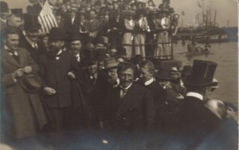

## Following the Polar Controversy 100 years on.

September 4, 2009

In September 1909, the name of Frederick Albert Cook was on the lips of the entire civilized world. Some said he was the greatest of heroes; others said he was the greatest of scoundrels. To this day Cook remains the most controversial figure in the history of exploration, and his claim to have been the first to the North Pole, besting Robert E. Peary by nearly a year, started the great Polar Controversy. The story made headlines for nearly four months and the dispute over which or either reached the Pole is now in its 100th year.   It was to become, quite literally, the story of the century.

“Whatever the truth is, the situation is as wonderful as the Pole,” exclaimed muck-raking editor Lincoln Steffens. “And whatever they found there, those explorers, they have left there a story as great as a continent.”

***Dr. Cook lands at Copenhagen.***

A century ago, Cook was being wildly feted in Denmark, where he landed on September 4, 1909, after an absence in the Arctic since July 1907. For the week following, until he sailed on the first leg of his return to America, he was besieged by cheering crowds, received by the King and showered with honors and medals.

***How to follow the Polar Controversy.***

It is difficult today to imagine the sensation the dispute between Cook and Peary stirred. But you can gain a sense of it by revisiting the primary documents of the dispute. You can catch a glimpse of the reception Cook received as he landed by viewing the film posted on this blog under the entry entitled “The Truth about the North Pole.” The last few minutes of that film, starting at 12.48, consists of actual newsreel footage of Cook arriving aboard the *Hans Egede* in the harbor of the Danish capital, being greeted by the crown prince, and being mobbed as he stepped from the launch at the dock. He can also be seen waving his cap from the Meteorological Building in response to calls for him to show himself to the enthusiastic crowds, from whom he had taken refuge. Just a few months later Cook was discredited by the very country who had so wildly greeted him, and “Tell it to the Danes!” became a popular catchphrase to respond to any dubious statement.

You can follow the events that were front page news every day between those two points in time in the feature of the *New York Times* called **[TimesTraveler](http://timestraveler.blogs.nytimes.com/2009/09/04/admiral-challenges-pole-claim-as-cooked-up/).** There you can see the actual stories that ran in that paper a century ago. But you should keep this in mind, so as not to loose your perspective: the coverage in the *Times* was at first largely doubtful to Cook, since the *Times* had paid Peary in advance the equivalent of $80,000 for the story of his attempt to reach the Pole, and wanted its investment to be worth something, when and if Peary returned. Also, William Reich, one of the editors at the paper, had a personal score to settle and badly wanted to get even with the owner of the *New York Herald*, James Gordon Bennett, to whose paper Cook sent his first telegram offering it the exclusive story of his polar attainment. And when Peary did return assuring the world that Cook’s story was a fake, Reich worked directly with Peary to undermine Cook’s credibility.  So there was more to it than an interest in “Whatever the truth is,” as Steffens noted.

]