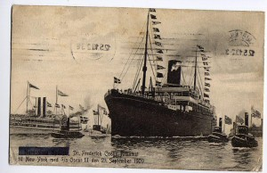
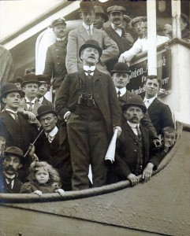
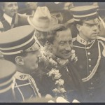
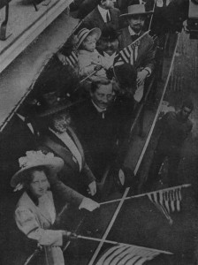
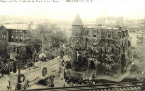
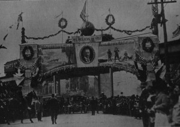

## How the Conquering Hero came

September 21, 2009

On September 21, 1909, Dr. Frederick Albert Cook arrived in the United Sates from Europe aboard the *Oscar II*. The liner had lain off Fire Island since three in the afternoon the day before so as not to upset the welcome plans for the Discoverer of the North Pole. She dressed in flags and proceeded to quarantine at midnight and at dawn was surrounded by boats of the press and well wishers.

Only one old friend was allowed aboard. Cook spoke to others from the rail.

Cook transferred to the a tug which bore his wife and children and a half hour later boarded an excursion ship sent by the Arctic Club to greet him. A tumultuous scene ensued on the deck as the 423 passengers mobbed him, crushing the wreath of white tea roses the daughter of the secretary of the club put around his neck. An honor guard to the 47th regiment made sure Dr. Cook did not suffer the same fate.

After sailing up the Hudson to kill time before the scheduled parade, the explorer disembarked to the blast of every ship and factory whistle in the harbor, and a cordon of 100 police officers forced a path to an awaiting car, the first of 200 assembled, whose horns took up where the ships whistles had left off.

Along the parade route an estimated 100,000 people stood, including many school children waving tiny flags and shouting “Cook! Cook!” as he stood in the back of his car and acknowledged them by doffing his derby.

At the corner of Myrtle and Willoughby Avenues, directly in front of the three story brownstone mansion Cook had lived in before he left Brooklyn for the Arctic, stood a huge triumphal arch made of wood covered with canvas as high as the El viaduct next to it. Surmounted with laurel wreaths and garlands, it bore a giant golden globe with a flag flying form its very top. It dripped with painted ice cicles and electric lights and was decorated with arctic scenes, shields, more flags and a portrait of Cook, crowned with the words “We Believe in You.” Four snow white pigeons were released as the doctor’s car passed under the archway.

The parade ended at the Bushwick Club, where Cook rested and met with his backer, John R. Bradley, before he was forced to greet nearly 5,000 admirers at the public reception before the doors were closed on thousands more that waited their turn to hail the conqueror of the North Pole. Then followed a dinner, speeches, a serenade by a Brooklyn singing group and another reception.

At 9.30 the doctor was whisked away out a side door and taken to his rooms at the Waldorf-Astoria.

In summing up the dramatic day, the press expressed surprise that despite the huge crowds, only a few women and children had been slightly trampled, and even more amazing, with more than 200 automobiles on the street at once, there had not been a single accident.

Throughout it all, the object of all this adulation, as the *New York World* reported, remained calm and collected:

“His rugged nature, concealed beneath an aspect of constant smiles, seems as nearly unemotional as it is possible to conceive.

“Not even when the melodramatic features of the welcome that was prepared for him gripped the nerves of spectators and brought unbidden tears to manly eyes did Dr. Cook appear to be touched. The crowds roared and stamped, whistles blew and horns honked, and several times the doctor was almost swept off his feet, but he showed no sign of great joy or pride. Behind his dancing blue eyes of shallow depth there lies either wonder power of self-control or an innate insensibility to the ordinary emotions.”

]