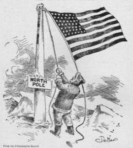
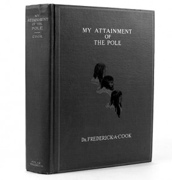
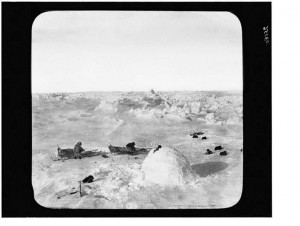

## Centennial of the publication of MAP

***My Attainment of the Pole***  
Cook’s “final summary” of his expedition was a long time in coming. Cook had become so notorious after the Copenhagen decision that no legitimate publisher would touch his narrative.  
Because he self published it, Cook tried to save expenses. Although the finished book looked good, it was shoddily bound, and even though 604 pages long, had a lot of white space. The cover is notable in that it shows Cook’s profile, in long hair and beard, between those of Etukishuk and Ahwelah. The dedication is also unusual in its acknowledgments :

To the Pathfinders  
To the Indian who invented pemmican and snowshoes;  
To the Eskimo who gave the art of sled traveling;  
To this twin family of wild folk who have no flag goes the first credit.  
To the forgotten trail makers whose book of experience has been a guide;  
To the fallen victors whose bleached bones mark steps in the ascent of the ladder of latitudes;  
To these, the pathfinders—past, present and future—I inscribe the first page.  
In the ultimate success there is glory enough  
To go to the graves of the dead and the heads of the living.

Cook established the Polar Publishing Company to publish his book and manage the series of lectures he planned to give after its released on August 3, 1911.  
Cook once said of an Eskimo’s central desire of life: “The real pivot upon which all his efforts are based is the desire to be rated well among his colleagues. . . . Is not this also the inspiration of all the world?” That desire was also Dr. Cook’s inspiration, that and every man’s desire not to be forgotten. Dr. Cook knew the truth about human immortality: that as long as just one living person remembers you, you are immortal, and as long as that one believes in your goodness, you are in heaven, not hell. And there are good reasons, based on the contents of *My Attainment of the Pole*, for belief in Frederick A. Cook and his ultimate salvation, if one only makes the right interpretations and has faith.  
Lending additional strength to those who still believe today are many harsh charges leveled against Peary on the pages of Cook’s book, which convinced many of its original readers that a moneyed conspiracy had robbed Cook of his honor, while blurring the fact that his own lack of proof was actually the cause of the rejection of his claims. Some of these charges, widely dismissed at the time of their writing, now have been shown to be true, and most of the rest have at least some plausible basis.  
My Attainment of the Pole is then, a polemic—not for scientific vindication—but for popular belief, and a magnificent one, couching its true intent in the beguiling story at its core.  
Nonetheless, Cook always maintained that the proof of his claim lay in the narrative content of My Attainment of the Pole. In 1917, Captain Thomas F. Hall found Cook’s narrative consistent and pronounced it “unimpeachable.” But much of it has since been impeached by the knowledge of the central Arctic Ocean basin accumulated since Cook wrote his book.  
But unlike Peary’s, most of the defenses of Cook’s claim do center on his polar narrative. Its defenders contend that it describes physical features that only a person who had actually made the journey could have known about, since no one had ever been there before. They argue that Cook had observed these things first hand and therefore must have at least reached the near vicinity of the pole.  
Cook described two islands lying at about 85 degrees north, which he named **Bradley Land.** These islands, like Peary’s “Crocker Land,” do not exist, yet Cook’s partisans have tried to resuscitate Cook’s credibility by linking “Bradley Land” to a discovery made in the Arctic only since Dr. Cook’s death.  
After World War II, aerial reconnaissance revealed a number of large tabular bergs drifting slowly clockwise in the arctic basin north of Ellesmere Island. Several arctic researchers and scientists have suggested these so-called ice islands—breakaway pieces of its ancient ice shelf—are probably what Cook mistook for “Bradley Land,” and Cook’s advocates have repeated these statements to support the doctor’s claim.  
Cook gave this description of “Bradley Land”: “The lower coast resembled Heiberg Island, with mountains and high valleys. The upper coast I estimated as being about one thousand feet high, flat, and covered with a thin sheet ice.”

Ice islands are no more than 100 to 200 feet thick, total. They are nearly flat, with only rolling undulations and rise only about 25 feet above sea level. Cook’s “Bradley Land” therefore does not remotely resemble an ice island, or even an ice island magnified by mirage. And Cook published two pictures of the high, mountainous land he called “Bradley Land.”

Cook’s Inuit companions are reported to have said these pictures were of two small islands off the northwest coast of Axel Heiberg Land; others believe they are of the coast of Heiberg Island itself, though the pictures have never been duplicated.

A far better candidate for an ice island is the “**Glacial Island**” that Cook said he crossed between the 87th and 88th parallels. His description of it fits almost exactly the ice islands now known to drift within two degrees of the pole—exactly where Cook says he crossed it (see MAP 265-66). “Bradley Land”is photograph of it in MAP, like that of “Bradley Land,” has proven a fake.  
British explorer Wally Herbert found a differently cropped lantern slide of this picture among Cook’s photographic material donated to the Library of Congress. It shows substantial, rocky land on the right-hand margin—an impossibility at the reported position of the “Glacial Island.” Below the two images have been laid over one another to form a composite picture. Notice how Cook cropped the picture in MAP very precisely to exclude the rock.  
But how could Cook have dreamed up an ice island before any had been discovered? There were precedents. Norwegian explorer Fridtjof Nansen had mentioned in his book, Farthest North, that he passed over undulating country covered with snow far at sea. In Nearest the Pole, Peary described crossing “several large level old floes, which my Eskimos at once remarked, looked as if they did not move even in summer,” and “several berg-like pieces of ice discolored with sand were noted.” Cook probably positioned his glacial island where he did because scientific theory at the time suggested possible land at that location.  
 Many of the features and incidents described along Cook’s route from his jumping off place to his “Glacial Island” will sound familiar to anyone who has studied the previous writings of Cook and Peary. The distortions of the sun at low altitudes and the descriptions of ice flowers forming along new ice can be found in Through the First Antarctic Night. The sudden storm on the pack ice has a close parallel in a “hurricane” at Annoatok described in Cook’s Winter Diary of 1907-08. The collapse of the igloo on the arctic pack is very similar to the collapse of an igloo in 1892, as described in Peary’s Northward Over the “Great Ice,” and Cook’s crossing of the Big Lead shares much with Peary’s description of that same accomplishment in Nearest the Pole.  
As for conditions at the pole itself, though not definitely known in 1908, there was general agreement after the discoveries of Nansen aboard the drifting Fram in the mid-1890s that there was no land in the immediate vicinity of the pole. Dr. Cook held this view himself. “The north pole is in the center of an imprisoned sea of ice,” he wrote in 1904. In fact, nearly every observation contained in Cook’s narrative is firmly grounded in the scientific theory of his time, whether correct or incorrect.  
At the pole, Cook set the thickness of the ice at 16 feet, a very common measurement in the central polar basin cited in other narratives, including Nansen’s. Cook correctly said the ice drifted southeast over the pole, but this might have been deduced from the drift course of the Fram.  
About the only original scientific observation Cook published was to say that his magnetic compass pointed south toward the magnetic pole along the 97th meridian when he was at the North Pole. We now know from computer models that in 1908 the magnetic compass would have pointed 133° 28.8′ west + or – 0.5 degrees. This leads to the logical conclusion that Cook did not actually determine magnetic declinations. If he had done so, he would not have claimed that the compass pointed 180° south along the 97th west meridian. Furthermore, there are no original data on magnetic declination anywhere in his surviving notebooks, nor any observational record for magnetic declination among his papers.  
Cook also placed the temperature at the pole ten degrees higher than south of it, in line with a long-held but incorrect contemporary scientific theory that the temperature would rise as the pole was approached because of the constancy of sunlight.  
Contemporaneous scientific theory also led Cook to believe that each pole was depressed about 13 miles to compensate for a perceived equatorial bulge of 26 miles. Today, satellites have revealed that instead of a depression, the earth bulges slightly at the North Pole—62 feet higher than if the earth were a perfect sphere. Given the theories of his time, however, perhaps Cook’s only obvious gaff came in his description of the movements of the sun at the pole—a concept, like celestial navigation and geomagnetism, that requires a grasp of mathematical concepts. Such concepts always gave Cook trouble. Cook originally described his observations of the sun at the North Pole like this: “In two days’ observations it was determined that the sun circled the horizon always at the same elevation, from which resulted the only possible proof that the pole was actually reached.”  
Of course, the sun does not do this at all, but actually rises spirally, higher and higher, until June 21, then it begins to sink spirally until September 22, when it sets. On April 21 and 22 the sun would have appeared to rise, respectively, 20′ 33” and 20′ 21” daily, but Cook did not include this in his reports until the publication of his book in 1911.  
Moreover, many of Cook’s more commonplace scientific observations about the central Arctic Ocean have proved incorrect. Cook said it was “a dead world of ice.” This was the popular view at the time, but the arctic pack is not a “sterile sea,” nor has it been so reported by travelers toward the pole since 1908. Polar bears have been seen above the 88th parallel. Since bears sit at the top of the Arctic’s food pyramid, their presence implies a complete chain of life below them.  
In 1914, the Scottish Geographical Magazine summed up all the observations of Cook’s polar narrative and found in them nothing startlingly original: “With a knowledge of Peary’s Crocker Land, found in 1906, Peary’s land ice near 86 degrees N., found the same year, and the experience in polar travel, which Dr. Cook certainly had, both in the Arctic and Antarctic, we submit that an imaginative man, taking into account probabilities, had an easy task in writing the story, and surely any man of even average education could write of the pole as ‘an endless field of purple snows. No life. No land.’ The more plausible hypothesis is that Cook never traveled as far north as the alleged Crocker Land, but turned back at or about the Big Lead and unwilling to admit defeat in the project which he asserts was his life’s ambition, proceeded to write his story from the data previously outlined by Peary.” On his return journey, Cook said, he was unable to reach his outward caches because an unknown current drifted him far to the west. Eventually it became known that a westward flowing current does pass through the area that Cook would have traversed on his described return route. This has been advanced as positive evidence of the authenticity of his narrative. But he might have discovered it by a journey of about 100 miles to the northwest, which is exactly the extent of his journey indicated in his original notebooks. Donald MacMillan, on just such a journey in 1914, noted a strong tide or current at the place he turned back. Or it could have been just a lucky expedient, since Cook’s story made it necessary that he be carried west to explain his inability to reach his caches in Nansen Sound and his subsequent absence over the next winter.  
Cook devotes a considerable part of *My Attainment of the Pole* to describing the winter he spent with his two Inuit companions at Cape Hardy. Cook claimed that he was without civilized food or ammunition to obtain game and survived only by reviving the techniques of the Stone Age hunter. Many who have vehemently denied he reached the North Pole have been willing to acknowledge his winter on Devon Island as one of the greatest of all arctic survival stories. But even this enthralling story collapses upon analysis of Cook’s original diaries now at the Library of Congress. According to them, Cook arrived at Cape Hardy with considerable food and ammunition, wintered in a snug standard Inuit stone igloo in a far milder climate than northern Greenland and was surrounded by ample game which he shot at will.  
Other important details of Cook’s narrative also suffer on close analysis, though less so than Peary’s. One of the chief jibes against Peary concerns the incredible speeds he claimed during the unwitnessed part of his polar journey. Cook’s, by comparison, look conservative, yet Cook’s progress to the pole, at an average of more than 15 miles a day is far faster than he, himself, estimated was possible before he attempted it. No dog-sledge journey to the Pole, before or since, even ones that were resupplied en route, and so did not need to haul all its supplies from land to the pole and back again, has ever approached anything like it. In fact, until 1995, no surface expedition of any kind reached the North Pole and returned to any point of land unresupplied in any amount of time. All of Cook’s pictures purporting to illustrate his climb of Mount McKinley in 1906 have been shown to be misrepresentations or out-and-out fakes, such as the one he claimed showed his climbing partner standing on the summit of the mountain itself. The editor’s recovery of an original uncropped print of this picture in 1994 proved irrefutably that it was taken on an insignificant outcrop of rock more than 19 miles from the true summit, just as Cook’s critics had alleged for decades. His polar pictures fare little better upon analysis.

Cook printed two pictures representing his **igloo at the North Pole**, which contain little detail and no discernible shadows. Cook attributed their washed-out appearance to the actinic light at the pole, which cast a “blue haze over everything” and had a diffuse effect on the film. A print of the original photo now at the Library of Congress (above) rather shows the washed out appearance is due to dodging and burning in developing, even washing out the uniformly dark, unexposed frame, and that there was actually good detail in the original negative.  
 Donald MacMillan reported that one of Cook’s Inuit companions told him that this “polar igloo” was built near Cape Faraday on the eastern shore of Ellesmere Land in the spring of 1909. By that time Cook had abandoned one of his sledges and all of his dogs, and his remaining sledge had been cut in half. No dogs and only a portion of one sledge, not enough to tell its length, are visible in either of Cook’s polar igloo photographs, though he claimed to have two sledges and at least twelve dogs at the pole. That the Inuit are wearing musk ox pants rather than polar bear suggests it was taken later as well.  
Other photographs indicate misrepresentation as well, when compared with original prints now in the Library of Congress. In the one opposite **MAP 172**, the original shows definite shadows of measurable objects, none of which are long enough for even the highest sun angle Cook would have experienced on the outward trip—12 degrees. This picture must have been taken when the sun would have been at a far higher angle than implied by its position in the text.  
 Proponents have often pointed to one of Cook’s photos as evidence in his favor. The one labeled “Mending near the Pole,” has shadows appropriate to a sun angle of 12 degrees, but this could be a coincidence or even an easily faked deception, which in isolation proves nothing.  
But the most damaging evidence comes from Cook’s own hand in the form of the diaries and notebooks he kept during his 1907-09 expedition. They show every indication that Cook’s tale is true only to a point, and that point lies more than 400 miles short of the North Pole. The rest is a fabrication, based on Cook’s real experiences, embroidered with his extensive knowledge of other arctic narratives and the scientific opinion of his day.  
When the various versions of his polar journey contained in his various notebooks are compared, Cook gives different observed locations on the same date, and various major events, such as his discovery of Bradley Land, occur on different dates. There can be no legitimate justification for these discrepancies, especially the failure of dates and latitudes in his notebooks to match the “original field notes,” if those notes were genuine. Rather the inconsistencies of his own accounts of the events of his expedition, written in his own hand in his contemporaneous notebooks kept on his polar journey, are the badges of fraud.

Cook was a remarkable man in many ways, with many real accomplishments to his credit, but he was never satisfied with his real experiences, remarkable as they were. He always wanted more and knew how to embellish even remarkable experiences to make them extraordinary, and to do so in a way that would convince his audience that they were completely plausible. There are ample examples in *My Attainment of the Pole.*

