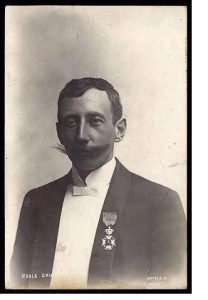

## “A Hack job”: An Editorial Review of True North.

**How the mighty have fallen**

In 2005 yet another attempt to resuscitate Frederick Cook appeared under the imprint of the once-respected independent publisher W.W. Norton Co., whose proud motto once was “books not for the single season, but for the years.” As a case study in how the print publication industry is foundering, Norton’s publication of *True North* by Bruce Henderson would do nicely. It speaks volumes about the sorry state of Editing, Proof-reading, and Fact Checking in a time of struggle, transition and consolidation in the face of new technology in which several mightier than Norton have already fallen.

**A penchant for plagiarism**

This is all the more disheartening because Henderson’s previous polar potboiler, *Fatal North*,  had already firmly established his propensity for plagiarism and reader deception. That book was not simply an unnecessary retelling of Charles Francis Hall’s Polaris expedition of 1871-72, already told so masterfully in Chauncey Loomis’s *Weird and Tragic Shores* (Knopff 1971), which acted as Henderson’s blueprint. A significant portion had been copied from *Arctic Experiences, containing Capt. George E. Tyson’s Wonderful Drift on the Ice-Floe, a History of the Polaris Expedition, the Cruise of the Tigress, and Rescue of the Polaris Survivors, to which is added a General Arctic Chronology*, Tyson’s account of his experiences as a member of Hall’s expedition, published by Harper and Brothers in 1874.  *Fatal North* also contained a considerable amount of quoted dialog between the expedition members of which there is no record in Tyson’s book or any other source. Henderson couldn’t copy this, so he simply made it up.  
In fact, although Henderson adopted all of the trappings of a legitimate scholarly effort in *Fatal North*, an examination of the three books will quickly demonstrate that, beyond his fictional dialogs, Henderson’s talent for either original research or prose is limited indeed. Even his copying without attribution was done in so crude a manner that no responsible secondary school teacher would have permitted it in a student paper. Take this passage on a single incident as copied from Tyson’s book:

p. 223 of Tyson:

“I have been thinking of home and family all day. I have been away many Thanksgivings before, but always with a sound keel under my feet, some clean, dry, decent clothes to put on, and without a thought of what I should have for dinner; for there was sure to be plenty, and good too. Never did I expect to spend a Thanksgiving without even a plank between me and the waters of Baffin Bay, and making my home with Esquimaux; but I have this to cheer me—that all my loved ones are in safety and comfort, if God has spared their lives; and as they do not know of my perilous situation, they will not have that to mar their enjoyment of the day.”

p. 166 Henderson:

“Tyson thought of home and family all day long. He had been away at sea on many Thanksgivings before but always with a sound keel under his feet, clean and dry clothes, and no thought of what he would have for dinner, for it would doubtless be turkey with all the trimmings aplenty and delicious. Never did he expect to spend a Thanksgiving without even a plank between him and the waters of Baffin bay, making his home in a igloo with Eskimos on an ice foe. But he had this to cheer him: his loved ones were together in safety and comfort, and they knew nothing about his perilous situation.”

The reader of these two passages might notice that the one original thought Henderson added to Tyson’s account is nonsensical. It would be a rare 19th Century sailing vessel that could boast a galley stocked with “turkey and all the trimmings” ready at hand.

**Encore!**  
Likewise, Henderson tries to pass off *True North* as an original and unbiased study of the Polar Controversy, backed by research in the original sources. It is nothing of the kind. Like *Fatal North*, Henderson again merely picks and chooses what suits his bias for Frederick Cook from easily obtained secondary sources without acknowledging this is what he has done, although he lists them in his bibliography.  
Nevertheless, on its jacket, Norton’s copy writers tell us “Bruce Henderson has crafted a gripping account of the claims and counterclaims, and presents fascinating scientific and even psychological evidence to put the harrowing details of polar exploration in a new context.” In reality, *True North* had about as much “craft” to it as *Fatal North.*

Henderson’s blueprint this time was the now-obsolete first biography of Cook, Andrew Freeman’s *The Case for Doctor Cook* (Coward-McCann 1961). *True North* repeats the substance of Freeman’s portrayal of Cook as a, naïve, helpless and even hapless outsider cheated of his great achievements and victimized by the big power and monied establishment represented by the Peary Arctic Club, which bankrolled the efforts of Cook’s eventual polar rival, Robert E. Peary. But not only does Henderson adopt this characterization pioneered by Freeman, and taken up by all of Cook’s subsequent partisans; as he did with Tyson’s, he often appropriates Freeman’s exact text, with only the slightest of paraphrasing.  
To cite just one example, compare this paragraph of Freeman’s text on his page 17 and one from Henderson’s page 31, line for line:

Freeman: “The great blizzard of 1888 forced him to suspend milk deliveries and medical studies. Not a wheel turned on streets, roads, or railroad tracks.”

Henderson: “During a massive blizzard in 1888, New York City came to a standstill, leaving Frederick unable to make milk deliveries or attend class.”

Freeman: “There was a dearth of all necessities, principally coal. To replenish his mother’s supply, he put sledge runners on an eighteen-foot boat Theodore had built to use at the beach during the summer and hitched two of his horses to it.”

Henderson: “To replenish the family’s coal supply he rigged up sledge runners on an eighteen-foot boat built by one of his brothers for summertime at the beach, and hitched two horses to it.”

Freeman: “As he drove home from the coal yard, he was offered premium prices for deliveries.”

Henderson: “On the way back from the coal yard, he picked up other customers willing to pay a premium for coal deliveries.”

Freeman: “Night and day for a week or more thereafter he and Will were in the coal business. Before the boat-sledge was retired, a picture of it was made by a photographer for one of Frank Leslie’s magazines, which reproduced it as an exhibit of man’s resourcefulness during the blizzard.”

Henderson: “He was in the coal business round the clock for a week, and before the specially outfitted boat was retired, a photographer took a picture of him standing with his innovation. The image ran in a magazine as an example of individual resourcefulness during the storm.”

Henderson might try to defend himself by saying he is only repeating facts, but because these “facts” and their specific sequencing are original to Andrew Freeman’s book, being the result of personal interviews Freeman conducted with Cook during the 1930s (no one knows whether this story is really true), Henderson’s use of them nearly verbatim without citing their source is the very definition of plagiarism.

**Curiosities of a copyist**  
Other examples of similar direct paraphrasing could be cited that occur in Henderson’s book: many more from Freeman, some from John Edward Weems’s *Peary, the Explorer and the Man*, and some from my own book, *Cook and Peary, the Polar Controversy, Resolved.* Additionally, scores of facts first published there, and still available nowhere else but the original documents, are reused in their same contexts, in the same sequence and in similar language unique to my book, making clear that it, and not the original documents, was the source of these facts.

The trouble with copying, beyond its ethical considerations, is that when something is copied without examining its sources, the author has no way of judging its accuracy. In other words, copied material in the hands of an uniformed author is only as accurate as the material being copied, at best. He has no real basis by which to distinguish what is actually true or false. Because of this, Henderson has inevitably copied others’ mistakes, “facts” that newer scholarship has supplanted, and material that the copied writer simply made up, whole.

The point is not that these errors matter in the larger scheme of things, but that they show the methods by which Henderson assembled his text from others’ without examining their sources. Almost all of his quoted references taken from original documentation are copied from already published quoted references to those same documents in others’ books. A comparison of these common quotations shows that Henderson’s quotes use the exact same text as the other writer published, even when inaccurately transcribed by the first author, that he uses the same edits done to the original text by the author he copied, which do not appear in the originals (see Weems’s note on this, on his page viii), and he uses ellipsis marks to omit the exact same text omitted by others, or he cites less of the quotation than appeared in the secondary work used, but never more. All of these characteristics of Henderson’s quotes are dead giveaways proving that Henderson did not use the original sources he cites, but instead used the secondary sources that originally cited them. Yet he cites his sources as if he did use the originals. In doing so, Henderson has attempted to deceive his readers as to the basis of the authority of his text, and ultimately the conclusions he draws. His citations of “original sources,” therefore, are mere window dressing, not the actual authority of his text. To anyone familiar with his sources, it is self-evident that Henderson was never even in the same building with 95% of the “sources” he quotes. Such a willful deception of his readers condemns *True North*’s scholarly merits even if it were not defective in other ways. In a book whose title’s first word is “True,” that’s not a small matter.

**An inability to distinguish fact from fiction undermines credibility**  
Ironically, the few previously unpublished materials that Henderson does use introduce many complete false statements into Henderson’s narrative. Most of these come from a single source: Cook’s unpublished memoirs. They were written in the mid-1930’s, as much as sixty years after the events they describe. Yet they are full of quoted dialog. Think about it: can you now recall, word-for-word, conversations you had even a year ago, much less twenty or sixty years ago? Cook couldn’t either, and such material is no more valid than the fictional dialogs Henderson made up to fill out Fatal North. An author can’t put words into the mouths of historical characters and call it non-fiction. Likewise, an author can’t rely on after-the-fact memoirs that contain many “facts” that can easily be shown to be his own self-serving inventions when compared with contemporary primary sources associated with the events he is describing. To cite just one infamous example from Cook’s memoirs used by Henderson, consider Cook’s account of his alleged diagnosis of pernicious anemia in Robert E. Peary in 1901.

As I show in my book (p. 788), pernicious anemia is impossible to diagnose in a patient, even with all of today’s medical knowledge, as far in advance of its once-fatal manifestations as Cook claimed to have done in his memoirs. The account of Cook’s diagnosis of the disease 19 years before it killed Peary, and Peary’s refusal of the correct treatment Cook prescribed to Peary (although then totally unsuspected), is simply a fantasy concocted by Cook in 1935 to lend an ironic twist to Peary’s fate. By then, Peary had already died of pernicious anemia (in 1920) and the treatment of the disease had been described by its discoverers, for which they won the Nobel Prize in 1934. Cook’s “diagnosis” is a favorite fable of the Frederick A. Cook Society, Cook’s booster club, and is endlessly repeated by it as fact in its propaganda, which goes so far as to say Cook should have gotten the 1934 Nobel Prize instead!  
Even given this, Henderson never fathoms the difference between simple anemia, which can be caused by any number of underlying conditions, and pernicious anemia. Pernicious anemia is a specific autoimmune endocrine disorder that results in an inability of the stomach to produce the intrinsic factor necessary to metabolize vitamin B12. It is not a blood condition, per se. And it is definitely not a “Polar malady”as Henderson says on his page 277. Anyone can develop PA, but it is most likely inherited. The fact that *True North*’s index lists only “anemia” to cover all of his references to both simple and pernicious anemia, shows Henderson didn’t know the difference. It is dangerous to the credibility of copyists to try to make pronouncements on complex subjects they haven’t taken the proper time to study, like medical pathology or the Polar Controversy.

Since Cook’s memoirs are corrupt, I made very little use of them in *Cook and Peary*, and when I did, I always cautioned the reader that they were being used only because there was no other account. This is how a responsible author uses the material at his disposal. He evaluates all sources, compares them, rejects after-the-fact accounts that conflict with other sound primary evidence or known facts (in this example, medical reality), and synthesizes his account accurately. Then he cites exactly what he has used, its actual source, and when necessary, cautions the reader when he doubts its authenticity. A scholar does not sit down with half a dozen published books and booster club publications and assemble a new text from them, just trusting them to be correct, or picking and choosing passages from them that suit his agenda. There may be other names for such a writer, but none of them would be “scholar.”  
And, of course, a scholar never quotes as if he has used the originals when he has merely lifted them from a previous writer’s finished pages. Henderson, however, has done this repeatedly, and because even the best copyist makes mistakes, he has inadvertently made an enormous number of errors through copying mistakes or because he lacks knowledge of the underlying topics, like pernicious anemia, or even elementary polar conditions in general. My point, again, is larger than the fact that Henderson made these mistakes. Every book has mistakes, including my own. The point is, a huge number of mistakes and obviously ignorant statements undermine the authority for whatever conclusions an author may eventually draw.  
Worse yet, some of Henderson’s citations are pure fabrications, because they are also due to copying others’ citations rather than consulting the original sources. (If you are interested in a detailed example of how this happened, read the one appended to the end of this review).

If an author is going to rely on being a copyist, he needs to know enough about his subject to at least be able to recognize which is the most reliable secondary source from which to copy. Henderson would have done well to have stuck to my book, it being the most recent and based on a massive number of primary sources, many never before cited, and all precisely documented in its more than 2,400 endnotes. Generally, where he did, he did well, but, alas, *Cook and Peary* also has a few errors in the text, and Henderson relied on so many of its facts that he managed to copy at least two of its mistakes into his own text: L.L. Dyche was not a professor at Kansas State University (Henderson’s p. 99, copied from my page 114) –he taught at the University of Kansas; the ship the Portia ran over in 1894 was the Dora M. French, not the Dora N. French (his p. 106, copied from my page 128). Sorry.

**Even copyists need knowledge**  
Copying from other non-fiction titles is one thing, but when an author indiscriminately copies from fantasy sources without knowing any better, this really condemns all pretensions to original scholarship or subject expertise. Quoting extensively from Bradley Robinson’s *Dark Companion*, whose style is more like a Rover Boys novel than a work of non-fiction, and which is filled with totally invented dialog and “facts” that appear nowhere else and can be easily demonstrated to be the inventions of either Robinson or his subject, Matt Henson, when compared with known primary sources, is bad for Henderson’s or any other author’s credibility. To be able to tell truth from fantasy, you must have a decent grounding in a subject won by many hours of study, and the first step in that process requires at least reading the easily available published accounts of those who participated in the events under study.

That Henderson thinks Langdon Gibson’s first name was “Longdon” (copied from Robinson, who bizarrely thought “Longdon” and Gibson were two entirely different men!), and that he reports John Verhoeff was from St. Louis, rather than Louisville, shows Henderson has never read any of the primary published books on Peary’s North Greenland Expedition by Peary, his wife, or Eivind Astrup, much less ever looked at the extensive original documentation of that expedition at the National Archives II or Bowdoin College. Even Andrew Freeman got those two facts correct. But when Henderson starts incorporating details from childrens’ books that have no pretension to being truthful (apparently children are in even less need of Truth than adults), like J. Alvin Kugelmass’s *Roald Amundsen, a saga of the polar seas,* and doesn’t know that anything is wrong, a knowledgeable reader has no alternative but the dismissal of Henderson’s whole text as having doubtful authority, at best, and his conclusions as having no credibility whatsoever.  
The Belgian Antarctic Expedition is one of the best documented of all polar expeditions by its participants. Of the nineteen who sailed on it, five left published accounts, so there is not much question over the basic facts. Yet here are some of the fictitious “facts” Henderson copied from Kugelmass’s book for children (recommended for “Grade 7 and up” and panned by the New York Times Book Review in 1955): There was no “French sailor” named Ernest Poulson in the crew at all; they were all either Norwegian or Belgian. (There was a French cook, but he was left the ship in South America before the Belgica sailed for Antarctica). Had Henderson even opened Cook’s own account of the expedition, *Through the First Antarctic Night*, he would have seen pictures of every sailor on board (opposite p. 401), and this person is not among them. Not only did the non-existent “Poulson” never fall on his own knife and die, no sailor went mad and threw himself from the yardarms, either. These are all Kugelmass’s inventions, copied by Henderson. Two people died on the expedition: one, a sailor named August Wiencke, fell overboard in a storm on the way to Antarctica, and Emile Danco, the magnetician, died of a congenital heart ailment during the winter there. All of this proves Henderson didn’t even bother to read the one easily available source in English detailing this expedition—Cook’s own—although he is ostensibly the subject of Henderson’s book. I suppose that is the advantage of being a copyist; you not only don’t have to bother with looking at original sources, you don’t have to read much of anything. But the disadvantage is that you have to trust much. Because of this, copyists who pretend to be scholars always get caught out.

**Boosterism and bias**  
Beyond mistakes, there is the matter of intent. It is very clear that the intention of Henderson’s book, following Freeman’s lead, is always to maximize Cook and minimize Peary. One of the many examples of this that could be cited is Henderson’s repetition of another favorite fable propagated by Cook’s boosters: that Cook’s services to the Belgian expedition were thought to be so exceptional that he was the only non-Belgian awarded the Order of Leopold after the expedition returned from the Antarctic. (Henderson’s p. 132, copied from Freeman p. 58). In fact, the other three members of the scientific staff, Arctowski (Polish), Dobrowski (Polish), and Racovitza (Romanian), plus all of the officers, got the same award as Cook. In proof that both Freeman and Henderson are wrong, here is a picture of Roald Amundsen, the second mate, who was Norwegian, wearing his Order of Leopold.

 Even more remarkable, but characteristic of the way Henderson’s book was assembled, Cook’s memoirs, which Henderson heavily relied upon for favorable but fabled “facts,” states on page 17 of Chapter 14: “King Leopold honored the officers and the scientific directors of the Belgica. Amundsen, the doctor and the foreign workers all got the same rewards. We were knighted as Chevaliers of the Order of Leopold, an honor of great distinction for which we were grateful.” Here he had Cook’s own contradiction of it, yet Henderson copies Freeman’s incorrect statement instead.

**Uninformed and out of date**  
Henderson’s *True North* is, quite simply uninformed, and it was out of date on the day it was released, since it failed to account for or counter any of the already published documentation that proves that Cook’s two biggest geographical claims were both circumstantial hoaxes. Instead, it quotes freely from those self-justifications written by Cook himself and his apologists’ baseless theories and arguments as “evidence” that he did climb Mt. McKinley and reach the North Pole, just as he said. Nothing could be more out of date than to quote Cook’s 1911 book, *My Attainment of the Pole*, in his defense. My own book spent many pages pointing out its provable lies exaggerations and citing the many improbabilities it contains. And nothing could be more uniformed than disregarding the only scholarly examination of Cook’s personal papers, available since 1990, which revealed doctored diaries and faked photographs showing that Cook’s claims to attaining the Pole and summiting Mount McKinley were knowing frauds, especially when Henderson has manifestly made no effort to examine these materials for himself.

Even so, Henderson’s retelling of Cook’s northern journey of 1908 on pp. 228-29 adds more fabulous new details that Cook never thought of: Henderson says Cook used his collapsible boat to get back to land on his return from “the Pole.” He also says he used it repeatedly to try to reach his caches on Axel Heiberg Land, but failed. Cook by his own account never used the boat until he reached Jones Sound, far south of either of these locations. He couldn’t, simply because, again by his own account, he still had up to ten dogs with him up until then. And he did not winter upon reaching Cape Sparbo, as Henderson would have it. He went far past that cape, seeking to reach a whaler in Lancaster Sound so that he could emulate Nansen’s famous chance meeting with Frederick Jackson in Franz Josef Land 1895. Since there was no whaler in sight, he then doubled back to Cape Sparbo, which he noted was teeming with game when he passed it. And he did not live in the “ruins of an old ice cave” as Henderson puts it. He reconstructed a perfectly standard Inuit winter stone igloo from the ruins of an old one, and enjoyed a very comfortable winter, by Arctic standards, shooting the abundant musk oxen there at will with the 120 rounds of ammunition he still carried with him. After the sun set, he spent the winter there perfecting the details of his fictitious attainment of the Pole in his notebooks. Cook’s narrative is not at all confusing on these points, except his experiences that winter, but that point is clear from his original notebooks. His so-called “stone-age winter” is simply yet another of the favorite fables of the Frederick A. Cook Society, disprovable from Cook’s own hand.  
Using disproven “findings” to bolster Cook’s case does nothing for Henderson’s credibility, either. Cook’s long journey through the Sverdrup Islands, where the ice did not drift, even in summer, proves nothing about him as an “ice traveler” or his sledging ability to reach the North Pole over constantly shifting pack ice. But it does prove that he lied about his return route.

**Polar precedents**  
As I demonstrate in detail in Chapter 29 of my book, Cook’s “original descriptions” of conditions in the Arctic were solidly based on conventional scientific beliefs of his time, some of them now proven false, and therefore his “findings” are now inaccurate as well. His knowledge of an unknown westerly drift does not require attainment of the Pole for him to have observed it. Cook’s description of Bradley Land does not even remotely resemble an ice island, and it doesn’t exist anyway (even though he published two photographs of it). Therefore, Cook’s published narrative is neither credible or consistent in itself, as my analysis in Cook and Peary shows, and when compared to his original notebooks it is very inconsistent with them, even as to several versions of where he claimed to have been on certain days during his journey, and even variant on what day he claimed to have discovered “Bradley Land” and reached the North Pole. It is therefore condemned as an out-and-out fake.

As Captain Thomas Hall remarked on such conflicts as Cook’s notebooks contain in his pioneering analysis, *Has the North Pole Been Discovered?*:

“Did all these various writings agree with themselves . . . it would not prove their statements to be true, because they might, nevertheless, be fabrications; but as they contradict each other in every particular, it proves falsehood absolutely. If one is true, the other speaks falsehood. If the other is true, the one speaks falsehood. There is no authority for believing either; and if the author cannot be believed in what he sets out to prove, the author is not entitled to be believed in anything he may say at any time. Truth is a uniform thing.”

Likewise, the “findings” Henderson lists about Mt. McKinley prove nothing about Cook’s claim to have climbed it. The estimate of its elevation Cook gave was nearly identical to the one already determined by triangulation previous to his “climb.” That McKinley has twin peaks is obvious to anyone approaching from the southwest, and was first reported by Edward Brooks in his official report in 1902. Even Cook made note of this fact in 1903, and is quoted as doing so by Henderson, himself, on his page 150, long before Cook attempted any climb at all. Also, the upper slopes are easy to observe from 25 miles off at the snout of the Muldrow Glacier, even without binoculars, and Cook had this very view through binoculars in 1903. When an explorer has circumnavigated the entire mountain, as Cook did in 1903, all the time looking up at the summit, it is not evidence of his having climbed it for him to state what could be seen looking down from the summit. But, in fact, Cook badly exaggerated how far he could see from the summit, and he failed to make any description at all of the dozens of then unknown glaciers and peaks he could have seen had he ever been there. That’s because the closest he ever got to the summit in 1906 was about 15 miles as the crow flies, and he never climbed higher than 5,300 of the requisite 20,320 feet above sea-level.

**Who found the “findings”?**  
And whose “findings” are these anyway? They are no more than the pet arguments of Cook’s boosters, which are endlessly repeated by them and have been copied by Henderson (again, nearly word for word) from the publications of the Frederick A. Cook Society.  
Upon finishing Henderson’s book I realized that he acknowledges absolutely no one as an aid to his writing it: no librarian, no archivist, no editor. This is singular among all previous books ever written on this subject. Given all of the above, however, it is also self-explanatory: copyists don’t want to acknowledge their real sources. And I also noted that his bibliography, small as it is, is nevertheless padded. For instance, Henderson doesn’t even have an index entry for Ernest Shackleton in his book, let alone a single word about his Endurance expedition, yet he cites his account of it, *South*. And Henderson makes absolutely no mention of Joseph Bailey, Cook’s mail-fraud trial lawyer, yet cites Sam Hanna Acheson’s biography of him. Many of the entries seem once again to have simply been copied for show, this time from the extensive bibliography that accompanied Frederick Pohl’s introduction to Cook’s posthumous book, *Return from the Pole*.

Finally, Henderson gives no space to Cook’s baffling mentality as one of the world’s greatest fabulists, even though it lies at the heart of the Polar Controversy. The argument over what Cook really was, and not what he claimed to have done, is what actually drove the Polar Controversy. But to Henderson, like the Frederick A. Cook Society, which aided him, it is all so simple: The naive Underdog shorn of his laurels by the all-powerful Establishment. To blandly accept this cartoon-like characterization of such a complex character as Frederick A. Cook is to throw away the opportunity to examine the most interesting part of the Polar Controversy and the larger lessons it has to teach about human belief and how history is made.  
Had Henderson written an original book, with a single original thought in it, or a single piece of original evidence that added to the history of the events it discussed, I would have been pleased to have noted it. Alas, there are none. Instead, in reading it, I had the distinct, and well-justified, feeling that I had read all of this before somewhere: in Freeman or in Weems, and, indeed, I had no trouble at all in recognizing that I had written some of it myself. Because of the way it was assembled, then, not written, True North contains many accounts and assertions already proven untrue.

**You can’t fool all of the people all of the time**  
A book like *True North* is still possible only because the Polar Controversy is an extremely complex subject filled with more details and subtleties than most people can or want to absorb (or publish), and because, as Dr. Cook knew, the big lie once spoken will always find someone with a reason to give it credence. Even so, among a number of submissions from readers who Henderson succeeded in deceiving, one review posted by a perceptive Amazon.com reader shows that all of this was not lost on him:

“Evident in his depictions of Cook versus Peary, Henderson’s motive is to prove that Cook was indeed cheated out of a victory that was rightfully his. Through Henderson’s descriptions, Peary is shown to be an egotistical and hard-handed man concerned only with fame, with a boisterous attitude and little respect for other people. In opposition, Cook is portrayed as being very humble and quiet, an inventive man who is content to share victory. When the events of the contested pole discovery come about, Henderson details how Cook was thwarted his due by Peary’s sabotage, and raises suspicion for Peary’s claim by pointing out that Peary would not hand over his own notes for inspection before Cook released a statement, insinuating that Peary was getting information from Cook to use in his own dubious notes. As told by Henderson, Cook’s evidence, though he produced no notes as proof and with only a diary and the statements of him and his Eskimo companions to back him up, is still more credible than Peary and the incomplete notes he supplies. It is even insinuated that Peary was responsible for Cook later going to prison for mail fraud because the judge trying the case was a friend of the family. Henderson finishes up his assessment by listing all of the ways in which Cook was right or credible in both his pole and Mt McKinley claims. So, despite Henderson never explicitly stating to support Cook, it comes through in his presentation of facts and their evident bias. Whether or not the facts are true as stated, Henderson clearly wants us to see things a certain way.

“Henderson’s source usage raises concerns over his presentation of facts and how they support his central purpose. *True North* is rich in detail and follows the separate and intertwining paths of Cook and Peary closely, even to minute detail. Yet the background provided, including an array of personal stories and emotions too intimate to be part of common knowledge, is given no footnoted documentation, which calls into question the validity of the information, its truthfulness, and whether or not Henderson is being true to the facts and portraying them accurately. A reader would have a difficult time verifying many of the things said and claimed to have happened by Henderson. Henderson does provide a selection of source notes at the end of the book, which serve the purpose of explaining where some of the specific personal statements come from. These are actually very informative and valuable to the credibility of the story because they are all primary sources, sources that come direct from people involved or in the time- they are the words of Cook, of Peary, of people witness to the events in question. There is included a bibliography at the back, but without the aid of footnotes, one cannot tell if the books listed at the end are indeed used and where.”

Another Amazon reviewer was more blunt in summing up the truth about *True North*: “In short, this is a hack job, ” he wrote.

**Beating a dead horse, or how Henderson invented citations in *True North***  
On Freeman’s page 231, he cites Representative Roberts’s comment on Peary’s notebook: “If the members of the committee care to, I would like to have the book examined particularly with reference to its condition and state. It shows no finger marks or rough usage; a very cleanly kept book.” On Henderson’s page 275, this quotation is abbreviated to “shows no finger marks or rough usage; a very clean kept book,” which is a slightly inaccurate copy of the portion used. But leave that aside.

Freeman cites this quote as coming from “Extension of Remarks,” House of Representatives, January 25, 1916, 64th Congress, 1st Session, Vol. 53, No. 44, Part 14, Appendix 1-13, page 275. Henderson cites it as *Congressional Record*, 61st Cong., 3d sess., vol. 46, “Extension of Remarks,” Rep. Henry Helgesen, p. 275. But the citation from the *Congressional Record* Freeman cites is actually that of a speech given by Representative Bruce Macon of Arkansas.  
How this happened is clear to those who actually have an acquaintance with the publications cited and the works Henderson copied his citations from, in this case Freeman’s p. 300. The *Congressional Record*, and the *Appendix to the Congressional Record* are entirely separate publications, with separate paginations. Macon’s speech was actually given in 1911 on the floor of Congress, whereas Helgesen’s “Extension of Remarks” was merely entered into the Appendix, never read. Freeman’s citation of each of these is correct, but Henderson’s of Helgesen, which appeared in the Appendix to the *Congressional Record* in 1916, is cited as appearing in the *Congressional Record* in 1911. Unfortunately for Henderson, when Freeman cites Roberts’s remarks on Peary’s notebook, he is citing Helgesen’s speech a second time, so he just refers the reader to “Helgesen’s ‘Extension of Remarks,’ as above, page 275.” When Henderson looked “above” he accidentally copied Freeman’s citation for Macon’s 1911 speech, thus creating a unique fabricated reference because Henderson is not so good a copier. It is very clear that Henderson never read either speech in its original, but merely copied the identical excerpts from Freeman, then miscopied his citation of the latter, thus inventing a completely false citation in the process.

Another example: On page 245 of Freeman’s book, he quotes a passage from Judge Killits’s sentencing speech to Dr. Cook. He gives as his reference on his page 303 “The excerpts from Killits’ charge are from the court record.” In 1973, Hugh Eames, another copyist, copied Freeman’s quotation into his book, Winner Lose All, and stated as his reference: “Court Record 2273, Fort Worth, Texas.” Eames at least had obtained portions of the transcript of the trial (but not this speech) so he knew the number of the court record. Henderson cites portions of Freeman’s quote from the speech on his page 287 and gives as his reference “U.S. District Court record 2273, Fort Worth, Tex.”

It is possible that the judge’s speech was part of the court record when Freeman was working on his book in the 1930s, but it is no longer part of it today. I went to Fort Worth in November 1991 and spent a week there going through every page of the 12,000-page court record of Cook’s trial now at the Southwest Branch of the National Archives. The judge’s sentencing speech was not in that record. After I returned and made note of Freeman’s and Eames’s citations, I wrote to Margaret Schmidt-Hacker, archivist at the Southwest Branch, asking her to check again for this speech. After she conducted her search, she wrote to me assuring me that this speech was not among the records of the trial or any associated material (see my note 75, p. 1,065 in Cook & Peary). Henderson simply copied it from Eames, who had assumed its presence in the court record that he learned of by reading Freeman, but without seeing it for himself.

]