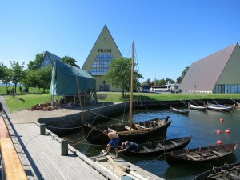
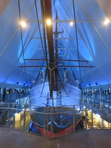
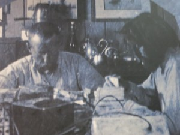
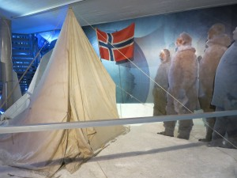

## Dr. Cook at the Fram Museum

This summer I had the opportunity to visit the excellent Fram Museum in Oslo, Norway. Anyone who is in the area should not miss the chance to board this most iconic of all polar vessels.

The museum is a large A-frame building that houses Nansen’s ship, with a wing that houses Amundsen’s Gjøa, on which he successfully navigated the Northwest Passage.  

There is an excellent film in English, informative displays of memorabilia of both ships’ voyages and a thorough history of Norwegian polar exploration. Dr. Cook appears in one of the pictures sitting with Amundsen at the table aboard Belgica working on polar gear.  

An example of the tent the two designed together is also on display, one of which was left at the South Pole and found by the polar party of Robert F. Scott, which reached the pole a month after Amundsen.

The museum also has an excellent bookstore. Cook and Peary, the Polar Controversy, Resolved can still be purchased there.

