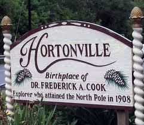
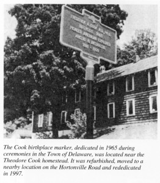

## 150th Anniversary

Today is the sesquicentennial of Frederick A. Cook’s birth. He was born in Hortonville, NY on this day in 1865. Sullivan County records record Cook’s birth in Hortonville. His family lived there until they moved to Port Jervis in 1878. The family home was occupied by Cook’s brother, Theodore, until his death in 1928, and he and their father, among other relatives, are buried in the hillside Hortonville cemetery. The sign welcoming visitors to Hortonville states that it is Cook’s birthplace.

There is even a New York State historical marker in Hortonville commemorating his birth, erected on its centenary in 1965.

So, there should be no doubt about Cook’s birthplace. Yet this simple fact is lost on many who write about Cook on the Internet, often still listing his birthplace as Callicoon. Even the *Encyclopedia Britannica*’s entry listed it as Callicoon until at their request the author of this blog updated their entry on Cook in 1997. Still, Cook’s current Wikipedia article lists Calicoon as his birthplace—a good example of why Wikipedia continues to be less reliable than many established print sources and their web products, like EB’s. EB has a stable editorial board and expert, knowledgeable fact checkers; anyone can write or rewrite Wikipedia articles at will, and the more controversial the subject, the more unstable the content, even as to uncontroversial facts, like Cook’s place of birth. If a writer cannot get indisputable facts straight, how can he be relied upon to get the many complicated and, frankly, sometimes unknowable, details of Cook’s controversial career as an explorer correct, or at least present them in an unbiased manner? I gave up long ago trying to keep the Wikipedia article on Cook accurate. Persons interested in accurate information on Frederick A. Cook and his career should rely on information written by experts in the field, like that available on the present website.

