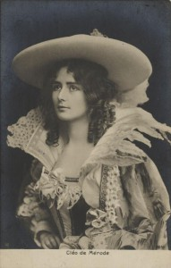
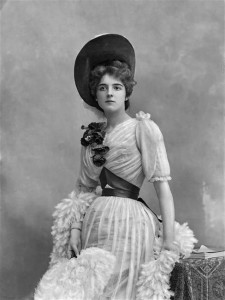
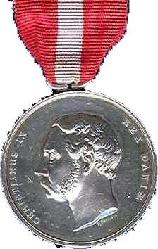
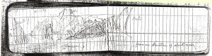

## Cook and Peary, up to date

September 22, 2015

It is now difficult to remember a time before the Internet was ubiquitous. It had been around, but it only came into wide usage about 1996 with the invention of practical search engines. Since then, the quantity, if not the quality, of information literally at ones fingertips has mushroomed to then unimaginable proportions. But Cook & Peary was entirely the product of a pre-internet world, when each bit of information had to be ferreted out of physical collections of published and unpublished documents held in specialized collections or libraries, and laborious page-by-page looks through newspaper and periodical literature with virtually no indexing. In the case of manuscript sources, often the only way of taking away the documents’ content was by making a handwritten copy. Consequently, many small errors of transcription or interpretation were unavoidable in such a large effort as that. A frequent source of error was a by-product of this: mistakes that were transcribed faithfully from the original, such as Frederick Cook’s numerous misspellings of foreign place names, not only in his private writings but also in his published works. Today, misspelling of uncommon foreign place names, terms and proper names can easily be checked and corrected. Most of the corrections can be found on the Errata sheet for Cook and Peary (C&P) that appears as an addendum to The Lost Polar Notebook of Dr. Frederick A. Cook (LPN), published by the author in 2013. A few errors were introduced during the editing process, but these were not many. In addition to errors, new information inevitably comes to light after any publication that adds to knowledge of the subject or that clarifies or corrects what has been included in a finished book. The annotations here seek to inform the reader of such new information that has come to the author’s attention since C&P was published in February 1997. The amount and, for the most part, the importance of it are not very great, but it is included here as part of the record of the momentous dispute that enthralled the world in the last months of 1909.  
p. 145 at note 35: the leader of the Belgian Antarctic Expedition’s name is properly de Gerlache. However Cook in TAFN always referred to him as Gerlache, as did Amundsen in his book, My Life as an Explorer. In keeping with these accounts, “Gerlache” was adopted as the spelling here and throughout C&P.  
p. 146 line 37: Cook refers to Amundsen throughout TFAN as First Mate. Actually, Amundsen’s official rank was 2nd Mate. Captain Lecointe was officially First Mate, ranking after Commandant de Gerlache. He is referred to throughout, as Cook referred to him, as 2nd Mate. Melaerts was 3rd Mate.  
p. 172 Here are the two finalists for “The Most Beautiful Woman in the World”.

p. 177, quotation at note 3: de Gerlache’s book appeared in English for the first time in 1998 as Fifteen Months in the Antarctic, in a translation by Maurice Raraty, published by Erskine Press, UK. For an alternate translation of this passage, see page 137.  
p. 181, for an alternate translation of the passage at note 12, see p. 145 of the above.  
p. 204, line 21: It is doubtful that Cook met with Shackleton at this time. According to Roland Huntford’s biography, Shackleton, during the period Cook was in England, Shackleton was at sea aboard the Carisbrook Castle, shuttling between Southampton and the Cape Colony. He did not return until “early March, 1901.” Shackleton had been appointed to the Discovery expedition while still at sea, on February 17. Cook returned to America before the end of that month, so would have had no opportunity to meet him before the Discovery sailed on August 6. Another scholar, Leif Mills, who has done research on many of Shackleton’s assistants and who is familiar with his movements confirms this.  
p. 216, line 1: The unedited version of Wyckoff’s diary was published in 2002 as part of Boreal Ties by the University of New Mexico Press. Any variances from the version of the diary provided the author can be found in this book. For the differences between the two versions, see the editorial note at the front of Boreal Ties. Likewise, Boreal Ties also contains the full diary of Louis Bement. It came to light only after Cook & Peary was published (see the note at the head of Chapter 10 on page 1011). The full diary adds very little that is not mentioned in Wykoff’s accounts.  
p. 223: see the note above on Wykoff’s diary.  
p. 267, line 19: Svartevoeg is Cook’s misspelling of Sverdrup’s Svartevaeg. It is used here and throughout to avoid confusion, as Cook’s misspelling is preserved in many subsequent books on the Polar Controversy. “Svartevaeg” refers to the black cliffs which line the eastern coast of Axel Heiberg Island just below Cape Stallworthy. In MAP 200 Cook gives a footnote which explains his use of the term as a substitute for Peary’s Cape Thomas Hubbard, which is the cape just west of Stallworthy, and the point from which Cook departed across the Arctic Ocean toward the Pole. He considered Peary’s naming the cape after one of his major backers as an attempt to rename Sverdrup’s original discovery.  
p. 320, line 9: Cook consistently spelled Cape Viele incorrectly both in MAP and in his original polar notebook.  
p. 323, The story related by Stefansson here is almost surely not true. It is contradicted by a letter dated in 1910 that the author found in Peary’s papers after Cook & Peary was published. Its text precludes that this meeting ever took place. Furthermore, in his autobiography, Discovery, p. 99-100, Stefansson relates that he went to the Grand Union Hotel hoping to meet Peary, but “I did not find Peary there—he was away at the time—so I went about my own business. . . .”  
p. 325, line 38: A study of Cook’s original polar notebook reveals that Koolootingwah was not with the party that was sent on this errand, although Cook claims that he was in MAP 149-150. The “advance party” consisted of three Inuit only: Essyou, Kudlu and Metik. See LPN 131. This party was also sent to look for a way up onto the inland ice so the polar party could descend into Cannon Fjord, which Cook hoped to use as a shortcut to Nansen Sound.  
p. 327, line 25: Franke’s published account says they stopped 3.2 miles short of the cache at Cape Viele.  
p. 327, line 35: Koolootingwah was with the main party, not the advance party, see above.  
p. 349, line 11: The telegraph office was located in the upper floor of the Post Office on Commercial St. This was verified by the author on a visit in June 2014 to Lerwick and the very same building from which Cook sent his telegrams.  
p. 349, line 15: More details about the telegrams Cook sent can be found in the author’s article: “One man’s trash; the recovery of Frederick A. Cook’s original telegram drafts announcing his attainment of the North Pole,” published in The Polar Record 45 (235) 351-359 (2009).  
p. 349, line 27: There was no American consulate in Lerwick. For details see the referenced Polar Record article above. See the news section of the author’s website at www.polarhist.com.  
p. 364, line 3: Dannebrog was misspelled in the American newspapers; the medal takes its title from the popular name for the Danish flag. Here is the medal Cook might have received had King Christian IX not decided to withhold it.

p. 570, the passage ending at note 80 is not in MacMillan’s notebook now at the American Museum of Natural History in New York. This appears to be the original, and the one used in this chapter, now at Bowdoin College, appears to be an expanded copy. See the news section of the author’s website at www.polarhist.com. The mileages also differ somewhat between the AMNH and Bowdoin notebooks.  
p. 583, paragraph 6: Cook’s statement about the Emden could not be true, since the raider had been sunk the previous fall near the Cocos Islands. This may be another example of Cook’s tendency to embellish his stories.  
p. 612, line 7: this is not entirely correct; while Strine was Peary’s personal physician, examination of his blood was done by Dr. B.L. Hardin. It was Dr. Hardin who diagnosed pernicious anemia in Peary. Strine treated him for it.  
p. 682, line 24: Notice that the resulting correction is still “incorrect.” The text says Kittit’s; the original says Killit’s, which is supposed to be Killits’s, of course.  
p. 757, paragraph 2: Dennis Rawlins pointed out to the author that he did mention Captain Hall once in his text. However, he makes no mention of Hall’s as the pioneer in analysis of the Polar Controversy, or of the significance of Hall’s work.  
p. 747, paragraph 2: In a telephone conversation with the author on Nov. 29, 1998, Mr. Gonnason told the author that at the time he had not seen Washburn’s photos. The photos he examined were obtained from General Dale V. Gaffney of the 72nd Reconnaissance Squadron in Fairbanks.  
p. 808, line 16: A detailed, direct comparison of the Cook and Barrill diaries appears in the author’s “Cook’s Curious Timetable,” DIO, vol. 7, no. 2, pp. 77-88, published in December 1997. An online version of this article can be found at www.DIOI.org.  
p. 809, line 28: Barrill’s map is reproduced on page 800.  
p. 811: Photocopies of the original diary were not allowed at the time the author did his original transcription. Later, he went to the Library of Congress and made copies of the microfilm of the diary. In rechecking these against his handmade transcription he found there were some small transcription errors, mostly punctuation, not affecting the text. The publisher did not take up the author’s instructions to insert these. To achieve the absolute accuracy promised on page 1083 under “Notes for Chapter 28,” these changes should be made in the entry for September 16:  
Sept. 16 should be underlined  
top should be capitalized and have a period behind it  
delete the period behind slope  
delete the period behind sq  
Actually, the line that starts out “Tube with date etc. . .” probably should read:  
“The hand shaking 20 minutes Tube with date etc flag & names”  
“Tube with date etc.” is written above “flag & names” and probably goes with it, but this is a matter of interpretation.  
p. 812, line 42: An analysis of Cook’s claim to have climbed Mt. McKinley with new evidence against  
it, including unpublished photographs and images from both Cook’s and Barrill’s diary pages, appeared in the author’s “The Fake Peak Revisited,” DIO, vol. 7, no. 2, pp. 40-76, published in December 1997. An online version of this article can be found at www.DIOI.org.  
p. 819, line 39 at note 33. After a rereading of this material, the photos Browne is referring to in this letter appear to be his own photographs of Fake Peak, taken in 1910, not Cook’s original negatives from 1906. If so, then the subsequent discussion on p. 820 is incorrect. Cook’s negative appears never to have been in Browne’s possession. See a discussion of this point in the author’s “Resistance of Resolution,” DIO, vol. 9, no. 3, published in December 1997. An online version of this article can be found at www.DIOI.org.  
p. 821, line 8: No satisfactory copy of the inferior print of the photograph (see note 38, p. 1087) could be had until after C&Ps publication, when most of the photographic materials held by the Frederick Cook Society were transferred to Ohio State University. The photo was first published in the author’s “The Fake Peak Revisited,” DIO, vol. 7, no. 2, pp. 68-69, in December 1997. The clear original seen by the author in 1991 has never been seen again; there is some evidence to suggest that the Cook Society intentionally suppressed it and possibly destroyed it.  
p. 822, line 7: The original of this photo showing Ed Barille to the right of the tent, like the original clear picture of Cook’s “summit” photograph has also gone missing, along with several other original prints including “photograph 5” on p. 832. A CD compilation of all of the images at OSUA proves these were removed from the materials by someone at the Cook Society before they were transferred to OSUA. However, one practically identical to Belmore Browne’s sketch made from the top of Fake Peak was among those they received and was published in DIO, vol. 7, no. 2, p. 74. An online version of this article can be found at www.DIOI.org.  
p. 833, picture at bottom: Notice that Browne’s caption on the drawing, “N.E. or Eastern Ridge” shows the same confusion as Cook’s over which ridge was which.  
p. 834, line 3: the caption might also be read “Mck. from Top. view from N.” This would make sense if Cook’s sketch is equivalent to Browne’s on p. 833, i.e. that it was made from the top of Fake Peak.  
p. 834, line 29: The right to reproduce the drawing in question was subsequently released to the author by the rights holder. Here it is:

A number of other pictures from Barrill’s diary are reproduced in DIO, vol. 7, no. 2 by permission of his daughter, Marjorie Mt. McKinley Barrill.  
p. 849, line 4. Cook referred to his experimental sledges in MAP 101, but this was published more than two years after Bradley’s statements.  
p. 865, paragraph 4: With the advent of sophisticated computer models this is no longer true. See the note below on this matter.  
p. 868 at note 48: “and so they are not there to this day” is an unprovable statement, since the original of Cook’s notebook has yet to be found. It is only known from the photographic copy made by the Danes, which, of course, was it’s state at the time it was filmed by them, before February 1911. Acomplete annotated transcript of the photographic copy can be found in LPN.  
p. 881, line 33: Cook’s original notebook indicates he left from Cape Thomas Hubbard, not Cape Stallworthy.  
p. 884, at note 81: The original print of Cook’s “Bradley Land” picture was published in DIO, vol. 9, no. 2, pp. 94-95 in December, 1999. An online version of this is available at www.DIOI.org.  
p. 885: An analysis showed that neither the picture in MAP nor the lantern slide represents the full original image. See: DIO, vol. 9, no. 2, pp. 78-79 for a discussion of the two versions of this picture and to see a composite of the two images. This available online at www.DIOI.org.  
p. 886 at note 86: The paper was read on April 29, 1907. Therefore it was read before Cook left, but published only afterward.  
p. 887 at note 89: According to the National Geophysical Data Center’s GEOMAG, a computer model based on spherical harmonic analysis, on April 21, 1908, the magnetic compass would have pointed 133 degrees 28′.8 west, plus or minus 0.5 degrees. This is very close to Rawlins’s estimate. The program mentioned was only brought to my attention after the book was published because neither of my technical experts (one of whom worked in the very office mentioned) made me aware of it earlier. The correction of this error strengthens the thesis that Cook was never at the Pole, but that his supposed “data” and “observations” were based on his interpretations of accepted scientific theory of the time.  
p. 889, paragraph 1: An original print of the picture of Cook’s photograph of the igloo he says was built at the North Pole was found in Cook’s photographic material at the Library of Congress. It was first reproduced in DIO, vol. 9.2-3, p. 48, published in December 1999 along with an analysis of it. It appears to have been intentionally overexposed during its development to obscure its telling features.  
p. 889, paragraph 3: A comparison of this picture’s three versions, including an original lantern slide now at the Library of Congress, can be found in LPN, page 223, including an analysis of the shadows visible in the picture by Dennis Rawlins. His analysis supported the author’s conclusion that this photograph could not have been taken at any point along Cook’s described route on his reported time schedule.  
p. 899, line 16: In the transcription of the entire diary from better copy for LNP, the illegible words proved to be “over a sea haze.”  
p. 900, paragraph 3: Dennis Rawlins’s analysis of this picture leaves open the possibility that it was taken at Cook’s turnaround point; see LNP, page 222.  
p. 901, line 6: A complete transcription of his notebook indicates the date Cook turned back was about April 19; see LPN.  
p. 903, paragraph 7: It seems likely from an analysis of the two handwritten versions that the version of the “original field notes” written in Cook’s original notebook was put in that notebook after the set in Notebook 1 was written; see LPN, page 312.  
p. 916, paragraph 2: The complete transcription of the diary in LPN shows that a majority of the narrative in MAP up to the time Cook starts for the North Pole was written in draft form in this notebook. Many passages are nearly identical, even as to preserving many misspellings of geographical place names and other correctable mistakes that appeared in MAP. So, it appears that both Harré’s and Cook’s descriptions of his role and contributions in regard to MAP are accurate.  
p. 893-894: At the time the author viewed Cook’s diaries at the Library of Congress, they were still in the transfer files, and photocopies of them could not be made due to restrictions on copying bound materials. Therefore, any material copied from them had to be done by hand on loose sheets of paper provided in the manuscript room. These notes were consequently transcribed for later use. Divorced from the full context of the actual diary, a few elements in these notes were misattributed. The “start” being described here by Cook was one of them. He is actually describing the one in February 1909, from his winter quarters at Cape Sparbo. Consequently, this passage has no bearing on Cook’s departure from Annoatok in February 1908.  
p. 895: as above, the handwritten notes taken at LC caused these mistakes of transcription; the slide caption numbers were mistaken in the handwritten notes for diary page numbers. The respective page numbers should be Page 62 for slide caption 52; Page 65 for slide caption 72.  
p. 974: The reason for all of these changes was a misreading of Notebook 4, which does indeed record six days; this is indicated by a shift in tense in the opening summary passage and is easy to miss, because for one of the days Cook gives no mileage traveled. This was first pointed out in a review of Cook & Peary by Randall Olseveski. Therefore, the notebook indicates he went some distance farther that the 92 miles recorded in the narrative in the notebook, probably the 22 miles he gives in his “field notes” in My Attainment of the Pole (and probably the meaning of the marginal 22 on page 7 of Notebook 4), bringing his total to 114. This is supported by his description of the conditions and travel time in the notebook. When the entry in Notebook 4 is read correctly, it adds one day and 22 miles to Cook’s actual trip, placing him perhaps 100 actual miles off shore before he turned back (all of Cook’smileages were only estimated by dead reckoning). This extra day and mileage brings his trip into almost identical agreement with what MacMillan encountered traveling through the same area in 1914, and places him in the same area influenced by the shear zone known to be in that approximate area even today, which MacMillan also encountered and which was the cause of his decision to turn back. This error in reading the text, then, when corrected, adds to the thesis that Cook made the trip described in this diary and turned back because of these same impossible ice conditions. That Hall used 92 miles as the length of Cook’s journey suggests that Hall may have made the same misreading of Cook’s mileages as recorded in his original notebook, indicating he may have access to it in writing Has the North Pole Been Discovered?  
p. 975, final sentence: This conclusion must be reconsidered in light of the transcription of Cook’s original notebook, which indicates that Cook had given up on any hope of reaching the Pole by the time he reached a position near Greely Fjord opposite Axel Heiberg Island, and whose actions subsequent to that time indicate he was at least considering a possible hoax by that time. See LPN.  
p. 1006; introductory remarks to notes for Chapter 7: de Gerlache’s book is now available in English, see above.  
p. 1020, line 7: Although Dedrick’s diary does not contain racist remarks, that is, ones that impute inferiority based on race, Dedrick does use occasional racial epithets, but this was common practice and not considered unacceptable at that time.  
p. 1079, note 14: The terms of the restrictions are stated incorrectly. The letters that were restricted were only those between Mrs. Peary and her daughter. In any case, these restrictions have now all expired.  
p. 1080, note 26: Melaerts was 3rd Mate, not second; see above.  
p. 1087, note 38: The inferior print was transferred to OSUA from the Frederick A. Cook Society subsequent to when the collection was viewed by the author. After C&P was published, prints became available from OSUA. The print was published for the first time in DIO, vol. 7, no. 2, pp. 68-69 in December 1997.  
p. 1090, note 66: refers to “both quotes.” In reality, there is only one quote. The other was removed during final editing of the book.  
p.1096, note 60: This was probably Samuel Blandford, which one contemporary source described as “one of the best known and most successful ice captains of Newfoundland.”  
p. 1100, note 70: Wolfe does make a general reference to Peary discovering “new lands,” but in context this seems to refer to the gap that had not been explored by other explorers before Peary’s trip to the west in 1906. After all, this was the point of Peary’s journey. There is nothing that could be held to be a description of what Peary later named Crocker Land, however.  
p. 1103, note 74: Tom Avery’s 2005 expedition supposedly recreated Peary’s expedition and accredited Peary’s speeds, however it actually did not recreate it in many crucial aspects, and its results in fact cast further doubts on its authenticity. See the author’s review of Avery’s book in Polar Record, vol. 46, no. 4 (October 2010) pp. 378-380.  
p. 1104, paragraph 2: The analysis of this print was based on a Xerox of the original print. Prints of it were not available during the writing of C&P. When the original photograph became available in a professional reproduction and the picture could be studied in more detail, much of this analysis proved incorrect. The bright spot appears to be simply a defect in the print’s processing and the better defined shadows indicate the sun is off the picture and to the left and almost directly in line with the sleds, but slightly toward the horizon. No definite information as to the time of day the picture was taken could be derived from the visible shadows of the sleds or dogs. Jerry Kobalenko sent the author a photo of Ren Bay on the coast of Axel Heiberg Island’s west coast, suggesting that this might be the true location of this picture. There are points of similarity between the two, but they are not a definite match, perhaps because of low haze obscuring some of the details of the land in the distance, a technique Cook had used to obscure the true locations of some of the pictures he had taken on his alleged climb of Mt. McKinley in 1906. An analysis of Cook’s picture by Dennis Rawlins appeared in DIO, vol. 9, no. 3, p.140, in which he concluded the visible land was less than 5 miles distant and about 100 feet high. The original print was reproduced for the first time in DIO, vol. 9, no. 2, pp. 94-95. If the picture was truly taken near Ren Bay, the sleds in the photograph are heading south, and the sun is in the north, indicating the time of day is near midnight. In any case, the shadows, as in the picture that appeared on MAP 172, appear to be far too short to match even the highest sun angle Cook would have experienced on his described outward journey, much less on March 30, 1908 at 9 A.M., the day and time he said he discovered Bradley Land.  
p.1109, note 103: The discussion and analysis of Cook’s index to his original notebook in LPN, pp. 4-7 supersedes this note.  
p.1112, note 111: Of course the winter at Cape Sparbo was nothing close to 6 months long. Total darkness occurred for about 60 days.  
p. 1119-20, note 72: Keith Pickering points out that Peary must have meant James Cook; if the mileage quoted for his position is converted to statute miles, it is almost exactly correct.  
p. 1121, note 98: there is only one quote; the other was removed during editing.

]