## An Excursion to Ealge Island

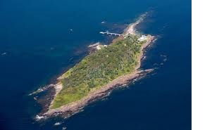

A few years back we were in Portland, ME, after climbing Mt. Kathadin in Baxter State Park, so we took an excursion to Eagle Island, summer home of Admiral Peary. Peary was captivated by the island on one of his trips to Casco Bay while a student at nearby Bowdoin College in Brunswick. When he got his first regular job as a draftsman with the Coast and Geodetic Survey in Washington, DC, he bought the island in 1881 .

Although he visited it and camped out on it in the interim, it wasn’t until 1904 that he built a modest four-square Cape Cod house on the bare northern promontory. In 1906 he enlarged the house with a one story wing off the back. It was there, in September 1909, that his wife Josephine received word that her husband had reached the North Pole in April of that year, and when he returned, he retired to the island during the heat of the Polar Controversy with Dr. Frederick A. Cook.

By the time he was credited with being the discoverer of the North Pole in 1910, Peary had pocketed the equivalent of millions of today’s dollars in book royalties and speaking fees. He had plenty of money to make some of the improvements he had long envisioned. He had grandiose plans. Some of his sketches for replacing the house looked like a castle with turrets blending into the rocky promontory. He even made elaborate sketches of a grand mausoleum in which he would be buried there.

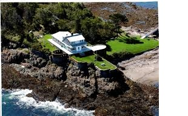But little of this was realized. Instead the house was raised onto a rock foundation to make it more stable on the wind-blown point, and two turret-like rock bays, which Peary referred to as his “bombproofs,” were set into the sea cliff. The west bay served as Peary’s private office and library, the east held all of his personal papers—253 cubic feet of them—and personal mementos including those of seven expeditions to the Arctic. Peary called it his “Cave of Memories.”

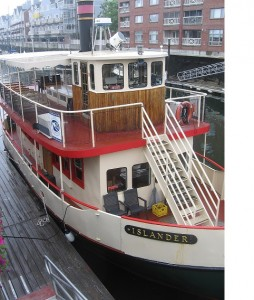To reach Eagle Island we boarded the Islander, one of the excursion boats run by Portland Discovery Land and Sea Tours.

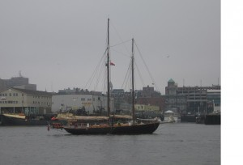As often on the coast of Maine, it was a foggy morning, but Portland Harbor was busy as ever. That’s the Portland Customs House with the cupola in the background.

It’s about an hour and a quarter trip to the dock at Eagle Island, since 2005, a Maine State Park. The fog didn’t allow much to see on the way, just an occasional fishing boat that emerged from the soup.

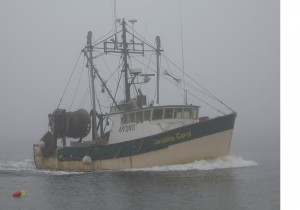

The tour allows you about an hour and a half on the island. Unfortunately, that isn’t really enough time to tour the house and see much of the 17-acre island too. The house is still quite spartan. Though the Peary family used it for more than 50 years, not much has changed since the Admiral lived there. Here’s the west elevation. Notice the porthole-like windows set into the rock foundation built in 1906.

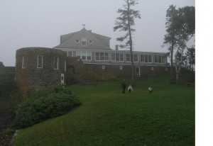

The main room is dominated by a three sided fireplace in which three distinct kinds of rocks from the island’s shores are set. Peary was an expert taxidermist and many of his bird specimens still sit on its mantle pieces.

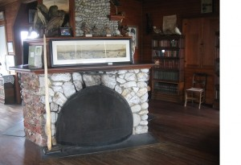

The lower floor is mostly a great room that served as living room and dining area. The entire house is paneled, with wooden ceilings and floors.

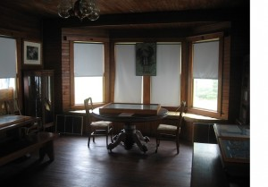

Scattered through the house in no particular order are a number of interesting Peary artifacts, including this sheepskin coat taken by Peary on his very first trip to Greenland in 1886.

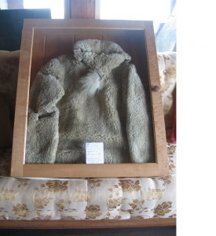

A narrow staircase leads upstairs to three spartan bedrooms.

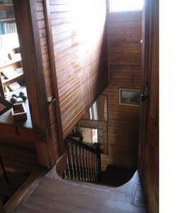

The children’s room has a display of toys spanning the three generations of Pearys who lived here.

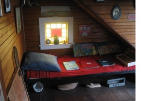

Out the window, the shell of Peary’s Cave of Memories can be seen. Many of his papers were damaged from storage in this space that took a beating in numerous storms before they were donated to the National Archives in the early 1960s.

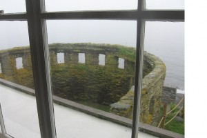

The front porch has a commanding view of the sea on a sunny day. Peary used this megaphone to quiet the Inuit dogs he brought back from Greenland and quartered on a nearby islet by shouting curse words at them in Inuktitut.

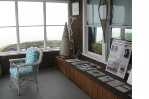

The kitchen was once detached to safeguard it against fires, but now is attached to the main house by the low extending wing built on the back of it.

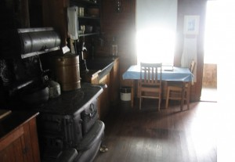

The island itself has a series of hiking trails that take you through its landscape of wind blasted Moosewood maples and spruce, with vistas of the sea from every shore. Unfortunately, neither the weather or the time constraints of the tour allowed for more than a short walk into the woods.

")

Peary’s other “bombproof” that housed his office suffered a collapse of its roof. It was restored from photographs to the way it appeared in Peary’s time in 1992.  It wasn’t open; this is a view through the window.  Peary is shown working at his desk in this same room.

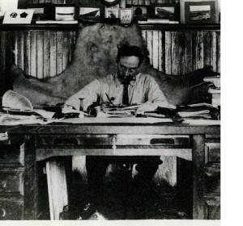

Atop the house’s roof is a weathervane cut in the shape of the S.S. *Roosevelt*, the special ice ship Peary had built in 1905, which he used on his last two attempts to reach the North Pole.

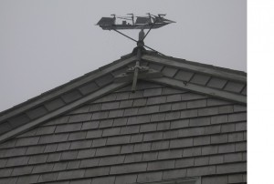

Soon it was time to return to the mainland and we bid goodbye to Peary’s island.

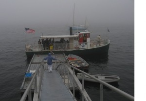

On the return, the fog held fast, but we were able to get a glimpse of Fort Gorges, built on Hog Island Ledge between 1858-1864.

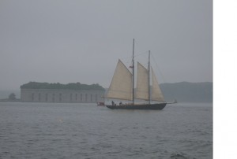

Since our excursion a small museum was opened in 2012, and the site was designated a National Historic Site in 2014.

]