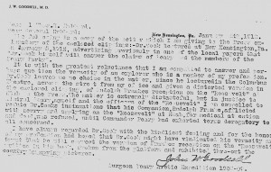

## The Cook & Peary files: January 8, 1912: Dr. Goodsell rebukes Dr. Cook’s account.

Over the 40 years your editor has researched the Polar Controversy, he has accumulated thousands of pages of documentation from the many archives, institutions and private individuals that hold significant material dealing with Cook and Peary. This is the first in an ongoing series featuring some of those documents.

Dr. John W. Goodsell was surgeon to the Peary Arctic Club’s North Pole Expedition of 1908, the one on which Robert Peary claimed to have reached his goal of a lifetime. In the dispute that followed, Dr. Goodsell mostly stayed silent. But when Dr. Cook came to his home town of New Kensington, PA to give a lecture on January 5, 1912, Goodsell felt he had to refute Cook’s account of how his companion, Rudolph Franke had been treated when Peary’s ship arrived at Etah in July 1908.

Cook claimed that Franke had been turned away without food and his entreaties to be taken to the United States aboard Peary’s relief ship, Erik, were denied until Peary extorted from him all of the valuable Arctic fox skins and Narwhal ivory gathered by Franke and Cook over the previous winter. When he appeared in New Kensington, Cook was in the midst of a tour promoting his recently published book, *My Attainment of the Pole*. Accompanying his talk he showed a motion picture entitled *The Truth about the North Pole*, in which Peary’s allegedly brutal treatment of Franke was dramatized (see the Artifacts section of this website). The link there is now dead, but this film can now be seen in its entirety at https://www.youtube.com/watch?v=q0ePNlvEJNA

On January 8th, Dr. Goodsell wrote to General Thomas H. Hubbard, President of the Peary Arctic Club:

J.W. Goodsell, M.D.  
New Kensington, Pa. January 8th, 1912  
General Thos.H. Hubbard.

Dear General Hubbard:

The following is a copy of the letter which I am giving to the Press ex-  
planatory of the enclosed clippings: -Dr. Cook lectured at New Kensington, Pa.  
on January 3, 1912, advertising previously in one of the local papers that  
“Dr. Cook himself will answer the claims of Peary and the members of the  
Peary Party.”  
It is with the greatest reluctance that I am compelled to answer and per-  
haps question the veracity of an explorer who is a member of my profession.  
Dr. Cook leaves me no choice in the matter, since he lectured in the Columbus  
Theatre, across the street from my office, and gives a distorted version in  
the enclosed clipping, of Rudolph Franke’s reception on the “Roosevelt” at  
Etah to the Press. The matter is extremely distasteful, but in justice to  
Admiral Peary, myself and the officers of the “Roosevelt” I am compelled to  
refute Dr. Cook’s insinuations that his Companion, Rudolph Franke, afflicted  
with scurvy and applying on the “Roosevelt” at Etah, for medical attention  
and food, was refused, until Commander Peary had extorted terms derogatory  
to all concerned.  
I have always regarded Dr. Cook with the kindliest feeling and for the honor  
of my profession had hoped that Dr. Cook might have vindicated his veracity and  
trust that he will correct the version of Franke’s reception on the “Roosevelt”  
written in his book, spoken from the platform and exhibited thro-out the  
country by moving pictures.

(signed) John W. Goodsell  
Surgeon Peary Arctic Expedition 1908-09.

The truth of the matter is that Franke was at first turned away from Peary’s ship, but when Captain Robert A. Bartlett heard of it, he had him brought back and he was given food. Goodsell then did a medical examination of Franke and found him unfit to spend another winter in the Arctic. As a result, Franke petitioned Peary to be taken home aboard his support ship, *Erik*. Although Peary denied it, Franke said Peary granted passage on the condition that Franke sign over all of Cook’s goods both at Etah and Annoatok, his winter headquarters, to him. When Franke returned he filed suit against Peary so stating. This suit dragged through the German Courts until at least 1915 before it was dismissed after Peary gave a disposition denying Franke’s claims of extortion.

Later, Goodsell had a bitter falling out with Peary over his refusal to allow him to publish his personal diaries. Peary held Goodsell’s diaries for years and used significant portions of it to fill out his own book, *The North Pole*. By the time he returned it to Goodsell, interest had waned, and it was too late for him to find a publisher. Goodsell’s diaries were only published in full, in facsimile, in 2009, by the Mercer County Historical Society under the title *There and Back Again.*

Goodsell later asked Dr. Cook’s aid in getting a position on some future Arctic expedition, but neither man ever went to the Arctic again.

**This item is part of the Peary Family Collection housed at the National Archives II in College Park, Md.**

