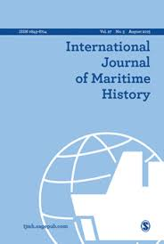

## The Lost Polar Notebook of Dr. Frederick A. Cook receives an academic review.

December 8, 2016

It is almost impossible for a self-published book to receive a professional review in the United States. That’s because many journals still believe that a book that is not subject to the normal publishing process is either a “vanity” book or somehow compromised by not being professionally edited. There is certainly merit in this point of view, because probably well over 90% of self-published works justify these doubts. However, there are works of an academic, though thoroughly legitimate, nature that would be a loss for any for-profit publisher to publish. There’s just no money in them, like most doctoral theses, for instance.  *The Lost Polar Notebook* is such a work.  
However, in the not-for-profit academic world, once published, each self-published book should be considered on its own merits, and apparently some in the UK take such a broad view. When I asked the *International Journal of Maritime History* to consider doing a review, they did.

The full review is published in the journal’s May 2016 issue, which is available from Sage Publications online. Here is a few of the things the reviewer said about it.

*It can certainly be stated that making it available for historical research on the exploration of the Polar Regions is an important achievement in itself. The meticulous transcription of Cook’s often virtually unreadable handwriting, and the careful analysis of the order of the various layers of text included in the notebook . . . serve to make this invaluable source readily available to the researcher for the first time. . . . Bryce provides comments on nearly all paragraphs of the notebook.*

*Altogether, the Lost Polar Notebook can be understood either as an addendum to Bryce’s earlier book or as an edition of an important primary source. Both takes are valid and welcome, but both takes render the book primarily relevant for the comparable small group of specialized historians dealing with the Polar Regions and or the history of science in around 1900.*

Certainly, the book was designed for that purpose exactly, though the reviewer did not recognize the important new ground broken within its pages. For the first time, researchers have the evidence that gives a credible, evidence-based timeline for Frederick Cook’s movements between the time he left his winter quarters at Annoatok up to the time he claimed to have been at the North Pole, and by doing so, it establishes the fact that he could not have reached the Pole during the spring of 1908, but instead fabricated an account of such a feat to deceive the world into believing he had. Anyone who reads both *Cook & Peary, the Polar Controversy, resolved* and *The Lost Polar Notebook* *of Dr. Frederick A. Cook* will be convinced of this fact, resolving this controversy convincingly, after more than 100 years of dispute, for all time.

The entire review can be viewed at: http://journals.sagepub.com/doi/full/10.1177/0843871416630274g

]