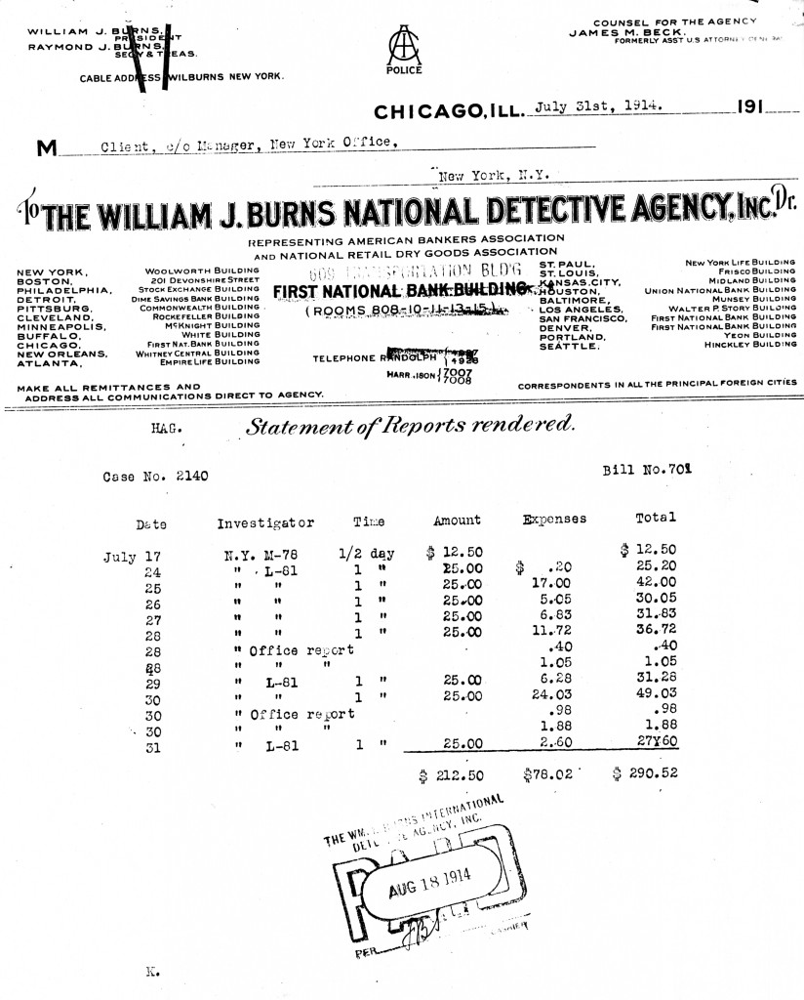

## The Cook-Peary files: July 31, 1914: “Case 2140″

**

*This is the fifth in a series examining significant unpublished documents associated with the Polar Controversy.*

During most of 1914, Frederick Cook was followed by detectives from the Edward J. Burns detective agency and became “Case 2140” on their books. The intent was to learn who he saw and what his future plans were so they could be anticipated. Screeds were then sent in advance to places he intended to lecture in an effort to undercut his credibility and reduce his earnings by discouraging those who might wish to hear him speak. Cook took the role of an ordinary man who had accomplished an extraordinary deed, and out of jealousy had been targeted for ruin by a black-handed conspiracy led by the rich and powerful “Arctic Trust,” The Peary Arctic Club, that backed Robert Peary. Cook was right as far as the efforts to discredit him. The Burns Agency bills were paid out of the account of General Thomas A. Hubbard, The Peary Arctic Club’s president. Illustrated is a typical bill for the last half of July, 1914, totaling $290.52. Similar amounts were paid month after month, and it should be remembered that $290 in 1914 was worth about 19 times that today, so it was no insignificant amount—equivalent to more than $5,000. Ultimately, the program of trailing Cook ended upon the death of General Hubbard in 1915. This bill and many others like it are among the Robert E. Peary Family Collection preserved at the National Archives II in College Park, MD.

]