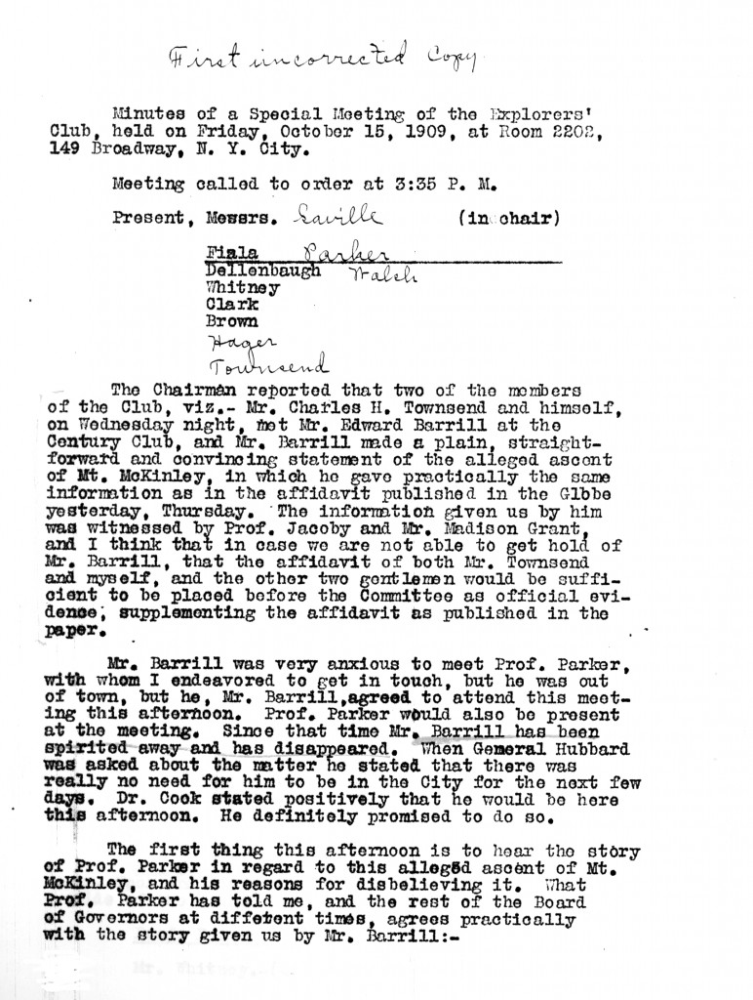

## The Cook-Peary files: October 15, 1909: The Explorers Club Investigates Cook’s Mt. McKinely climb

July 17, 2017

*This is the sixth in a series *examining significant unpublished documents associated with the Polar Controversy.**

On October 14, 1909, an affidavit appeared in *The New York Globe,* sworn by Edward N. Barrill. Barrill had been Dr. Cook’s only witness and climbing partner on his last attempt to conquer Mt. McKinley, in which effort Cook claimed to have stood at “the top of the Continent” on September 16, 1906. Conflicting rumors about Barrill had appeared in the New York newspapers for days previous to the affidavit, some saying he would support Cook’s claim, others that he would deny it. Conflicting, too, were reports from witnesses that told of Barrill bragging of his share in the successful feat and those who had said, early-on, that he had told them it was a hoax. When it finally appeared, his affidavit emphatically labeled Cook’s climb a blatant fraud.

Barrill asserted Cook had been no nearer to the 20,000-foot summit of the mountain than 14 miles and no higher than 10,000 feet. After the affidavit appeared, although he had just been in New York City, where he met with two members of the Explorers Club, Barrill disappeared, his whereabouts unknown, but safely out of reach of the Press. The next day, the Explorers Club assembled a committee to investigate Cook’s claims in regard to Mt. McKinley. Cook had been its sitting president when he had departed in 1907 on what eventually resulted in his claim to have reached the North Pole in 1908. Robert E. Peary had been appointed to fill his place in his absence, and was now the sitting president of the Explorers Club. Although the newspapers reported that the club’s investigatory panel included “Cook’s friends,” in fact, though they expressed neutrality and impartiality in the raging dispute between the two explorers, they were largely Peary men.

The panel included Marshall Saville of the American Museum of Natural History, long an institutional ally and contributor it Peary’s expeditions, Charles H. Townsend, director of the New York Aquarium, who later spearheaded a dubious attempt to “prove” that Cook had tried to steal the life’s work of a aging South American missionary by publishing as his own a dictionary of the language of the Yaghan Indians of Patagonia, Walter C. Clark, who was the business partner in the Parker-Clark Electric Company with Hershel Parker, the chief witness against Cook, and Frederick S. Dellenbaugh, Secretary of American Geographical Society, who claimed to know where Barrill was but said he couldn’t disclose this information without “breaking a confidence.” Saville and Townsend were the two members who had interviewed Barrill before his “disappearance.” About the only members who could be remotely considered “Cook’s friends” would have been Caspar Whitney, editor of *Outing Magazine,* who had editorialized for fairness for Dr. Cook in its pages, Anthony Fiala, a fellow arctic explorer and long time associate of Cook’s, who ran a sporting goods store in New York, and Henry Walsh, who had been a co-founder with Cook of The Arctic Club of America.

That the mysterious disappearance of Barrill, the only eyewitness to Cook’s actual movements on his claimed climb, was blown off in so casual a way in the opening statement reproduced here, shows that, as a whole, the committee was clearly in Peary’s pocket. Basically, they said, Barrill’s published affidavit was to be accepted without any questioning of him by the panel. That was what General Thomas H. Hubbard, the president of the Peary Arctic Club wanted. He had paid for “expenses” connected with Barrill’s and others’ making affidavits against Cook, and the cost of bringing Barrill to New York and his accommodations while there. It was Hubbard who “spirited away” Barrill, ostensibly to visit relatives in Missouri instead of appearing before the committee to expand upon the eyewitness account of events he had sworn to in *The Globe*, a paper owned by General Hubbard.

Barrill’s absence left the committee with only two witnesses, Parker, and Belmore Browne, both of whom had been on Cook’s 1906 expedition. In this series, their testimony before the Explorers Club is published for the first time. The meeting began with a preliminary statement concerning the absence of Edward Barrill, after which Parker was called. Parker, unlike eyewitness Barrill, had already left Alaska before Dr. Cook made his attempt with Barrill to reach the mountain’s summit.

*A transcript of the Parker-Browne testimony, which will be published in the next few posts is among the Robert E. Peary Family Papers at National Archives II in College Park, MD.*

]