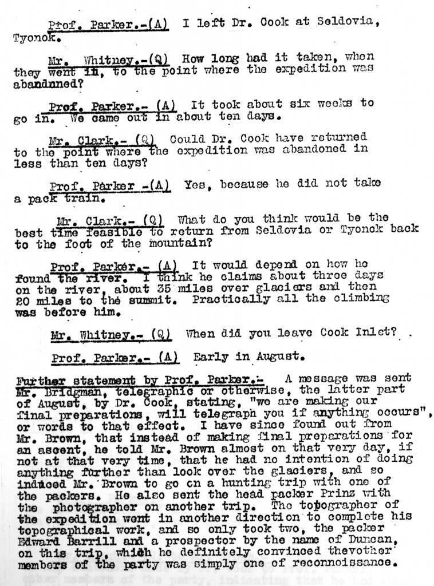

## The Cook-Peary files: October 15, 1909: The Parker-Browne testimony, part 1

*This is the seventh in a series examining significant unpublished documents related to the Polar Controversy.*

Parker began his testimony by recounting his 1906 Alaskan experiences (not reproduced here); the panel then asked him some questions.

It should be noted that when Cook sent a telegram announcing his success on McKinley on October 2, 1906, Parker had openly doubted it could be true. After Cook returned to New York in November, and met with Cook personally, however, he dropped his doubts, but still maintained that Cook’s triumph was nothing but an admirable physical feat, he having made no reliable measurements that would be of interest to science. Parker belief eventually went so far as to allow him to stand in for Dr. Cook at several lectures on the conquest in 1907. Browne, for his part, openly praised Cook before the Mazama Club upon their return to Seattle in early November, and in 1907 published an article along the same lines, expressing his admiration for Cook’s feat and saying he and Barrill had proved themselves to “be of the stuff men are made of.”

Parker and Browne, however, as Parker admits here, had designs on another attempt to reach the summit, and Barrill’s affidavit reopened the door to their ambitions. If Cook could be disqualified, they might be able to claim the first conquest of the great mountain for themselves.

Things to note in this part of Parker’s testimony:

The prospector who accompanied Cook and Barrill part way up the Ruth Glacier was named John Dokkin, not “Duncan.” Also, throughout the transcript, Belmore Browne’s name is misspelled “Brown.”

* Although he said he would not consider “for an instant the possibility of approaching the mountain from the South” on any future attempt, that is exactly what he and Belmore Browne did in 1910, on an expedition funded by General Thomas Hubbard. The main purpose of this expedition was not to climb Mt. McKinley, however, but to prove Cook hadn’t.
* Although it was “perfectly understood” between himself and Cook that all further attempts “were abandoned for that season,” he was less certain of this later in his testimony.

