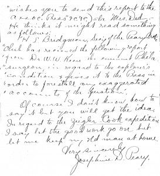
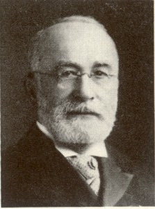

## The Cook-Peary Files: October 15, 1902: A Ziegler-Cook Expedition?

**

*This is the 10th in a series examining significant unpublished documents related to the Polar Controversy.*

**Here is a transcription of the above letter:**

*1700 Summer Street*

*Phila. October 15. ‘02*

*Dear Mr. Bridgman;*

*Mr. Peary wants me to tell you that the operation was successfully performed today & tonight he is as comfortable as could be expected.*

*He has asked Dr. Keen to send you a report covering three points*

*1st The simplicity & perfect success of the operation.*

*2nd That his recovery will be speedy & <successf> complete.*

*3rd That the Dr. has examined him & found him in perfect health & physique.*

*I am also commanded by the Commander to suggest to you that you give this report to the Associated Press, (minus any irrelevant matter such as “Mr. Peary wishes you to send this report to the Assoc. Press” &c. &c.) a la Mrs. Ded. He thinks it might read something as follows:*

*“H. L. Bridgman, Sec’y of the Peary Arctic Club has received the following report from Dr. W. W. Keen the eminent Phila. surgeon in regard to the explorer’s condition & gives it to the Press in order to forestall any exaggerated accounts of the operation.”*

*Of course I don’t know how to say it but you will get the idea. In regard to the Ziegler-Cook expedition, I say let the good work go on but let me keep my old man at home.*

*Very Sincerely*

*Josephine D. Peary*.

Recently, a book about the two expeditions William Ziegler financed to reach the North Pole was published. On p. 241 of P.J Capelotti’s *The Greatest Show in the Arctic*, Univ. Oklahoma Press, 2016 it has this to say:

“One man who could have helped the expedition immeasurably, both with his genial disposition and polar experience, was Dr. Frederick Cook. There were hints in late May 1901 that Cook might join the expedition, but in the end he elected to stay in Brooklyn and write up the results of the *Belgica* expedition to Antarctica.” The reference given for this statement is “Four of Baldwin’s Party Sail on the St. Paul,” Brooklyn Eagle for May 29, 1901.

However, this must have been a different proposition than the one Mrs. Peary refers to. Evelyn Briggs Baldwin had already been named as the leader of Ziegler’s expedition, and it is likely that Cook was merely offered the position of surgeon, only. Mrs. Peary’s letter was written in 1902, at the time Baldwin had already failed, and Ziegler was looking for someone to return to the Arctic and pick up the effort he had lavishly financed to reach the North Pole from Franz Josef Land. And in 1901, Cook would have been working “on the results of the expedition stated.

But that Mrs. Peary refers to a “Ziegler-Cook” expedition indicates that in 1902 it was abroad in the New York polar explorer’s community that Cook was likely to be offered the leadership. This was the very time Ziegler was searching for a candidate. In 1909 Anthony Fiala, a member of Ziegler’s expedition, said he had recommended Cook to Ziegler. Why Cook was not chosen is unknown. Eventually Ziegler settled on the equally incompetent Fiala, himself.

The operation Josephine Peary refers to was done on Peary’s feet after his return from his five-year “Siege of the Pole” lasting from 1898-1902. He had lost seven toes to frostbite in January 1899 attempting to reach Fort Conger. His physician, Dr. Dedrick, removed those toes in the Arctic, leaving painful stubs. The Dr. Keen mentioned was William W. Keen (below), one of the elite surgeons of his day, who was called upon to assist in the secret operation on President Grover Cleveland when he was found to have cancer of the palette in 1893. It was he who operated on Peary to remove one remaining good toe, leaving him with only his two smallest toes, and evening up the stubs. He then pulled the skin of the sole of Peary’s foot over them, making a cushion for the shortened digits.

Mrs. Peary’s reference to “Mrs. Ded” is a reference to Cora Dedrick, wife of Peary’s expedition doctor. The two of them had a falling out during the winter of 1900 and hardly spoke to one another the rest of the expedition. Dedrick knew of Peary’s infidelity with Inuit women, and Peary was deathly afraid it would get back to Morris K. Jesup, President of the Peary Arctic Club and his chief benefactor. Jesup was a straight-laced founder of the New York YMCA and ally of Anthony Comstock, such information would have been devastating to Peary’s interests and future financing.

Peary’s strategy against Dedrick was to portray him as “practically insane,” and to disregard any “insane” charges he might bring. Not only this, but Dedrick, being Peary’s doctor, not only knew that Peary was crippled by his frostbite injuries, but had developed a hernia serious enough to require a truss. Peary didn’t want any news of these conditions to be made public lest it reflect on the claims he would make regarding his achievements on his last expedition or impair his ability to gain financing for another one. Mrs. Dedrick was visited by Herbert Bridgman in an effort to influence her husband to avoid any rash statements long before Peary returned, having learned of the dispute when he led a relief expedition to check on Peary in the summer of 1901. When her husband got back, she and he were indignant at Peary’s attempted portrayal of his former doctor, and she may be referring to a statement about Peary’s physical condition published by the Associated Press. In the end, Dr. Dedrick decided not to speak publicly about the dispute, probably because he had also engaged in sexual indiscretions with an Inuit woman, and suffered from extreme guilt over it. The complex details of these incidents can be found in *Cook and Peary, the Polar Controversy, Resolved.*

*Mrs. Peary’s letter is now in the Peary Family Papers at the National Archives II.*

