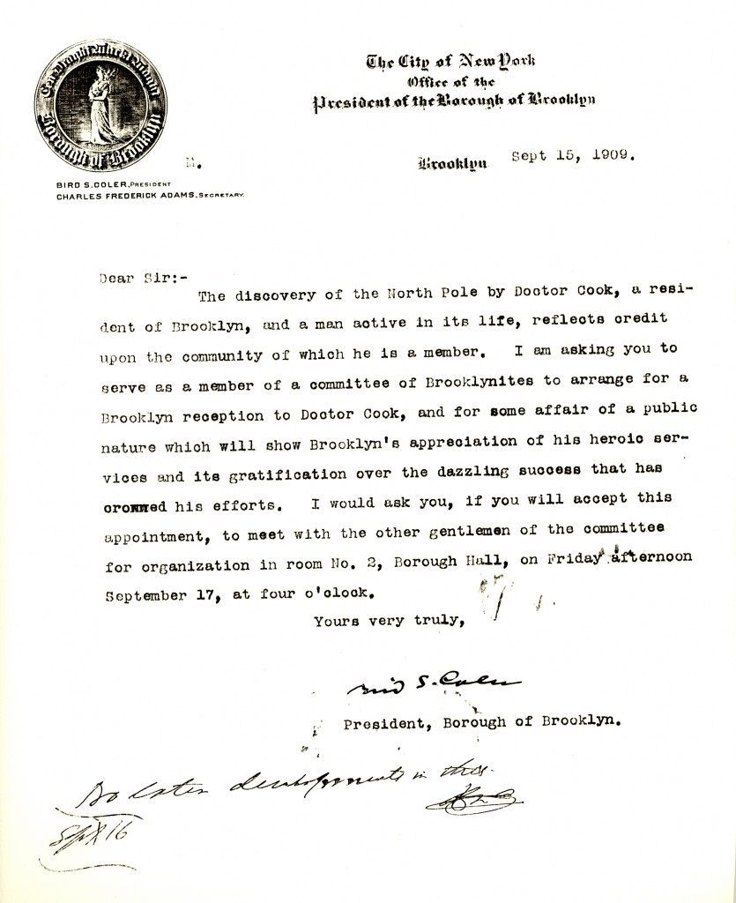
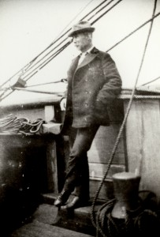

## The Cook-Peary Files: October 15, 1909: Herbert Bridgman declines

January 19, 2019

*This is the 11th in a series examining significant unpublished documents related to the Polar Controversy.*

In anticipation of Dr. Cook’s imminent arrival in New York aboard the Oscar II, his hometown sought to give him a grand welcome. The aldermen of the Borough of Brooklyn decided a committee to plan the official welcome for the Conqueror of the North Pole was in order. The Borough President, Bird S. Coler, sought the input of prominent citizens to participate in the planning. Among them was Herbert L. Bridgman, Editor of The Brooklyn Standard Union, himself a veteran of a trip to the Arctic on the 1901 relief ship for Peary. To this end, Coler wrote to Bridgman on October 15, 1909:

Bridgman was the Secretary of The Peary Arctic Club, an organization of millionaires formed in 1898 to aide Peary materially in his plans to capture the North Pole for the United States, and was sometimes called “Peary’s Press Agent,” because of the favorable publicity he gave Peary in the pages of his newspaper. He was more than that. He had been involved with Peary as early as 1891 and in 1892 had scotched a feature article written by Dr. Cook that he was about to publish after he learned from Peary that he considered it a breach of contract of the agreement Cook had signed before joining Peary’s North Greenland Expedition. In the Polar Controversy Bridgman managed the overall campaign to destroy Cook’s credibility and skillfully gathered information detrimental to Cook’s credibility on topics as variable as his previous claim to have climbed Mt. McKinley and his connection with the publication of a dictionary of the Yahgan language, which he was alleged to have stolen from a South American missionary. Bridgman was the first to raise doubts concerning various aspect of Cook’s polar narrative.

On the first day Cook’s claim was made public he was interviewed, he had this to say:

“Dr. Cook will, of course, recognize the moral and honorable obligation and insist that his claims to the highest geographical distinction be irrefutably established. The word of the Eskimos who went with him will be of use in getting at at the proof. . . . The Eskimos cannot write, but Mr. Peary has told me that they can draw a map of the north pole and the regions surrounding that is remarkable for its accuracy. With this skill, the Eskimos ought to be in position to help Dr. Cook establish beyond doubt his claim. . . . If Dr. Cook has reasonable proofs the credit for having discovered the north pole must go to him.”

After Peary reappeared, claiming the pole for himself, Bridgman qualified this:

“Cook’s word must be taken the same as any other man’s I have not the slightest doubt that Dr. Cook believes implicitly that he has reached the North Pole and that he made his observations with the utmost care, but I do believe that he has made mistakes in the reading of his instruments that will rob him of the glory. I think that when the records are submitted to scientists there will be flaws.  
I think when Mr. Peary gives to the world his account of the stories told by the two Eskimo boys who accompanied Dr. Cook their narrations will do much to prove or disprove Dr. Cook’s claim. They are simple minded people, but they have a strange and wonderful intelligence regarding geography.”

This is eerily prophetic of the means by which Peary attempted to discredit Cook’s claim, and the basis on which that claim was ultimately rejected. It is so accurate that it indicates he was aware of Peary’s intended tactics before Peary left for the Arctic in 1908, because when Bridgman made the first statement, Peary had not been heard from at all, and when he made the second statement, Peary had said nothing specific about any interviews with Cook’s Inuit companions. Yet it was just these interviews that Peary advanced to discredit Cook, along with a detailed route of where Cook had actually allegedly traced on a map of the Arctic by them, due to their “wonderful intelligence regarding geography,”.

 *Herbert Bridgman aboard the Erik in 1901*

It was most unlikely indeed that Bridgman would have any interest in planning ceremonies to honor Peary’s rival, and Bridgman declined. He forwarded Coler’s letter to Peary with the comment, “No later developments on this. Sept 16 HLB.”

*The letter is among Peary’s papers now at the National Archives II in College Park, MD.*

]