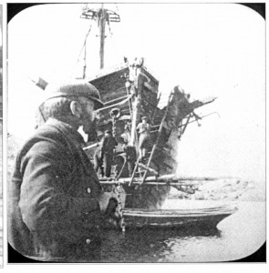

## There and Back Again: The Dr. John Goodsell Archives Volume II

*This is the third of three posts covering There and Back Again; The Dr. John Goodsell Archives issued by the Mercer County Historical Society. For preliminary remarks, see the first published post.*

The second volume of the Dr. John Goodsell Archives is, if anything, more disappointing than the first. It consists of “Supplementary Materials.” Despite its 780 pages, only a few of those which are not available elsewhere will be of any interest to scholars of polar history.

In the first section, there is a facsimile of a list of medical supplies taken on the expedition by Dr. Goodsell in 1908, a facsimile of a list of temperatures recorded at Cape Sheridan during the overwintering of the *Roosevelt* 1908-09, and antarctic temperatures compiled from secondary sources, apparently gathered secondhand to buttress an article Goodsell hoped to publish.

The next section consists of transcriptions of random newspaper clippings, which, of course, are available in their original sources. These are mostly from Pittsburgh and New Kensington, PA papers, but some are from New York and elsewhere. In one case, the exact same article that appeared in two different papers is transcribed twice.

The most important section for historians comes next. It is a transcript of Goodsell’s script for the illustrated lectures he gave after he finally got tired of waiting for Peary’s blessing. However, the value of this section is compromised by the illustrations scattered throughout the transcription. A casual reader might reasonably assume that they are the original illustrations that go with the text. However that is not the case. In a letter reproduced on p. 640 of Volume I, Goodsell says his lecture was illustrated with “150 beautifully colored, stereoopticon views.” If so, then none of the illustrations are those, as none of them are stereo views, unless only one half of the view is being reproduced. Stereo views were slides with two views of the same subject, slightly shifted, that when projected gave a 3-D effect. Without using a special camera, they had to be produced commercially, and then hand-colored from ordinary photographs at some expense.

An ominous editorial note at the head of this section states: “Some slides are the best guesses of the MCHS, staff, interns, and volunteers.” As it turns out, most turn out to be just that, and it appears that among the described guessers, often times they really had no clue. Some do appear to be correct, however.

For instance, “Slide 46” is adjacent to the text: “Nearing the Labrador Coast, the *Erik* smashed head first against an iceberg and Captain Sam Bartlett secured the split bow with coils of anchor chain.” The slide does indeed show the bow of the *Erik* smashed, with Sam Bartlett sitting in the foreground. This sort of pose would be ideal for stereo reproduction, having a subject posed as a distinct foreground. Others show people or scenes at least related to the text, but many others have absolutely no relationship to the text whatsoever. Here are some examples, but to list all of them would be prohibitive as to space.

“Slides” 94 and 115 are identical, and the same illustration appears again on p. 1056 unlabeled. This is a steel plate engraving of the rescue of G.W. Greely’s Lady Franklin Bay Expedition at Cape Sabine in 1884. It has no relevance whatever to any text near where it is printed three times. It would have been appropriate positioned next to the text at “Slide 155,” however, where Greely’s rescue is mentioned. Most of the “slides” used to illustrate the lecture notes already have appeared, sometimes multiple times, in the illustration sections of Volume I, and consist of illustrations from Peary’s *Hampton’s Magazine* series and from his book, *The North Pole*, among other published sources. Many of the illustrations in this section also appear multiple times, and many times they appear in proper registration and also in reversed image form, as they did in Volume I. One, “Slide 33,” even appears as a negative image! It appeared in Volume I in positive format.

It is probably safe to say that the only illustrations in this section that were part of the original lecture slides are those with rounded corners. That would be the usual format of non-stereoscopic glass slides used in projectors of that era. So most of the “slides” have nothing to do with the lecture presentation at all. In fact, most of them are not even the work of Dr. Goodsell in 1908-09. “Slides” 15 and 29 were taken by Dr. Frederick A. Cook, and date from 1901. The Inuit pictured in the latter is not the one described in the lecture notes’ text. Others are by Joe White and Donald MacMillan. And of course the many illustrations coming from print sources such as those already cited were not produced to accompany this lecture.

After the lecture notes there next follows a number of original writings of Dr. Goodsell. Several of the articles are on medical topics, but others are not. Some of the letters in Volume I deal with his attempts to have these published. One with the sober title, “The Arctic is very different from the Antarctic,” breaks into poetry. One rejection letter noted: “Regretfully we return your manuscript. . . The article as it is, is too purely lyrical for use in GLOBE.” [p. 732].

This was not the end of Goodsell’s poetical leanings, however. There follows the largest section of this volume called “Garden of the Gods.” One is perplexed as to what to make of this. Only by turning to Goodsell’s interspersed notes [p. 1099], evidently intended for a publisher, might we get some sense of it:

“In Venus and Adonis, the ordinary reader can easily distinguish between the fiction of Venus’ tasks and the authentic Polar or World War personal reminiscence inserted by the author. Should the publishers desire, the personal authentic reminiscences in each instance could be edited apart from any fiction. In fact the polar reminiscence of a notable expedition is extracted from my contemplated book, ‘On Polar Trails,’ which I am now revising for publication”

Goodsell’s own extended title reflects the character of this curious effort: “*Garden of the Gods; Love’s Old Story; A Novel; Epic Tone Poem; Fiction, Myth, Humor, Fact.*” It consists of 211 printed pages of, by Goodsell’s own estimate, 5920 “poem words” couched in the mythological doings of the Greek gods. And that’s not all. It also contains excerpts from his Arctic Diary, what appear to be fantasy passages mixing the two, with such accoutrements as giant polar dirigibles 1,500 feet long, and I don’t know what else. It would be kind to say that because it is dated 1935, and mentions later dates within the text, that this was a product of Goodsell’s dotage. The poetry is all in rhymed couplets and is uniformly quite awful in both sentiment and forced rhymes:

“When the priests wield cymbals,  
Zeus, but a symbol,  
There’s greater God on high,  
His presence, ever nigh.”

The mixing in of his personal reminisces (which mercifully are not in rhyme) makes the quite sad impression that Goodsell, despite all his experiences, including service in World War I since, never got beyond that year he spent as Peary’s surgeon, or his bitter disillusionment in Peary’s treatment of him in its wake. If this epic piece of doggerel is anything similar to what Donald Wisenhunt described as Goodsell’s “flowery” Victorian prose in the original manuscript of On Polar Trails, then he was not altogether wrong in editing it the way he did. The less said about “The Garden of the Gods” the better. It should never have seen the light of day in print.

The next major section consists of a transcription of the original diary of Ross Marvin kept on the expedition of which Goodsell was the surgeon as well as that he kept on Peary’s previous expedition in 1905-06. Marvin was originally said to have drowned after he fell through the ice on his return to land with two Inuit after he left Peary’s party going north. But in 1926 it was disclosed that Marvin had actually been murdered by one of the Inuit. Some students of the subject have suggested that he was killed on the orders of Robert Peary. The Inuit in question had been taken in by the Pearys as an orphan at an early age to act as a playmate for their daughter Marie, was proficient in English, and had spent the night previous to Marvin’s return in the same igloo as Peary, a fact that Peary deliberately skipped over while reading from his diary in testimony before Congress in 1911. Several reasons why Peary would want to eliminate Marvin, who was Peary’s private secretary and privy to many confidences, have been advanced, but so far no proof has emerged as to Peary’s direct involvement in the killing.

Goodsell and Marvin were good friends, and Goodsell maintained a life-long interest in his fate. We learn in the letters section of Volume I that Marvin’s brothers loaned his diaries to Dr. Goodsell for the explicit purpose of copying them. [Letter dated April 16, 1938 p. 727] They also granted permission to quote from them to Dr. Goodsell, but reserved their rights. Whether Goodsell suspected foul play on Peary’s part, we see no evidence in this archive, but the timing of the grant of permission to copy the diaries raises that thought, as it came only after the actual circumstances of Marvin’s death were revealed.

Because the original Marvin diaries are available at the Chemung Historical Society in Elmira, NY, the Goodsell transcriptions don’t add anything to scholarly sources, but they might prove more convenient (assuming the transcription is accurate) than visiting Elmira, as they are not yet available online. Reading them, I found a few tidbits of interesting information, but they actually added little to my knowledge of the 1908-09 Peary expedition not to be found elsewhere. Unfortunately, there are no revelations about the “confidential” aspects concerning “The Cook affair” that Marvin hinted at, but could not disclose in letters sent from Greenland to a friend. [see *Cook and Peary* pp. 331-332]

The volume ends with a selection of newspaper clippings and articles about Marvin’s murder, and another section of like materials about Donald B. McMillan, another of Peary’s assistants, and the last of them to die. A reproduction of the article “A Clash of Egos,” by Wisenhunt and Anita Genger that appeared in *The Historian* in 1980 ends the volume.

The same errant Glossary and incomplete and inaccurate Index described in the last post conclude Volume II.

The biggest disappointment, in a myriad of disappointments in this work, is that it does not include either a transcript or a facsimile of the original 600+ page manuscript of *On Polar Trails.* That would have been a far greater service to polar scholars than anything else, save, perhaps a facsimile reproduction of Goodsell’s original handwritten diary. We get to see exactly one page of it, the title page, in facsimile. In this day and age of simple means to publish books at a very low cost, such as Amazon’s Kindle Direct Publishing platform, the MCHS could scan the manuscript and publish it with scholarly introductory remarks and annotations at a very modest cost. Such a publication would be far more useful than anything in these two large, expensive, hardbound volumes.

Sad to say, for all the evident time and good intentions spent on this project, *The Dr. John Goodsell Archives* is largely worthless. Most of what it contains is available elsewhere. Confidence in the accuracy of the transcriptions it contains is compromised by the blatant mistakes, lacunae, inaccuracies, and the nearly complete lack of competent professional editing the original materials have received. Any serious polar scholar could only quote from it with cautionary notes to his reader. Despite its existence, anyone seriously interested in an accurate reading of Goodsell’s materials will still have to journey to Mercer County to access the originals in person.

