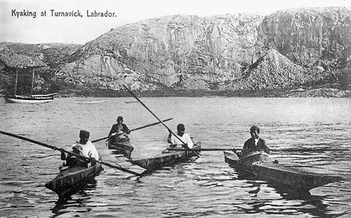
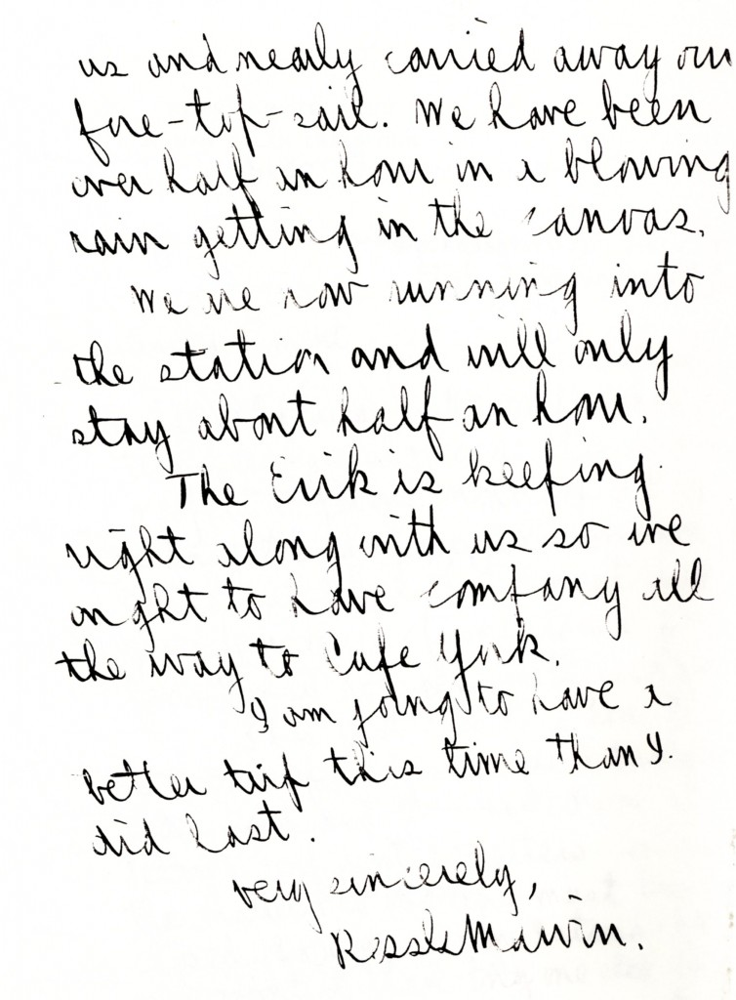

## Inside the Peary Expedition: Part 3: A brief stop in Labrador, July 23, 1908

on board the Roosevelt,  
off Turnavik, Labrador  
July 23rd, 08.

Dear Mr Bement: -

Just a few lines

we we <sic> will land for a few minutes  
at the fishing station of Captain  
Bob’s father at Turnavik. He has  
200 pair of skin boots here & so  
we came up after them.

This note ought  
to reach you at the same time  
yesterdays letter did.\*

I started in before  
breakfast to rig up a box for  
my instruments and have been  
at it all day. I started to  
write a note to Mother after  
supper, when a squall struck  
us and nearly carried away our  
fore-top-sail. We have been  
over half an hour in a blowing  
rain getting in the canvas.

We are now running into  
the station and will only  
stay about half an hour.

The Erik is keeping  
right along with us so we  
ought to have company all  
the way to Cape York.

I am going to have a  
better trip this time than I  
did last.

very sincerely,  
Ross Marvin

**Notes:**

\* No such letter was included among the copies given to the author by Silas H. Ayer III.

]