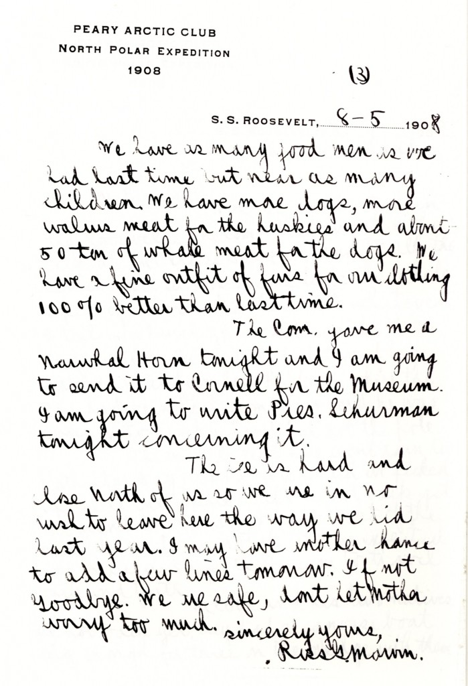

## Inside the Peary Expedition, Part 6: Waiting for the ice in Melville Bay, August 5, 1908

The *Roosevelt* was delayed at North Star Bay while waiting for the ice to loosen in Melville Bay before heading farther north. Melville Bay was notorious for hazardous ice jams, but beyond was generally clear in August. While he waited, Marvin added a few details about the expedition’s outfit. The “Huskies” referred to here are the Inuit men Peary took on board at North Star, along with their families. The women worked all winter aboard the ice-bound ship preparing skins and sewing fur garments.

8 – 5 1908

We have as many good men as we  
had last time but near as many  
children. We have more dogs, more  
walrus meat for the huskies and about  
50 ton of whale meat for the dogs. We  
have a fine outfit of furs and our clothing  
100% better than last time.  
The Com. gave me a  
Narwhal Horn tonight and I am going  
to send it to Cornell for the Museum.  
I am going to write Pres. Schurman  
tonight concerning it.  
The ice is hard and  
loose north of us so we are in no  
rush to leave here the way we did  
last year. I may have another chance  
to add a few lines tomorrow. If not  
Goodbye. We are safe, dont let Mother  
worry too much.  
sincerely yours,  
Ross Marvin

