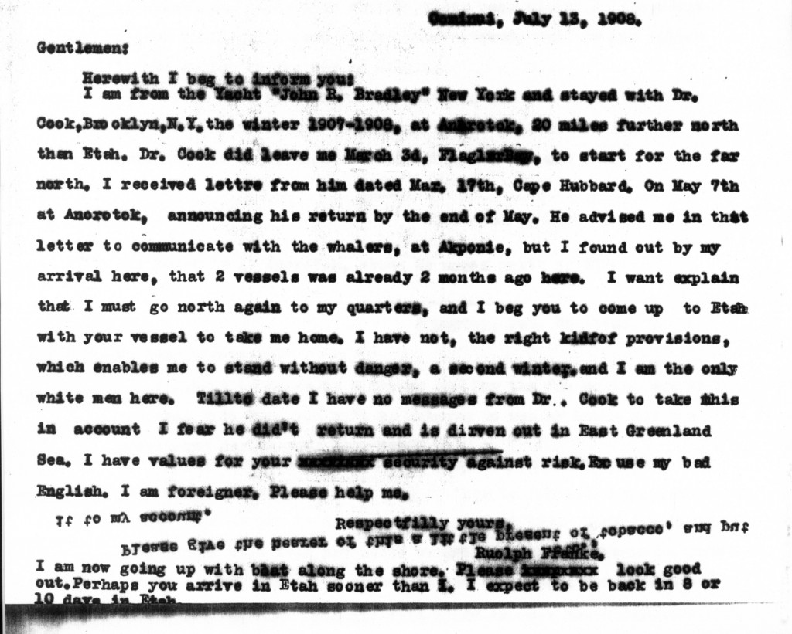

## Inside the Peary Expedition, Part 7: A Letter from Rudolph Franke

At Etah, Peary retrieved a letter sent north via a native by Rudolph Franke, who had been the cook on Bradley’s yacht, and whom Cook had paid to overwinter with him in a house he had built from packing crates at Annoatok. Franke had received a letter from Dr. Cook in May via the Inuit who had accompanied him to Cape Thomas Hubbard, dated March 17. In it he had given these instructions to Franke in case he was not back by June. It read in part:

“While I expect to get back to you by the end of May, still I wish you to be ready to go to Acponie, the Island off North Star, where the whalers’ steamers come, by the 5th of June, and if I am not back go home with the whalers, I think however we will be back.

“Gather all the blue fox skins you can. These must be our money on the return trip. If you can get a few bear skins take them, also Narwhal and Walrus tusks, but do not give too much for them. . . .

“There is likely to be much open water between you and Etah so you had better send the trunk, the Narwhal tusks and all things for the return to Etah at least, if not further, as soon as you can.”

When Cook had not appeared by the appointed date, Franke set out for North Star Bay. Not finding any whaling ships, he started back for Etah, sending ahead this letter to deliver in case he encountered a ship along the way or one had arrived at Etah during his absence:

Oomanui, July 13, 1908

Gentlemen:  
Herewith I beg to inform you:  
I am from the Yacht “John R. Bradley” New York and stayed with Dr. Cook, Brooklyn, N.Y. the winter 1907-1908, at Anorotok, 20 miles further north than Etah. Dr. Cook did leave me March 3d, Flagler Bay, to start for the far north. I received lettre from him dated Mar. 17th, Cape Hubbard, on May 7th at Anorotok, announcing his return by the end of May. He advised me in that letter to communicate with the whalers, at Akponie1, but I found out by my arrival here, that 2 vessels was already 2 months ago here. I want explain that I must go north again to my quarters, and I beg you to come up to Etah with your vessel to take me home. I have not, the right kind of provisions, which enables me to stand without danger, a second winter, and I am the only white man here. Tillto date I have no messages from Dr. Cook to take this in account I fear he didn’t return and is driven out in East Greenland Sea. I have values for your [illegible word] security against risk, Excuse my bad English. I am foreigner. Please help me.  
Respectfully yours,

Rudolph Franke

I am now going up with boat along the shore. Please look good out. Perhaps you arrive in Etah sooner than I. I expect to be back in 8 or 10 days in Etah. Please give the bearer of this a little gift of tobacco and put it to my account.2

1 Acponie, as Cook spelled it, is a large island near North Star Bay.

2 This last sentence is printed upside down and backwards in the space occupied by the signature and must be read by holding it up to a mirror. Perhaps it was on the outside of the envelop containing the message, but why it is so oriented on the transcript is unknown. Perhaps it is a bleed through from the other side of the carbon paper.

The typed transcript of the letter is in the Peary Family Papers at National Archives II, College Park, MD

]