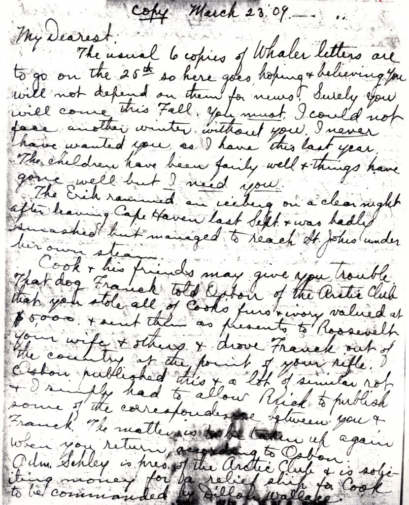

## Inside the Peary Expedition: Part 13: Aftermath: Spetember 1908; Franke reaches the United States

On August 18th Franke, still brooding over his dealings with Peary, watched the *Roosevelt* steam slowly north and vanish from sight among the ice of Smith Sound. Peary had forbidden him to take anything aboard the *Erik* besides his personal effects; he was not even allowed a pair of dogs he wanted to donate to the Catholic relief mission ship *St. Bernard.* The Roosevelt was hardly out of sight when Franke began to hear grumblings among the crew of the *Erik* about Peary’s unfair treatment of them, though while the commander had been present they had seemed totally subservient.

The day after the *Roosevelt* sailed, the *Arctic*, under the command of Captain Joseph Bernier, anchored in Etah’s harbor. Captain Bernier had hope to try for the North Pole himself in 1908, but the Canadian government had ordered him to visit the islands discovered by Sverdrup and claim Canadian sovereignty over them instead. One of Bernier assignments was to deliver 15 boxes of relief supplies sent by Marie Cook. Bernier also had 11 letters for Dr. Cook, which Franke took on the doctor’s behalf. He gave them to Harry Whitney for safekeeping, since he did not trust Peary’s men to deliver them. When Bernier tried to obtain a team of dogs to aid his explorations, Bos’n Murphy would not allow him to have a single animal, and after caching Cook’s supplies slightly south of Etah, the *Arctic* left Foulke Fjord bound for Jones Sound.

The meeting with Captain Bernier made Franke all the more depressed and resentful of Peary. Certainly, he thought, Peary must have known the Arctic was coming to Etah but had kept silent in order to extort from him Cook’s provisions and furs for his personal gain. He felt he now realized the extent of Peary’s unscrupulous nature and began to fear for Dr. Cook’s safety in case of his return, as Peary seemed capable of anything. But he had asked Panikpa to keep a watchful eye on things at Annoatok; in this, at least, Franke took comfort as the *Erik* left Etah on August 23rd . He did not know that at that moment Panikpa was bound for Cape Sheridan aboard the *Roosevelt*, along with many of the Eskimos who had accompanied Dr. Cook across Ellesmere Land, for further questioning.

Even the prospects of a tranquil voyage vanished when , on the evening of September 22nd the *Erik* collided with an iceberg that stove in her bow. After some frantic activity, it was determined that the severely damaged ship could still make port. Franke went below to discover that his trunk was also a casualty of the accident. Many of the photographic plat4es were destroyed, but he was able to save Dr. Cook’s diary.

When the *Erik* limped into Brigus the next day, he was hospitably greeted by Moses Bartlett, who had captained the *Bradley*. There he found that it was not September 23rd, as he thought, but September 30th. In the nightless Arctic summer he had lost count of seven days. The *Erik* managed to make it to St. John’s for repairs, and from there Franke took a boat to Sydney, where he caught the train for New York.

Once in the city he met with the secretary of the Arctic Club, B.S. Osbon. Osbon was a flamboyant character with many outspoken views. He knew all the inside gossip about Robert Peary and found him insufferably arrogant. When he heard Franke’s story of his dealings with Peary at Etah, he urged Franke to write a letter to Josephine Peary asking her to set things straight or he would report the affair publicly. Franke enclosed two copies of the letter, one in English and one in German, since Mrs. Peary spoke his native tongue:

[illegible N.Y. address]

Mrs. Robert E. Peary

Washington, D.C.

Madame:

While I am very sorry to do it, I cannot help

to write these lines to you. No doubt your hus-

band has mentioned me to you in his last letter

and told you that I met him at Etah, North Green-

land. When I first met your husband, sickness and

distressing fatiques had brought me near death, and

people said I could not live much longer.

I told your husband all concerning John Bradley’s

expedition and especially all about Dr. Cook in a

sincere frank and honest way, and was glad not only

to have met your husband but to have won a mutual

confidence. Unfortunately I found how much I was

mistaken on that in return trip on the “Erik” as to

my trust in your husband when I found out how unfair

a man could be, who called himself a gentleman. Let

me tell you my explanation. Among other things your

husband said, he could not allow that Dr. Cook’s be-

longings (about 200 fox skins and 7 narwhale horns)

to go with the Erik for he himself needed winter clo-

thing, etc., and he said he had never traded or

bought furs to be taken South. Your husband knew

that the furs and narwhale horns were Dr. Cook’s

property and how his action in obtaining the same

made him guilty. When I spoke to him the next

day about his action he told me literally:

“Do you think I would allow you to go home with the

furs on board the Eric? I never did it in my life

to send furs and something else home. I will shoulder

the responsibility with Dr. Cook myself.” I told all

I took and the whole thing was settled for me. My

health improved and I could walk around. I saw your

husband must have permitted to send furs home for I

saw boxes and bundles and took notice of some addresses.

found likewise that furs were dried in the salon of the

Eric; furs which belonged to Dr. Cook. When your hus-

band needed furs for winter clothing, why did he not

keep them on deck to be used for the benefit of his men

instead of sending them to you and other persons as pre-

sents: I have acted fair towards your husband. From the

instant I was told he had come here with an expedition.

I stopped buying and trading and left him everything

he needed. I am now busy with getting my report

ready and to be truthful I must mention this inci-

dent. The honor of your husband will very much

be doubted and I leave it to you to remedy this

occurrence in communicating with Mrs. Fred A. Cook.

All women are, as a rule, clever and wise and can

overcome difficulties easily, that are almost im-

possible for men. Please, help! I am writing the

truth to you and if necessary, I can swear too all

I have said above before court.

Sincerely yours

Rudolph Franke

When Jo Peary ignored Franke’s letters, Osbon made good on his promise of creating a “sensation” in the press by claiming Peary had used Franke’s desperate condition to extort from him supplies and valuable fur and ivory worth more than $5,000.

When it came time to write her letters to be delivered to her husband via the Arctic whalers, Jo warned him of the events that had ensued since he departed on his latest expedition:

March 23, 1909

My Dearest,  
The usual 6 copies of whaler letters are  
to go on the 25th so here goes hoping & believing you  
will not depend on them for news. Surely you  
will come this Fall. You must. I could not  
face another winter without you. I never  
have wanted you as I have this last year.  
The children have been fairly well & things have  
gone well but I need you.  
The Erik rammed an iceberg on a clear night  
after leaving Cape Haven last Sept. & was badly  
smashed but managed to reach St. John’s under  
her own steam.  
Cook & his friends may give you trouble.  
That dog Franck told Osbon of the Arctic Club  
that you stole all of Cook’s furs & ivory valued at  
$5,000 & sent them as presents to Roosevelt,  
your wife & others & drove Franck out of  
the country at the point of your rifle.  
Osbon published this & a lot of similar rot  
& I simply had to allow Reick1 to publish  
some of the correspondence between you &

Franck. The matter is to be taken up again

when you return according to Osbon.

Adm. Schley2 is pres. of the Arctic Club & is solic-  
iting money for a relief ship for Cook  
to be commanded by Dillon Wallace3.

1. William Reick, sub-editor of the *New York Times.*  
2. Admiral Winfield Scott Schley’s connection with the Arctic came from his rescue of the survivors of Greely’s Lady Franklin Bay Expedition in 1884. He later was the hero of the Naval battle of Santiago during the Spanish American War.  
3. Dillon Wallace was a lawyer and best selling author, who mounted three expeditions to Labrador. He was a personal friend of Dr. Cook’s and a fellow member of the Arctic Club.

A typed copy of Franke’s letter and Jo’s letter is at NARA II.

