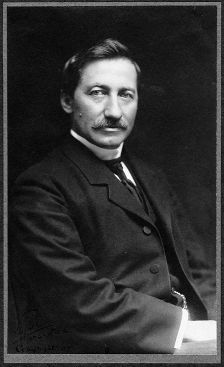
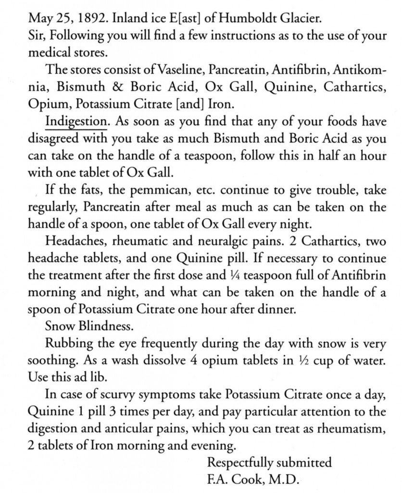

## Frederick Cook, M.D.: What it was to be a doctor in 1890

In too many instances modern interpretations of history ignore the true context of events. Individuals’ attitudes and actions are today often criticized or condemned because they do not conform to current thinking on social or moral norms. But to treat the past as if it were the present, completely distorts history and thwarts an understanding of the past as it was actually lived. Even the simple fact that Frederick Cook was a medical doctor must be put in the perspective of his own times without the intervention of current attitudes and expectations. Otherwise, without any historical context, many might ascribe attributes of social status or character now associated with being a medical doctor to him that would not have applied in Cook’s time.

In 1890, when Cook received his medical degree from New York University, the scientific basis of today’s medicine was barely understood even by its most advanced practitioners, and because of this doctors were hardly held in the high regard they are today. Most of America’s 57 million inhabitants then lived in rural areas, and farmers still far outnumbered laborers. Babies were mostly delivered at home by mid-wives, and outside the cities, hospitals hardly existed. In 1889 there were only 700 hospitals in the whole nation, and there were only fifteen nursing schools. Even in metropolises like Boston, hospitals were places where only the working poor, indigent or the insane received institutional care. The rest, from the middle class up, were treated at home, usually by a relative, or at best by someone who had some “medical” experience, perhaps during the Civil War. If a community had access to a “doctor,” he was often a self-proclaimed one, with perhaps some experience working with an actual physician. But even then, because there were few regulations on who could practice medicine, that might not be much of a qualification.

Many shunned doctors entirely, and for good reason. As Oliver Wendell Holmes of Harvard’s Medical School said at mid-century, “If the whole materia medica as now used, could be sunk to the bottom of the sea, it would be all the better for mankind—and all the worse for the fishes.” Through much of the 19th Century medical practice included such ancient practices as blood letting and harsh purging of the bowels. These treatments, though given in good faith, were based on misapprehensions of the causes of disease, which were often thought to arise from miasmas or imbalances of the humors within the body. Even Koch’s announcement of the Germ Theory in the 1870s, and his identity of the specific microbes that caused tuberculosis and cholera in the 1880s, and Pasteur’s proof that microbial agents were the cause of such diseases as anthrax were slow to take hold. It was one thing to identify the causative agent, another to discern a cure for the disease caused by it. Tuberculosis remained the number one killer of adults fifty years after Koch’s identification of its pathogen. Lister’s 1867 demonstrations that led to antiseptic techniques to avoid infection of wounds eventually revolutionized the surgical field, but they were also put into practice slowly, and effective antiseptic techniques did not become routine until the mid-1890s.

Despite the growing acceptance of Germ Theory, in 1890 the causes of epidemics of vector diseases like yellow fever, malaria and typhus remained unknown, and the treatments given them were futile. Poor sanitation, filthy, crowded living conditions in the cities and unprotected water supplies led to massive outbreaks of cholera, gastrointestinal and respiratory diseases. Typhoid fever, syphilis, malaria, measles and diphtheria commonly claimed those TB spared. Vaccination as a preventative to infection was limited to small pox, and it was usually employed only during an epidemic. Basically, before antibiotics, doctors had a reliable cure for almost nothing.

Life expectancy at birth was a little over 40 on the average, lowered by the frequency of death in infants and children who died in childbirth, or of measles, diphtheria, diarrhea, croup, pneumonia or scarlet fever. Those who survived past 40 could, however, expect to live on average to 65. But compared to today, few lived long enough to die of degenerative diseases such as heart disease or cancer.

As a result of the scarcity of rural physicians and a suspicion of their treatments, calling a doctor was a last resort after consulting with family, friends or perhaps a general storekeeper with a stock of patent medicines that often contained dangerous compounds such as arsenic, antimony, mercury or opium, or reliance on tonics whose only active ingredient was alcohol. There were no pure food and drug laws until 1906, and little regulation of drugs, either over the counter or prescription medications. Pharmacists actually competed with doctors in that they were allowed to fill any prescriptions once issued to a patient over and over, leading to sometimes inappropriate self-dosing.

Most state licensing laws did not come into force until the end of the 1880’s, and even then the best educated medical doctors had invested relatively little time in training compared to modern standards. A medical degree could be obtained in three years and the coursework consisted mainly of attending abstract lectures with little or no bedside or laboratory training. Entrance requirements consisted of being of “good moral character” and being 21 years of age. There were no formal educational requirements beyond grammar school. Dr. Cook’s course work at New York University was typical: two winter lecture series lasting six months each and a course in practical anatomy followed by passing written examinations in surgery, chemistry, practice of medicine, materia medica, anatomy, physiology and obstetrics. Practical examinations on a cadaver and demonstration of urinalysis competency were also required.

Their low standing placed most physicians outside of cities in a cash-strapped position. It was considered ordinary to carry at least 30% of owed bills on a deferred, “ability to pay” basis, and to accept in-kind payments in goods and services in lieu of cash. Even in the big cities pay for doctors was not high. In 1909 the average general practitioner in New York City earned $1,300 a year. In modern buying power that would amount to about $30,900 today. A common labor averaged about $500. Cook, like most other doctors of his time, had to work hard to establish a practice and struggle to retain the patients he did attract.

Cook felt it necessary to take a further private course in medical diagnosis after graduating. With little understanding of the underlying causes of disease, diagnosis lay at the heart of being a successful doctor in Cook’s time. Such aides as X-rays, electrocardiographs and diagnostic tests beyond urinalysis all lay in the future. The ophthalmoscope and laryngoscope were then considered the tools of specialists, and even the use of the stethoscope and the thermometer was not yet universal. Clues to the nature of the patient’s illness had to be obtained by sight and touch. As such, observational skills were critical. A doctor’s reputation and credibility rested squarely on his diagnostic and prognostic skills, which may account for Dr. Cook’s success as a physician. He was an acute observer.

The effective medicines the doctor prescribed were limited as well, and as already alluded to, often contained dangerous compounds. Few were without side effects or long term consequences. For pain or diarrhea concoctions containing opium, such as laudanum, were useful. Digitalis was prescribed to manage certain heart irregularities; quinine exerted an effect on malaria. A new drug, acetylsalicylic acid, later commonly called by its trade name, Aspirin, was found effective against fevers and rheumatism. Belladonna was used to treat asthma, whooping cough and cardiac disease; mercury compounds were commonly used against syphilis. Tincture of iodine was a common disinfectant. But like today, most patients equated being given a medicine with proof that something tangible was being done to address their ailment, and doctors of Cook’s time routinely carried a supply of sugar pills when they knew they had nothing effective to offer beyond satisfying this psychological need.

In Cook’s day, as did the ancients, physicians still considered environmental factors to play a large role in the onset and progress of diseases and sought to control them, for example, advising TB patients to move to a dry climate. The use of diet, tonics, and wines as “blood stimulants” were also considered part of good practice.

A glimpse into Cook’s use of the medicines at his disposal in the context of the knowledge and practice of his time can be gotten from the medical advice he wrote out for Peary just before his separation from him on Peary’s attempt to cross Greenland’s icecap in 1892:

The invention of anesthesia using ether, chloroform or nitrous oxide, had made pain-free surgery possible, but major operations, which were usually performed outside of hospitals, remained rare due to the ongoing obstacle of post-operative infection until it was controlled through antiseptic technique. So the term “surgeon” by which Cook was known on the arctic expedition with Peary and with de Gerlache’s Belgian Antarctic Expedition, should not be equated with the common understanding of the term today. Cook was not trained or qualified to handle more than would be considered “minor” surgery today.

With such limitations of effective treatment and diagnostic technologies, the ability to inspire confidence in the patient and assure him he would recover was recognized as one of physician’s most powerful tools, and the “bedside manner” displayed by a doctor was often the determining factor in the selection and retention of a physician by prospective patients. In this area Cook was at a great advantage. His always cheerful, non-fussy, and compassionate behavior was noted by everyone who knew him. While other doctors so jealously guarded against losing their patients to other practices that they rarely took time off or entrusted their care to another doctor for even a short time, Cook was absent on his exploring adventures years at a time, yet when he returned his patients always came back to him.

The patient’s impression of Cook can be sensed from a quote by Admiral Winfield S. Schley, the hero of the Battle of Santiago in the Spanish-American War, that appeared in the *Los Angeles Times* on September 23, 1909, shortly after Cook returned to America from the Arctic and his claim to have been to the North Pole and his general veracity was being questioned. “Dr. Frederick A. Cook was for two years my wife’s physician,” said Schley. “I saw him two or three times a week, and we chatted many hours. If I have ever known a man of integrity, probity, sincerity and modesty, it is Dr. Cook.”

The astute perception of human psychology that made Cook able to nearly carry out the most audacious circumstantial geographical hoax ever attempted was just as instrumental in his success as a physician. He understood that “the passions” and psychological factors were often as important in medical recovery as actual treatment of illness in his time. He was ever encouraging to his patients as, for example, in alleviating the depression now known as Seasonal Affective Disorder that ran rampant among his shipmates during the first overwintering within the Antarctic Circle aboard the *Belgica*.

As Roald Amundsen, who was the *Belgica*’s second officer, attested in his book *My Life as an Explorer*: “It was in this fearful emergency, during these thirteen long months in which almost the certainty of death stared us steadily in the face, that I came to know Dr. Cook intimately. He, was the one man of unfaltering courage, unfailing hope, endless cheerfulness, and unwearied kindness. When anyone was sick, he was at his bedside to comfort him; when any was disheartened, he was there to encourage and inspire. And not only was his faith undaunted, but his ingenuity and enterprise were boundless.”

His acute powers of observation led him to correctly conclude that a major contributing factor was a lack of sunlight during the Antarctic winter and led his to prescribe a crude form of light therapy, placing them before an open fire as a substitute. He also set an example and always found words to give them hope, the best medicine of all.

This understanding of human nature and the power of the mind over the body was enhanced by his contact with primitive cultures, such as that of the Greenland Inuit, where he observed the power of the native shamans to distract, comfort and sometimes “cure” their “patients” solely by elaborate ritual practices that convinced them they would recover.

Only with all this in mind, can we have a truer picture of Cook’s actual status in his time and avoid the pitfalls of “presentism” and avoid judging the past by modern standards and experience, which would impute to him a much higher status than he actually enjoyed and that his professional training had endowed him with intellectual achievement and scientific acumen that under its then comparatively sketchy requirements he did not necessarily possess. It also avoids the assumption that being a doctor conferred on him a high degree of ethics and moral standing that many now impute to his profession and so would make him less vulnerable to resorting to deceit and dishonesty.

This survey of the state of medicine in Cook’s time is largely based on the article “What it was like to be sick in 1884,” by Charles E. Rosenberg, that appeared in *American Heritage*, volume 35, number 6, published in 1984.

The quotation from Cook’s medical instructions to Peary can be found among the records of Peary’s first Greenland Expedition of 1891-92, which are part of the Peary Family Collection housed at the National Archives and Records Administration II, College Park, MD.

