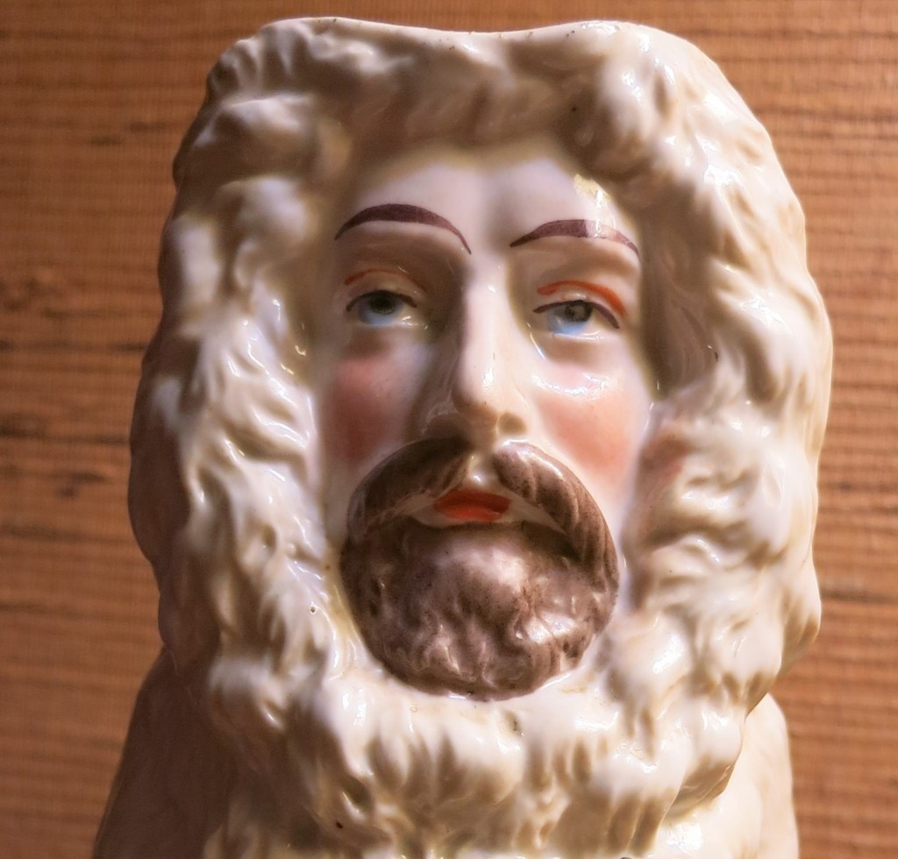
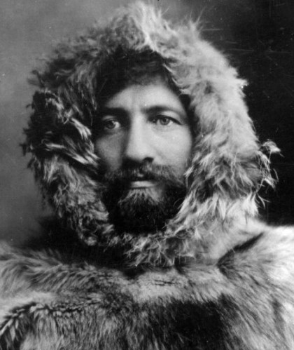
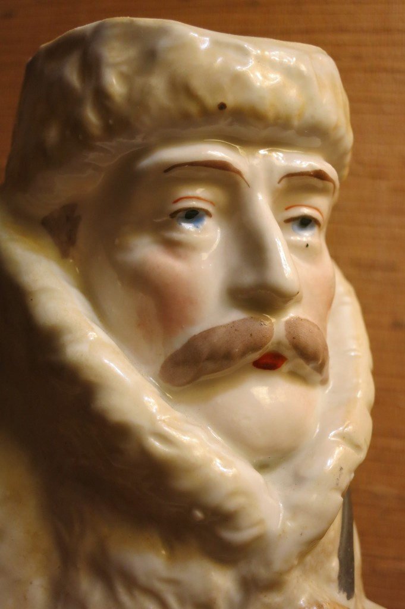
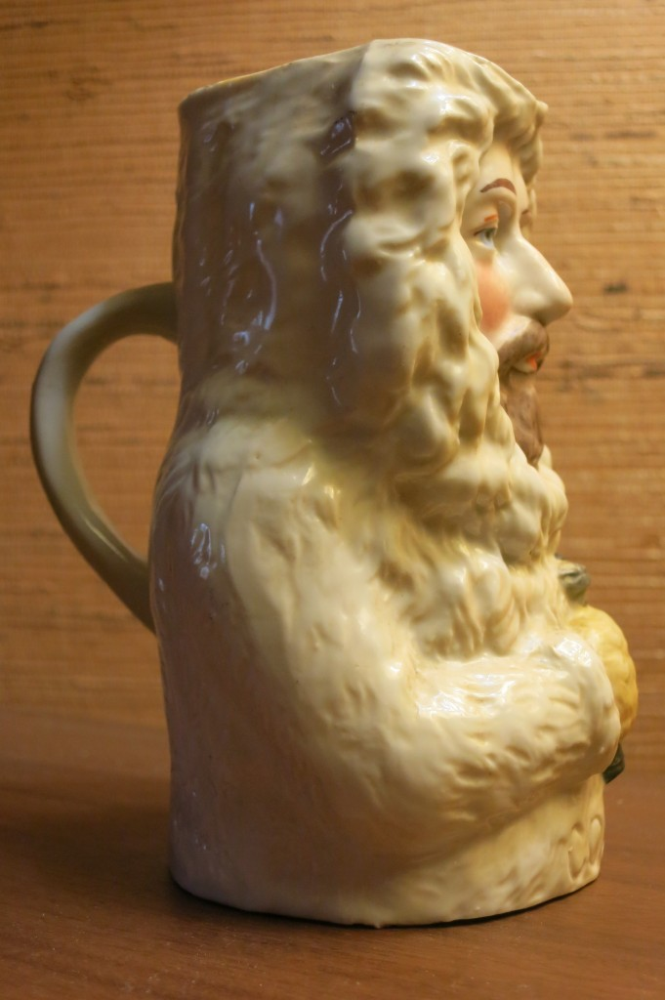
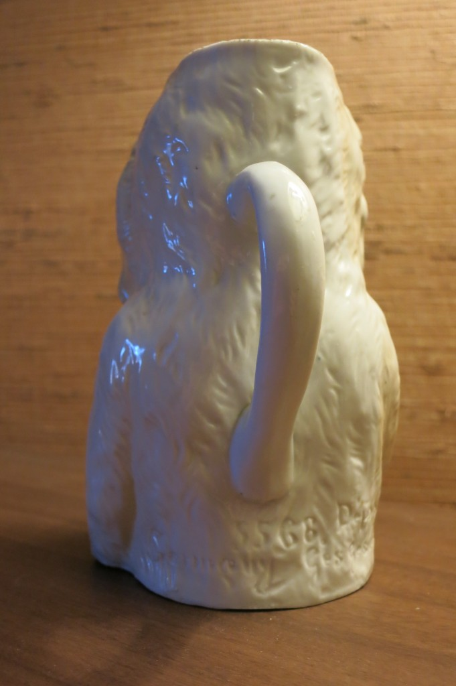
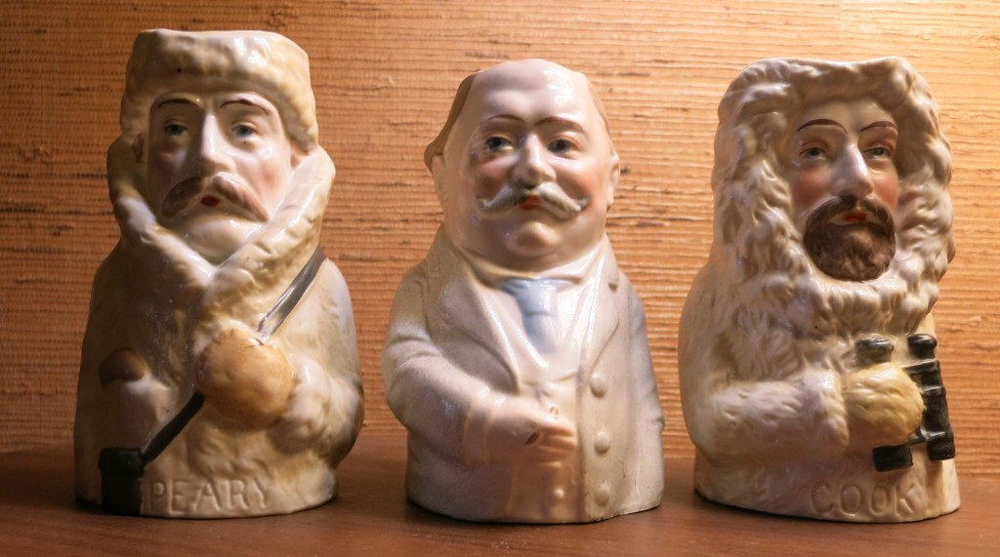

## Dr. Cook Artifacts 4: The Portrait Mug

January 17, 2022

Among the handsomest items that was marketed in the wake of the Cook-Peary dispute were small portrait mugs of the explorers made in Germany. Germany was the leading exporter of inexpensive bisque and decorative pottery items at the beginning of the 20th century.

The mugs are made of glazed pottery and hand decorated. The one of Dr. Cook is based on a widely published photograph of him from 1894. It shows him in a fur outfit, fully bearded. The mug shows his right, mitted hand holding a pair of binoculars. At its bottom it has “COOK’ inscribed in block letters.

The Peary mug is based on a photograph taken about 1898 showing him in a seal-fur hat and fur coat.  He has a small pouch strapped across him which he is clutching with his left hand, and a curved brown object in his pocket. Just what this object is supposed to represent is not obvious. “PEARY” is inscribed at the bottom.

Each mug stands about 5 inches tall and is about 4 inches at the broadest. They hold about 10 oz. of liquid. That these two were issued as a pair is not only obvious from their common design but from the positioning of the arms so they can be stood next to each other in a balanced array.

The back of the mugs have the inscription “Germany” and a style number. The Cook mug is #5568 and the Peary #5569. They also say “Déposé” and “Ges. Gesch;” “depose” means “deposit” in French; “gesh” is an abbreviation for Geschützt, which means “protected” in German. Both are similar to “Copyright” in meaning, and might be translated as “legally protected.” No maker is indicated.

There is a similar portrait mug of William Howard Taft. Whether it is directly related to the explorers’ mugs is doubtful. It’s style number is #5440, indicating it was made in advance of the ones of Cook and Peary. Taft assumed the presidency on March 4, 1909, six months before the start of the Polar Controversy, so the mug was probably issued to commemorate Taft’s inauguration. The close similarity in style and coloring indicate that Taft’s mug was issued by the same company, however. Instead of just saying “Germany” on the back, it says “Made in Germany Ges Gesch 5440 Déposé.”

Although probably unrelated to the Cook and Peary mugs, the Taft makes a fine show standing as a buffer between the two rival explorers.  Considering the relative frequency the Peary comes onto the market compared to the Cook indicates that the Cook mug is far, far more scarce.

]