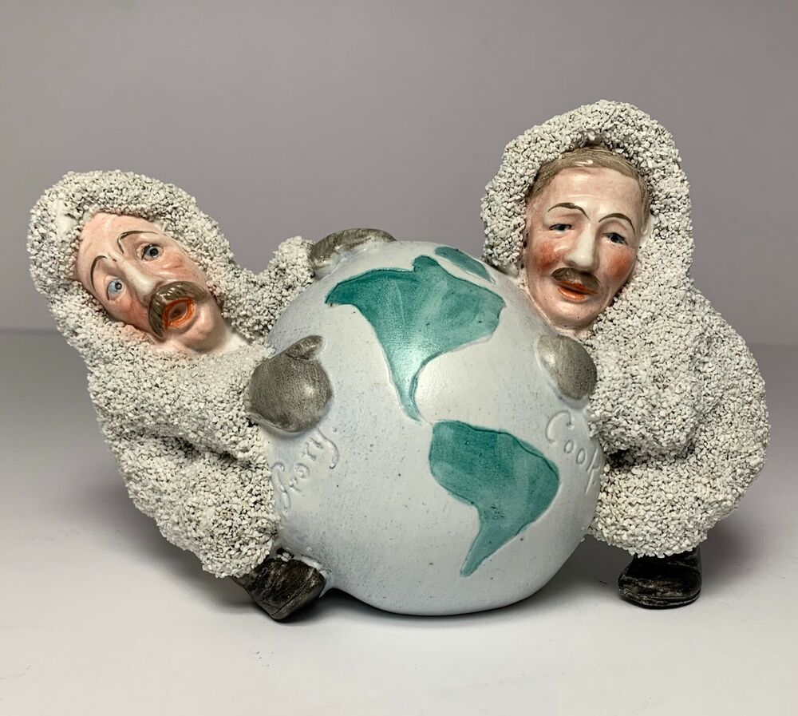
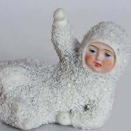
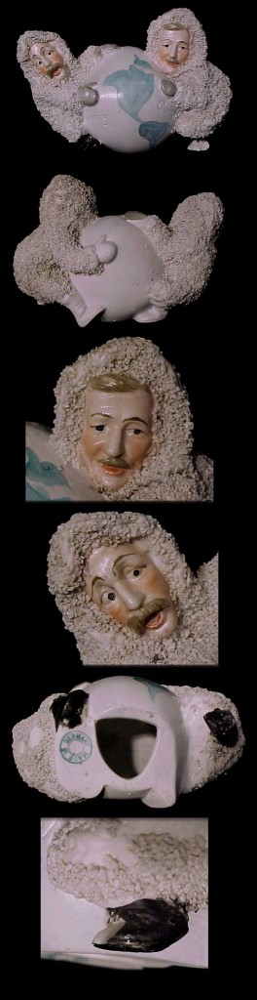
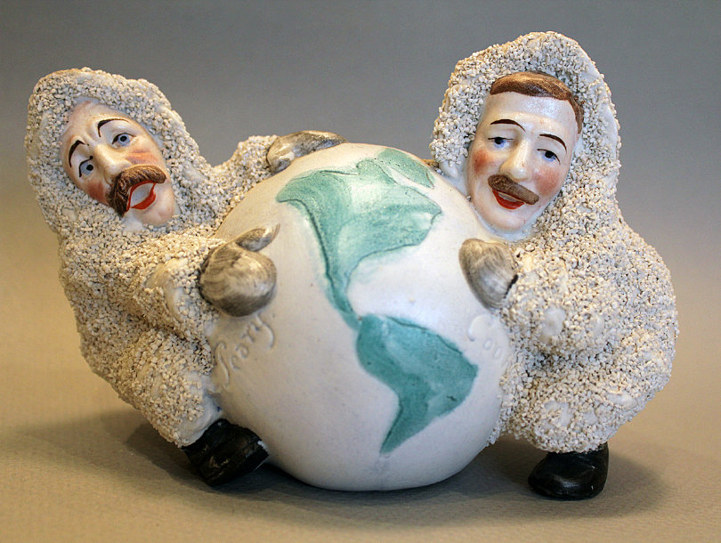
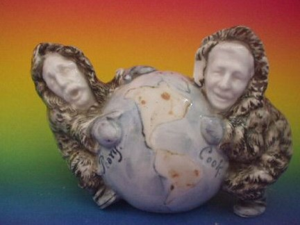
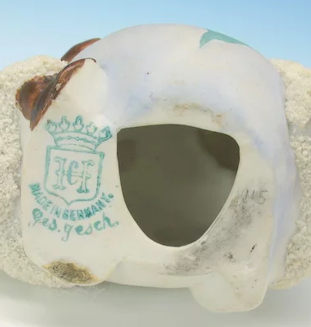
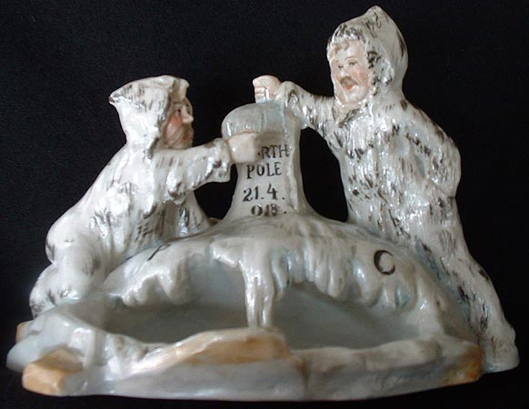
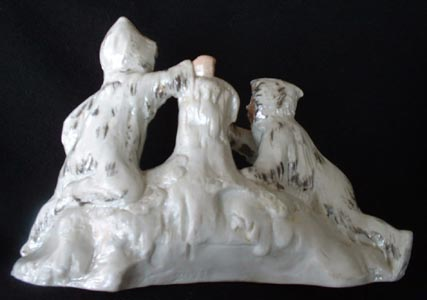
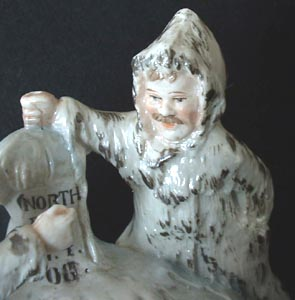
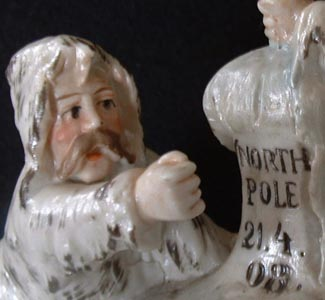

## Dr. Cook Artifacts 6: The Cook-Peary Figurines

Happy 113th Anniversary of Dr. Cook’s non-arrival at the North Pole.

Of all the souvenirs that were marketed in the wake of the Polar Controversy, perhaps the most artistic are the porcelain items produced in Germany, then a leading exporter of such wares. The two character mugs have already been highlighted in the February 2022 post of this blog. Two other pieces symbolize the struggle between the two claimants for first rights to the North Pole.

The first is a figurine showing the two explorers gripping a world globe from opposite sides. Cook, on the right, wears a confident smile, while Peary on the left seems to be throwing his head back, mouth open, howling in outrage. The explorer’s name is written below each figure’s outstretched arm on the globe.

The suit of each explorer is covered with tiny porcelain grains, which has led many to confuse this piece with the later, so-called “snow babies” of the 1920s, which use a similar decoration technique.

Here is a strip of photos showing the figurine from all sides and in detail.

The piece is found in two sizes; one is 3.75 inches x 5.5; the other is 4.5 inches by 6.25. Whether these are both original 1909 figures is not certain. One or the other may be a later copy. That there are later copies is suggested by the wide difference in the quality and color of the painted decoration on this figurine. All of these German porcelain exports were hand painted before firing, but in the portrait mugs these decorations are much more uniform in color and quality. Several specimens are shown here to illustrate this point. I suspect the cruder looking pieces are not originals.

At least one specimen exists that does not have the granular coating on the explorers fur suits and the faces are not decorated, but left plain white. This piece allows an appreciation of the care taken to realistically reproduce each of the explorers facial features on this item. Cook’s face, for instance, even takes into account the droop in his right eyelid, that gave his face an asymmetrical, quizzical expression.

This figurine has been incorrectly ascribed to Gebruder Heubach, a German porcelain manufacturer best known for porcelain doll heads. The generic “Made in Germany” maker’s mark on the bottom of the figurine (see above) is the one most commonly encountered, but some bear the mark of Heber and Co., a manufacturer based in Neustadt, Bavaria, Germany. Heber not only produced doll heads, but also a wide variety of other porcelain wares as well.

This piece is fairly common, falling somewhere between the Peary portrait mug, which is more common, and the Cook portrait mug, which is much less common.

Scarcer still is another little known piece. It shows the two explorers in fur suits reaching for a pinnacle of “ice” labeled “North Pole.”

The fact that the inscription is in English shows this piece was intended for export. The explorers are not identified by name as they are on the first piece, but are merely indicated by a large “P” for Peary on the left and “C” for Cook on the right. Like the first, that this piece also favors Cook’s claim over Peary’s is indicated by the date on the “North Pole” as 21.4.08 = April 21, 1908, the date Dr. Cook claimed he attained his goal. Below the figures is an “ice cave” which indicates the piece may have been designed as a pin or trinket holder.

The back of the piece bears the style number near the base. The painted decoration is sparse beyond the faces, consisting of black dabs to the fur suits and several tan “rocks” below the opening of the snow cave.

The faces are less true to the explorers actual features than the previous piece, but make each recognizable. The position of the hands indicate that each of the explorers originally grasped a small flag. Peary lifts his toward the “Pole,” only to find Cook has his firmly atop the Pole already.

Again, Cook looks confident, while Peary looks dismayed. Although born in New York, Cook was a pure German, the son of two recent immigrants, so naturally he would be favored in Germany over Peary.

]