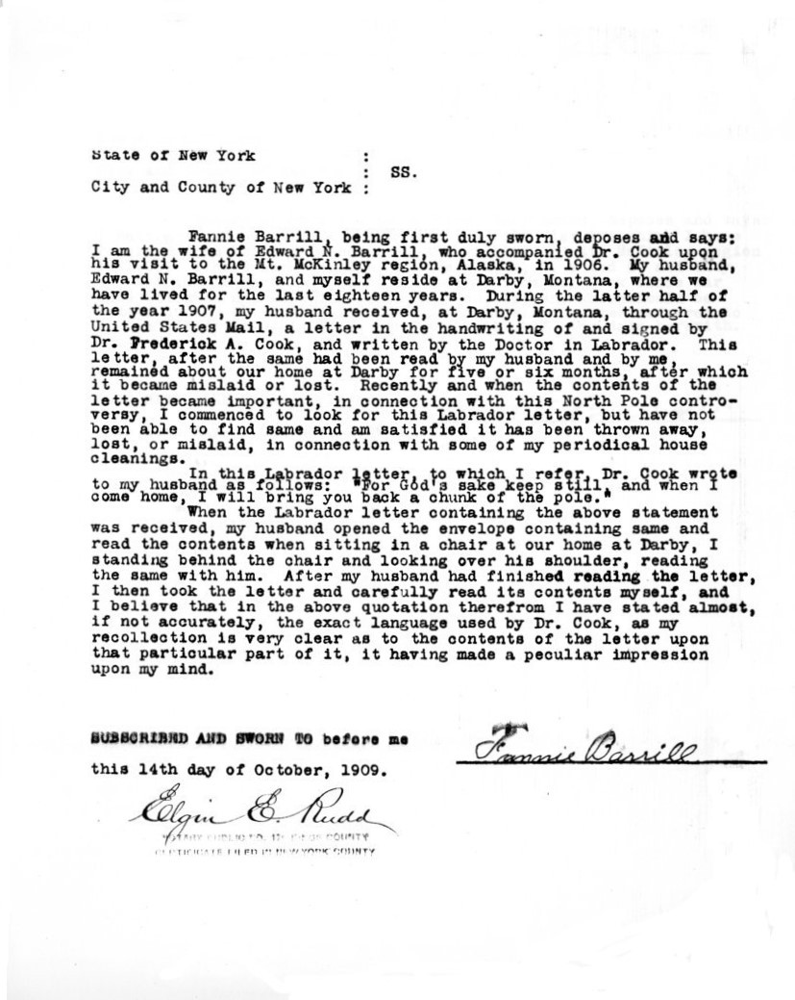
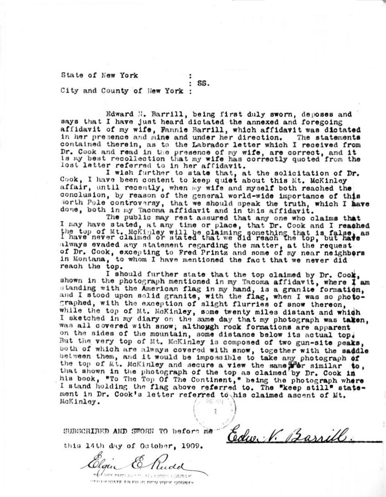
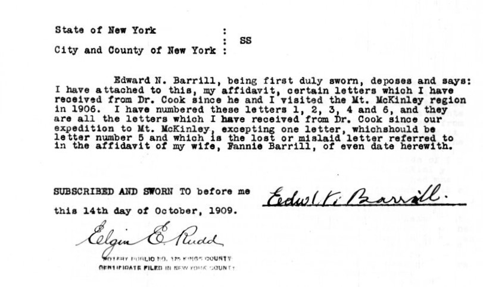
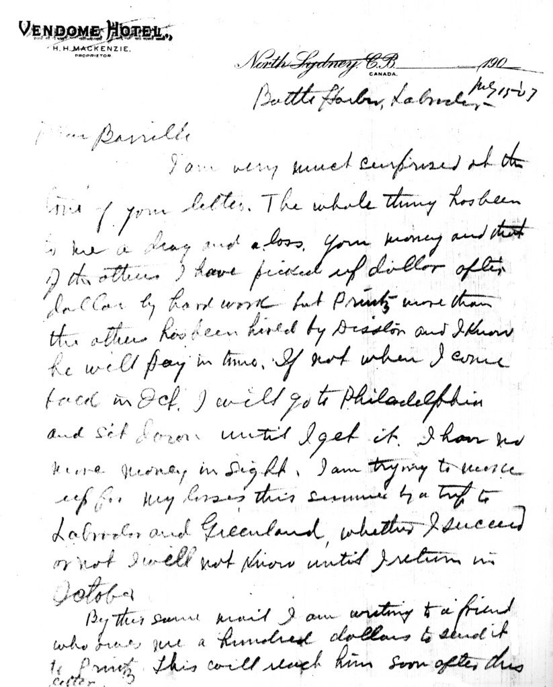
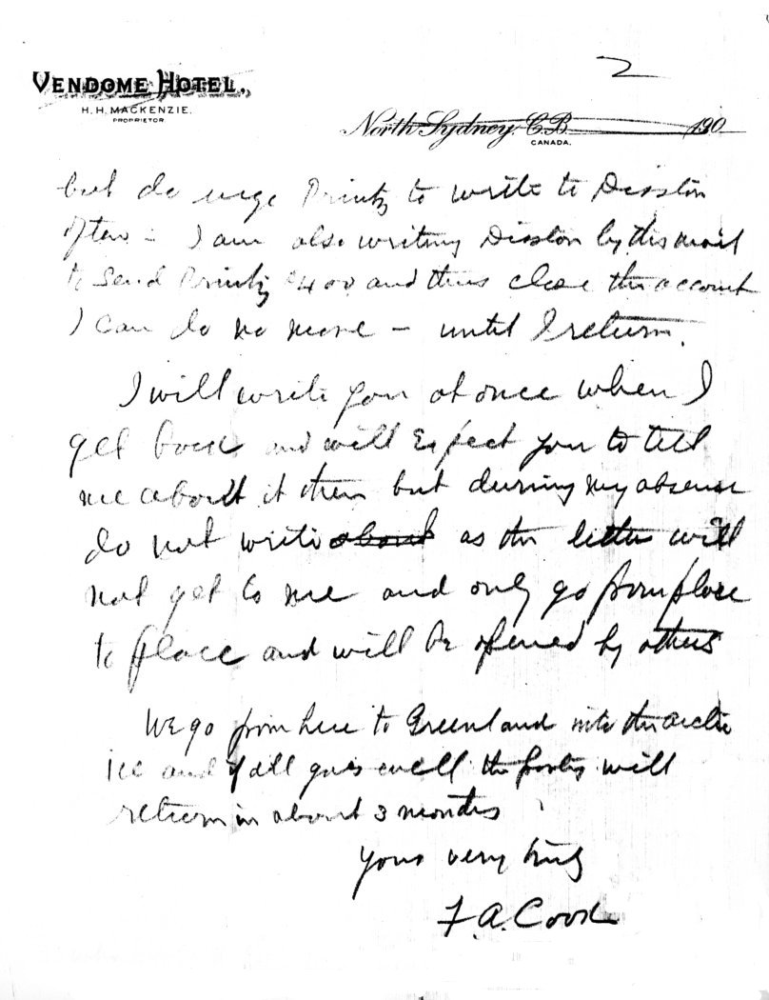

## The Cook-Peary Files: The Barrill Affidavit Part 3: The “chunk of the Pole” letter

*This is the 20th in a series examining significant unpublished documents related to the Polar Controversy.*

During the Barrills brief visit to New York, they swore out additional affidavits on October 14, 1909, concerning a letter Fanny claimed her husband had received from Dr. Cook, sent from Labrador in July 1907, but which had been misplaced. In their separate affidavits, each claimed the letter in question had promised Barrill “a chunk of the Pole,” and in Ed Barrill’s, if only he would “keep still” about Cook’s Mount McKinley hoax. Here are those two affidavits, published here for the first time:

A third affidavit was sworn by Ed Barrill the same day saying that he had received six letters from Cook since his return from Alaska, affixing five of them to the affidavit, swearing the one that was missing was the fifth in the sequence and was the one to which his wife made reference in her affidavit.

Ashton and Hubbard were very interested in the recovery of this letter. Once back in Montana, the Barrill’s looked high and low and eventually found it. This is what it said:

July 15, ‘07  
Battle Harbor, Labrador

Dear Barrille  
I am very much surprised at the  
tone of your letter. The whole thing has been  
to me a drag and a loss. Your money and that  
of the others I have picked up dollar after  
dollar by hard work but Printz more than  
the others has been hired by Disston and I know  
he will pay in time. If not when I come  
back in Oct. I will go to Philadelphia  
and sit down until I get it. I have no  
more money in sight. I am trying to make  
up for my losses this summer by a trip to  
Labrador and Greenland, whether I succeed  
or not I will not know until I return in  
October.  
By this same mail I am writing to a friend  
who owes me a hundred dollars to send it  
to Printz. This will reach him soon after this  
letter.

2

but do urge Printz to write to Disston  
often. I am also writing Disston by this mail  
to send Printz $400 and thus close the account.  
I can do no more – until I return.  
I will write you at once when I  
get back and will expect you to tell  
me about it then but during my absence  
do not write about as the letter will  
not get to me and only go from place  
to place and will be opened by others.  
We go from here to Greenland with the arctic  
ice and if all goes well the party will  
return in about 3 months.

Yours very truly  
F. A. Cook

There is not only no mention of “a chunk of the pole,” but Dr. Cook gives no hint that he has any intention of even trying for the North Pole, instead saying twice that he expects to return in October. But what subject did Cook not want Barrill to write about in a letter that might “be opened by others”?

This must be the letter in question, since it fits in by place and by date with the other five, and it is unlikely that Dr. Cook would write another letter to Barrill from Battle Harbour—the last place visited before leaving for Greenland, from which no mail could be sent—on the same day he sailed for the Arctic. And Barrill himself said there was only one letter missing. Therefore, there does not seem to have been a “chunk of the pole” letter at all.

After reading this letter, in a letter dated November 20, Ashton told Hubbard that “I do not see  much to it,” and that “I have Barrill still searching for that lost paper.”   The letter was never published and, apparently, no other letter was ever recovered by the Barrills.

**The affidavits and Cook’s letter are in NARA II, College Park, MD.**

