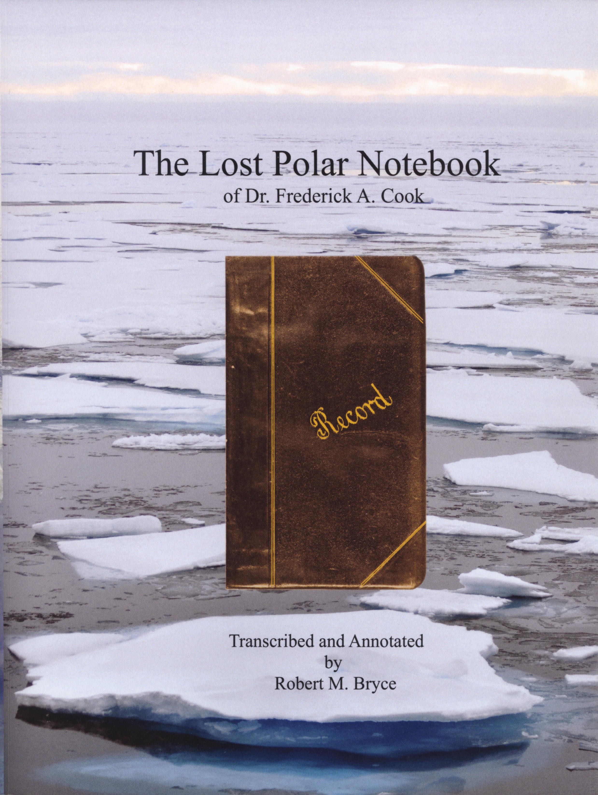
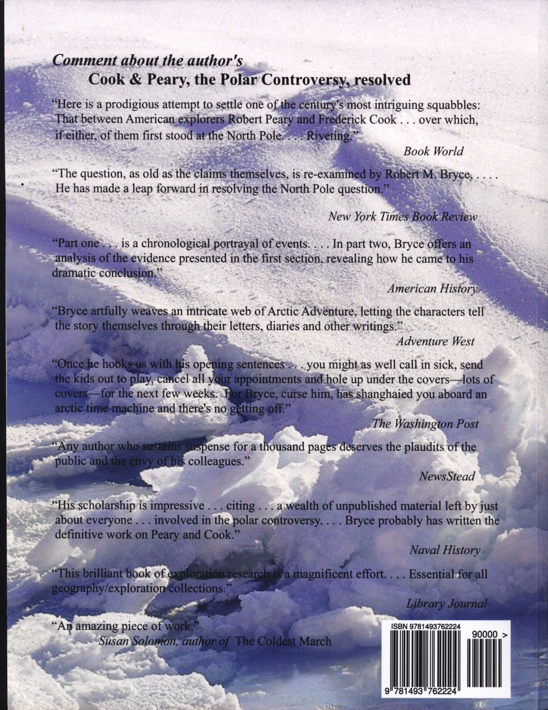

## New edition of The Lost Notebook of Dr. Frederick A. Cook published

July saw the publication of the third edition of *The Lost Notebook of Dr. Frederick A. Cook.* Originally published in 2013, it had one previous major revision done to it in 2018. The new edition has been a year in preparation.

A number of small errors have been corrected, some sections revised to include new information that has come to light since 2018, and the illustrations have been improved and a few new ones added. For instance, at the author’s request digital scans of the letters Cook left at his winter base in 1908 before starting on his polar attempt were obtained from NARA II. These, along with a number of other items in the papers of Robert E. Peary, were restricted and the holographs were not allowed to be handled. The old illustrations, which were made from microfilm copies, have been replaced by these new digital scans. The probable route map of where Cook actually went instead of the North Pole has been revised in light of a study of a number of sources related to the various stories Cook’s two Inuit companions told of their travels with him in 1908-09. Also, all the indexes have been checked for accuracy, as have all of the internal cross references in the book.

The book contains a transcription of every word in a photographic copy of a now lost notebook I discovered in 1993, which had lain hidden away in an astronomical library in Copenhagen, Denmark for nearly a century. It proved to be the actual field diary Cook kept on his 1908 polar attempt. Besides the transcription, the book contains a careful, detailed and documented analysis and annotation of each page, which proves, absolutely, that Cook could not possibly have attained the North Pole in 1908, as he claimed. The detailed annotations also provide many hidden connections and insights into the notebook’s context and significance that were only possible after the author’s decades of study of this subject.

Cambridge University’s prestigious journal, *The Polar Record*, published pre-publication extracts from this book in 2013, and *The International Journal of Maritime History* had this to say of it the finished book: “The meticulous transcription of Cook’s often virtually unreadable handwriting, and the careful analysis of the order of the various layers of text included in the notebook are achievements in themselves, and serve to make this invaluable source readily available to the researcher for the first time.”

The book, which is 425 pages long and contains 200 illustrations, including images of all of the notebook’s pages, is a must for all serious students of the Polar Controversy. It is available on Amazon.com, but the least expensive way to obtain a copy is on eBay. Recently, the cost of printing the book, like everything else, increased, causing the price of the copies available on eBay to go up in response. A copy can be obtained there for $44.95 postpaid. 

