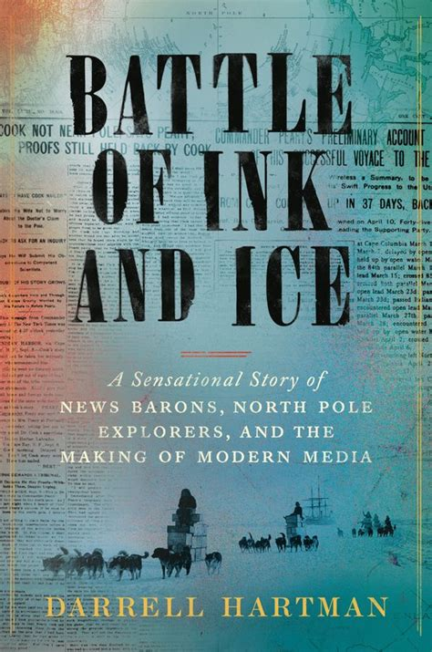
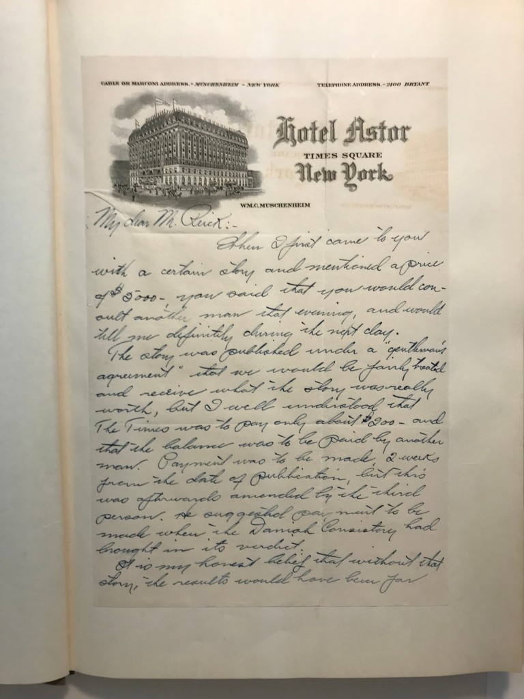
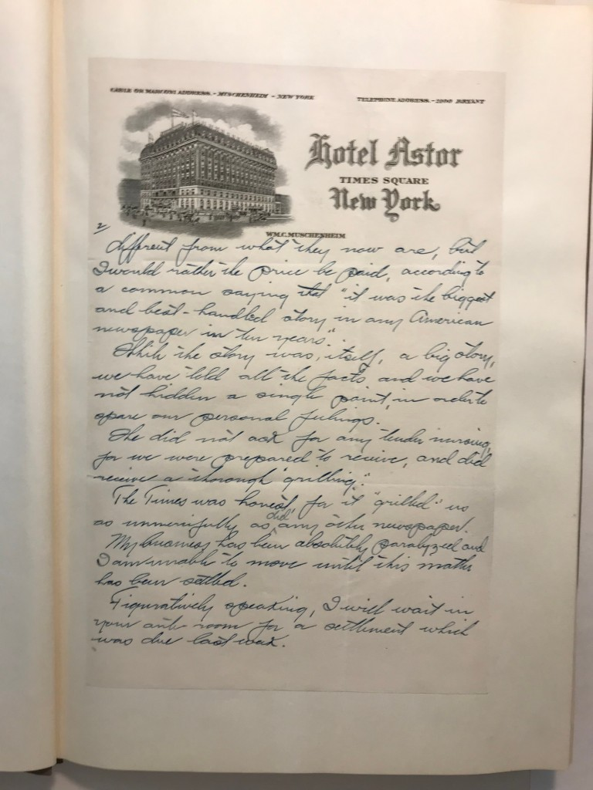
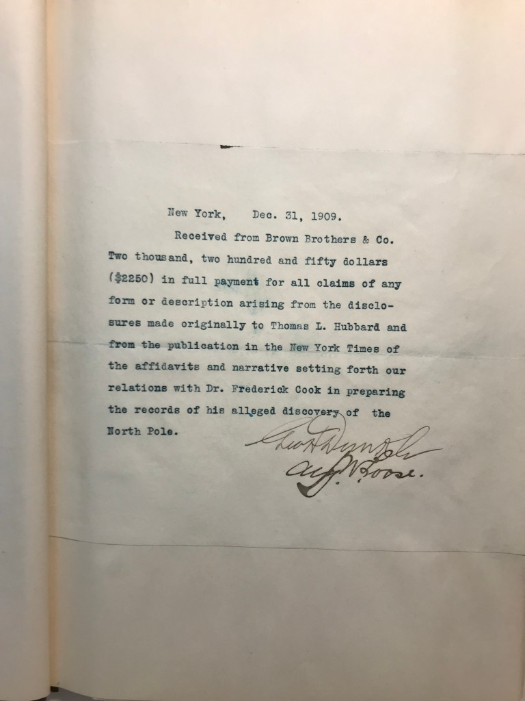

## Dunkle and Loose get paid

*This is the latest in a series of posts that publish for the first time significant documents related to the Polar Controversy.*

In the latest book on the Polar Controversy, author Darrell Hartman focuses on the Press’ role in making the 1909 dispute between Cook and Peary a national obsession. He agrees with me that the resultant recognition of Robert E. Peary as the true discoverer of the North Pole, and the demise of Frederick Cook’s prior claim, was a watershed event in the history of New York newspaper publishing. Peary was backed by the *New York Times*, Cook by the then much more influential *New York Herald*. As I put it in my book, “the downfall of Dr. Cook marked the beginning of the rise of the *Times* to the powerful institution it was to become, and the decline of the once preeminent *Herald* into oblivion.”

Among the questions I was not able to answer in my book, *Cook and Peary, the Polar Controversy, resolved*, was whether or not Dunkle and Loose acted on their own, or were someone’s paid agents, hired to place the doctor in a compromising position (see my post for May 21, 2022 below). I was able to speculate from the evidence I saw, however, that if they were someone’s agents, as I wrote in my book, “The principal suspect would have to be William C. Reick,” an editor at the *New York Times*, the paper in which appeared their extensive affidavits about how they concocted fake observations at Cook’s request to serve as proof of his polar attainment. The affidavits were spread over nearly three full pages—by far the largest amount of space given a single story on a single day during all of 1909.

To many who read the Dunkle and Loose affidavits, the whole idea that Cook would enter so casually into so dangerous and risky an arrangement with total strangers seemed preposterous, the alternative monstrous and the conclusion obvious. As one newspaper editorialized; “Dr. Cook is either the greatest and at the same time the stupidest charlatan who ever attempted to impose upon a skeptical world, or he is the victim of the most malignant and devilishly ingenious persecution that hatred and envy could devise.”

Reick had a motive: he wanted to get even with James Gordon Bennett, the flamboyant owner of the *Herald*, where Reick had once been the powerful City Editor. But Bennett, ever wary of competitors for his absolute power over the *Herald*, kicked him upstairs by making him President of the New York Herald Company. Reick eventually quit and joined the *Times*. Among the many resources Hartman consulted for his book, were those in the New York Public Library, among them the papers of Adolph S. Ochs, long time owner of the *Times*. There he may have found at least a partial answer to whether Dunkle and Loose acted alone, or they were part of a larger plot.

General Thomas H. Hubbard (via a brevet commission from the Civil War), was the owner of the *New York Globe and Commercial Advertiser,* as well as the president of Western Union and a powerful corporate lawyer. He was also an alumnus of Bowdoin College in Maine, Robert E. Peary’s alma mater, and had been since 1908 president of the Peary Arctic Club, a group of millionaires formed in 1898 to bankroll Peary’s attempts to reach the North Pole. When the dispute between Peary and Cook over priority at the Pole broke out, Hubbard quickly grasped that Peary was not capable of managing the situation and became Peary’s official spokesman. He also financed a massive anti-Cook campaign, paying for such things as the Barrrill Affidavit, the Parker-Browne expedition to Mt. McKinley (see my post for July 17, 2017 below), and later, an extensive mail campaign to discredit Cook’s attempts to rehabilitate his claim to have reached the North Pole a year ahead of Peary. It now develops that he apparently also paid for the Dunkle and Loose Affidavits as well, though it does not seem to have initiated the scheme that led up to them.

That Cook had dealings with Dunkle and Loose there can be no question. Several close associates, including his private secretary, Walter Lonsdale, attested to that as a fact, but considered Cook’s dealings with them essentially innocent. But whether this scheme was the sole initiative of Dunkle and Loose, or that they were put up to it by a third party as a plot to destroy Cook’s claim by raising doubts in the minds of the panel just about to sit in judgment of the authenticity of his claim, as many newspaper editorials of the time suggested, is possibly answered by two documents Darrell Hartman recovered. Though not definitive, they strongly suggest that Dunkle and Loose initiated the plot themselves, figuring whichever way events might fall out, they would come out ahead.

I first learned of these documents during consultations Darrell Hartman had with me while in the final stages of preparing his book for publication.

The first document is a letter from George W. Dunkle to William C. Reick. Here is that letter, published for the first time with the permission of the New York Public Library:

Although unsigned, the handwriting is Dunkle’s. The content also confirms he is the author. In it he states “My business has been absolutely paralyzed and I am unable to move until this business is settled.” Dunkle was an insurance agent who lost his job due to the publicity surrounding his sensational affidavit.

According to his affidavit that appeared in full in the *New York Times* on December 9, 1909, Cook entered into an arrangement with Dunkle to pay him $2,500 for a set of fake celestial observations, to be provided by an indigent Norwegian sea captain named August Loose, “proving” that Cook had been at the North Pole on April 21, 1908, as he had claimed. Another $1,500 was to go to the pair if Loose’s calculations convinced the board of scientists of the University of Copenhagen, to which Cook had promised his data, and which was about to sit in judgment of his “proofs,” that his claim was authenticated by the evidence provided them.

In his affidavit, Dunkle said Cook reneged on his agreement and only paid him $260 before he broke off negotiations and checked out of his hotel without leaving a forwarding address. When his “proofs” were presented to the Consistory in Copenhagen by Cook’s private secretary in late December, they did not contain the observations Loose allegedly provided, however. In fact, they contained no observations whatever, and on that basis, the Danes rejected what Cook submitted as proof of his attainment of the North Pole.

Dunkle certainly must have seen that once he had broached his offer to Cook and Cook had entered into dealings with him, that he was in a can’t-lose position. If Cook went trough with the arrangement, and the Copenhagen panel was convinced by Loose’s calculations, he and Loose stood to make $4,000. If Cook backed out or refused to pay, they still had valuable evidence that they could peddle to the New York newspapers, the obvious first choice being the *New York Times*, which had exclusive rights to Peary’s first account of his North Pole journey and an editor who had a visceral hatred of his former boss at the *Herald*, which had the exclusive right’s to Cook’s account. Still, that does not preclude that this scheme was not part of a larger plot.

However, while the two documents don’t disprove Reick’s prior knowledge of Dunkle and Loose’s scheme, they strongly imply that once Reick was approached by Dunkle with his story after Cook reneged, that Reick then went to Thomas Hubbard, and it was his guiding hand, as it had been in all matters concerning the Cook-Peary dispute, that resulted in the eventual appearance of their affidavit in the *Times*’ columns. That Reick did not have prior knowledge of the scheme is also suggested by a letter I recovered from the Peary Family Papers at the National Archives, asking Peary for a sample of Dr. Cook’s handwriting, apparently to compare with what Dunkle claimed was Dr. Cook’s instructions to Loose as to what he needed in the way of fake observations, which was published in facsimile along with the Dunkle and Loose affidavits. This note to Peary was dated December 6, 1909, which would have been after Cook had checked out of the Hotel Gramatan, where his dealings with Dunkle and Loose were alleged to have taken place. Reick had previously cabled Peary on December 3 that he had “what I consider most important development yet,” suggesting that was when he was first contacted by Dunkle.

It is not stated in Dunkle’s letter to Reick who did the “grilling” it mentions. It’s true that many other newspapers noted with suspicion that this “scoop” appeared in the most anti-Cook of all newspapers, which had a vested interest in seeing Peary declared the victor in the ongoing dispute, but Dunkle’s statement that the *Times* also “grilled” him and Loose is certainly not applicable to what the *Times* printed. It is also doubtful that William Reick did any personal grilling, because the person to be satisfied that the story the *Times* was given by Dunkle was truthful in every respect was the “third man” paying for it, which the two documents Hartmann recovered together certainly point to as Thomas H. Hubbard. This is most forcefully implied by the content of the second document, a receipt and legal release, which states that the details of the affidavits that appeared in the Times were “made originally to Thomas H. Hubbard.” The “grilling” was undoubtedly administered on this occasion.

Hubbard had similarly “grilled” Edward Barrill, Cook’s sole witness to his claim to have been the first to ascent Mt. McKinley in 1906, before he published Barrill’s affidavit in the pages of his own newspaper, which stated that Cook’s McKinley climb was a hoax (see my series of posts on the Barrill Affidavit, beginning on June 13, 2022 below). Barrill had come to New York for that very purpose—to meet with Hubbard personally—and Hubbard managed Barrill’s stay in the city completely, ending it by sending Barrill back to Montana without him ever testifying before a panel appointed by the Explorers Club to look into Cook’s 1906 claim, where he might have said something that would contradict the affidavit Hubbard published.

The letter to Reick, although it bears no date, can be approximately dated from its content. Two weeks after the publication would have been December 23, and it is clear from the letter’s content that the Danes had already made their decision by the time it was written, which was announced on December 21. The letter must therefore have been written after December 23, but before they were paid.

Although the letter still leaves some details hanging, the second document supplies others. It’s a receipt and legal release, dated December 31, 1909, here published for the first time:

**(Note: Brown Brothers & Co. was a private investment bank in NYC. It merged in 1931 to form Brown Brothers Harriman & Co.)**

Its content definitely places the date of the letter before the last day of 1909 and leaves no doubt that they were paid well for their scheme, but perhaps not as well as they might have been. It’s interesting that the letter implies that Hubbard told Reick to withhold payment until the Danes decided on Cook’s proofs, suggesting that the amount Dunkle said he had “a gentleman’s agreement” –$2,000–might have been adjusted, depending on Copenhagen’s decision.

All along, Dunkle and Loose might have intended to play both sides of the street. Even if Cook had paid them a significant amount, or especially if the Danes had accepted Loose’s calculations as Cook’s originals and certified his claim to the Pole, the value of the story would have only increased, because revealing that the calculations that won their approval were Loose’s, not Cook’s, would have been iron-clad proof of Cook’s fakery. They might have then turned around and sold their story to the *Times* for an additional big payday. But Cook never used Loose’s calculations, and, in fact, no one to this day claims to have ever seen them after the face. But neither did he include them, or anything similar to them in the material he sent to Copenhagen in proof of his claim. Therefore, the value of their affidavits to Hubbard was severely diminished, and the final price they received was less than the amount Cook was originally to pay them, according to their affidavit. What they received is equivalent to about $76,500 today.

**The documents shown here can be found at the New York Public Library in the New York Times Company Records / Adolph S. Ochs Papers, Box 77, Folder 3. Darrell Hartman’s book, *Battle of Ink and Ice*, is published by Viking.**

