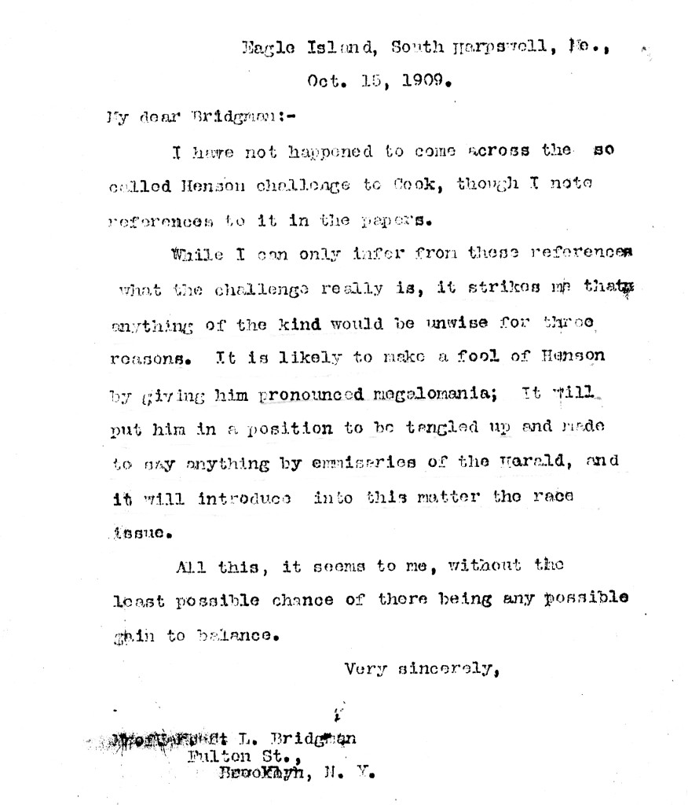
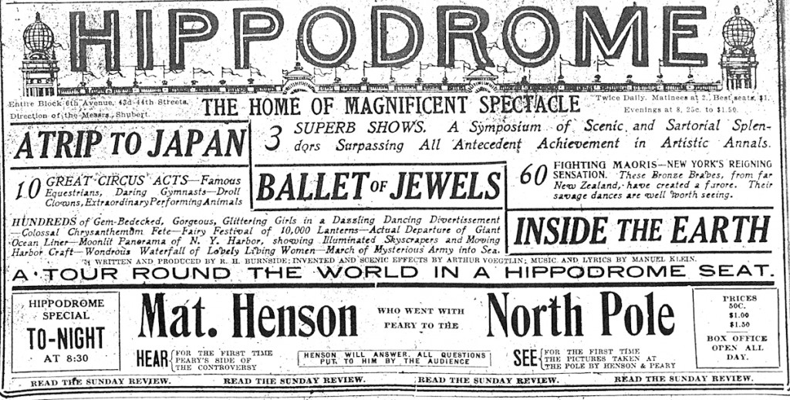
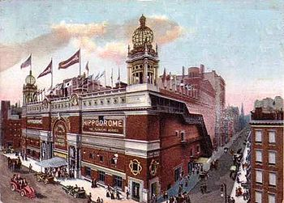
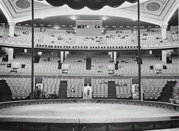
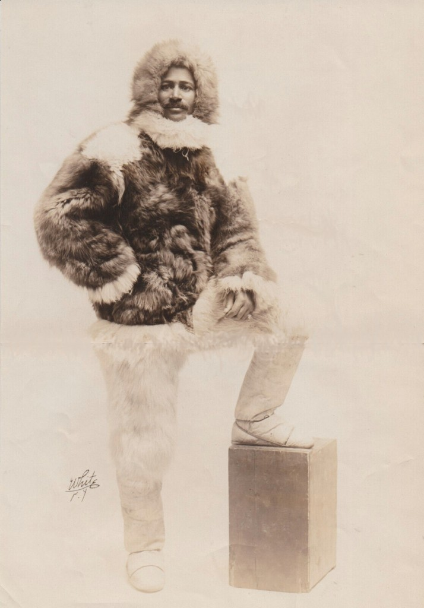
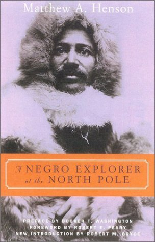

## The Cook-Peary Files: October 17, 1909: ONE NIGHT ONLY!  Matt Henson at the Hippodrome

*This is the latest in a series of posts that publish for the first time significant documents related to the Polar Controversy.*

Peary had given his longtime expedition member, Matthew A. Henson, the cold shoulder ever since their “arrival” at what Peary claimed was the North Pole. Henson reported Peary practically said nothing to him on the return journey and kept his distance once back aboard the *Roosevelt*. The silence continued upon the expedition’s return to the US in September 1909.

Once back in New York, Henson had an offer for a series of lectures from the well-known promoter William A. Brady. Brady had previously tried to land the lecture rights from Dr. Cook and then Peary without success. As a result of Brady’s offer, Henson wrote to Peary asking his permission to accept, and also for copies of some of Peary’s photographs and a lantern slide map of the Arctic to be shown at his appearances. Peary turned him down flat. This prompted Henson to tell Peary why he had decided to accept Brady’s offer anyway, saying, “I have been with you a good many years on these trips and have never derived any material benefits. I am not getting any younger, and it has come to an issue where I have to look out for myself.”

Brady broke Matt in with a lecture at Middletown, Connecticut. It was an awkward performance. Henson had a prepared text, but because he was functionally illiterate\*, his hesitations in attempting to read it had to be constantly prompted from the wings. Finally, he just abandoned his script and simply talked about his 70 stereooptican slides as they were flashed on the screen, including one he claimed to be “the only photograph of the pole in existence,” after which he answered questions from the sparse audience. The receipts in Middletown amounted to less than $37 for two performances. But the appearance still made news.

There were rumors that Henson had challenged Dr. Cook to a public debate. Peary wanted this to be avoided at all costs and seemed to fear what Henson might inadvertently say. He wrote to Herbert L. Bridgman, Secretary of the Peary Arctic Club:

*(”I have not happened to come across the so called Henson challenge to Cook, though I note references to it in the papers*

*“While I can only infer from these references what the challenge really is, it strikes me that anything of the kind would be unwise for three reasons. It is likely to make a fool of Henson by giving him pronounce megalomania; it will put him in a position to be tangled up and made to say anything by emissaries of the [New York] Herald [which was backing Cook’s claim], and it will introduce into this matter the race issue.*

*“All this, it seems to me, without the least possible chance of there being any possible gain to balance.”)*

Peary also strenuously objected to Henson showing photographs made on the journey to the North Pole, claiming that Henson by contract was bound to turn over all of the photographs he had taken to him. He was so concerned about the picture of the Pole itself, that he wired, “If Henson, as newspapers say, has picture of NP, or the sledge journey he has lied to me, and these pictures must on no account be shown by him I doubt the papers.” The dispute with Peary was just the publicity Brady dreamed of, and he was now so sure that Henson’s lecture tour would be a success that he booked him at the Hippodrome for the evening of October 17.

The Hippodrome was billed as the largest theater in the world; certainly it was the largest in the United States. Occupying an entire block on 6th Avenue between 43rd and 44th Streets, it was host to full-fledged three-ring circuses and other monster extravaganzas.

Henson must have been awed to step onto the stage of this cavernous house, which sat up to 5,300. But the paying audience amounted to only about 500 scattered among a vast sea of empty seats.

One of them was occupied by Herbert L. Bridgman, who Peary had dispatched to get a look at Henson’s photographs and generally do damage control if necessary. Bridgman didn’t seem too concerned by Henson’s performance, though he did say some unsettling things, including that Cook’s Eskimos, when they had first come aboard at Etah, had said that Cook had told them they had arrived at the North Pole [see the series “The ‘Eskimo Testimony’” below.]   After this fiasco Brady immediately canceled the two nights he had booked at Carnegie Hall, the turnout at the Hippodrome not justifying any hope for recovering the high overhead of that booking. Instead, he took Henson to Pittsburgh. But there and the farther west Henson went, the receipts continued to dwindle until Brady had to compromise his contract and pay him off.

****

**Matt Henson ready for the stage: Henson’s publicity photograph by White Studio, theatrical photographers**

Nevertheless, Henson’s appearances had led to a number of revealing statements that became fodder in the ongoing Polar Controversy, and the building case against Peary actually having attained the North Pole, himself. Henson related that on the trip to the North Pole, Peary, because of his crippled feet, had been little more than baggage on the sledges, and that because Peary rode most of the way, Henson was in the lead when they arrived at the North Pole, technically making him the first man to have reached that fabled spot.

Peary was outraged, and assured General Thomas Hubbard, President of the Peary Arctic Club, that these and other reported statements were “all lies.” He complained to Benjamin Hampton, owner of Hampton’s Magazine, who paid Peary a record per-word fee for the magazine rights to his narrative, that “Henson, after my looking after him for years, after giving him a position in the advance party with me on all of my expeditions, and after permitting him to go with me to the pole this time, has now for the sake of few dollars deliberately and intentionally broken faith with me.” And to Herbert Bridgman Peary was unequivocal about what such “disloyalty” meant: “He has deliberately and premeditatedly deceived me and broken his explicit and thoroughly understood word and promise to me and I am done with him absolutely.”

\**For those interested in the documentary evidence of this statement, see the Introduction to the Cooper Square Press edition of Henson’s book,* A Negro Explorer at the North Pole*, published in 2001.*  

**All of the quoted correspondence, including the one published here for the first time, can be found among the Peary Family Collection, Record group XP, at NARA II.**

