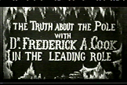
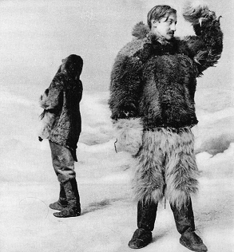
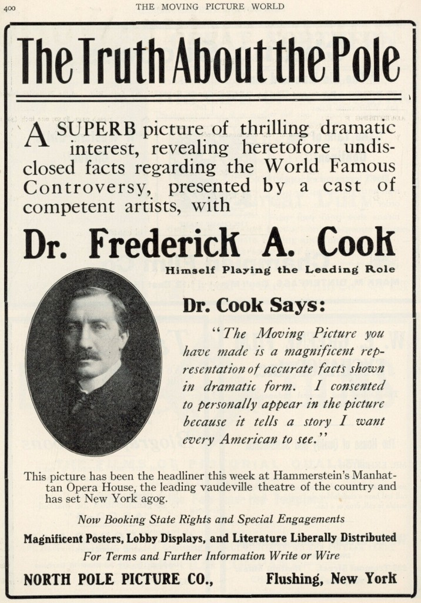
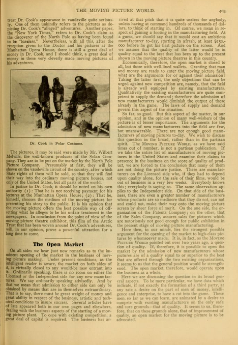
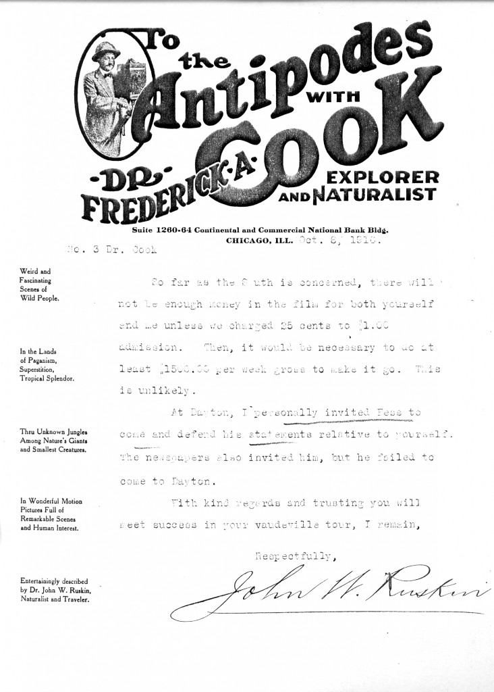

## Dr. Cook Artifacts 7: Dr. Cook at the Movies

Not long after returning to the United States from nearly a year of “exile,” in December 1910, Dr. Cook went to Chicago, then the center of the film industry.

The result was the formation of the North Pole Picture Co. Its production, *The Truth about the North Pole,* in which Cook played himself, was designed to be shown along with planned personal appearances, reasserting that he was the first man to reach the North Pole.

**A publicity photo for Cook’s film**

Once finished, Cook took out a full page ad in the trade publication, *Moving Picture World* to promote it.

In this same issue the film was featured in a two page spread critiquing and publicizing the film.

When I was writing *Cook & Peary* in the early 1990s, Cook’s film had been completely forgotten. I learned of it first from an ad that appeared in the *New York Herald* advertising Cook’s appearance in which he first showed the film at Oscar Hammerstein’s Manhattan Opera House on February 12, 1911. Then while studying the Peary papers at the National Archives I came across a stenographic report of Cook’s performance and a blow by blow description of the film, commissioned by Herbert L. Bridgman, Secretary of the Peary Arctic Club and sent to Peary.

At that time, I then searched for a copy of the film, but failed to find it in any of the archival film libraries in the US. However, when I was  collaborating with BBC producer Tim Jordan on the BBC film *Icemen* in 1998, I was able to obtain a copy from a film footage dealer in California, whose catalog listed it, when the company’s search for it at the BBC’s request came up empty.

Since then, that copy has appeared on the internet, thus entering the public domain. Now, a slightly different, but superior copy has been located in the British Pathe film library, and is available on YouTube. You can view that copy at https://www.youtube.com/watch?v=cliewW\_-4s8

Although this film is now available to anyone, a copy of Cook’s other film, *To the Antipodes*, has yet to emerge. It was the only issue of Cook’s Orient Film Co.,  which he organized in Maine, and was put together from footage shot on Cook’s ‘round the world trip in 1915, which was originally aimed at an attempt to climb Mt. Everest. But because of wartime tensions, Cook, who was of German descent, was suspected of being a possible German agent, and the British refused to give Cook’s party passage through India to  enter Nepal, so he never got near the tallest mountain on earth. As a result, Cook was forced to fall back on a trip to Borneo, instead, where he filmed scenes of local color, including some among the Dyaks, the so-called “Wildmen of Borneo.”

As can be seen from this letter to Cook from John W. Ruskin, a then popular lecturer on natural history subjects who appeared in the southern states to narrate the silent film, the movie was a financial flop and quickly faded as a commercial enterprise. But its promotion had all the elements of Cook’s penchant for advertising aplomb which landed him in Leavenworth Penitentiary ten years later, including the flamboyant letter head of his company’s stationary on which Ruskin broke the bad news to Dr. Cook.  

**The ad and article appeared in *Moving Picture World*, Volume 8, no. 8, February 25, 1911.**

**The letter is in the Papers of Frederick A. Cook held in the manuscript division of the Library of Congress.**

