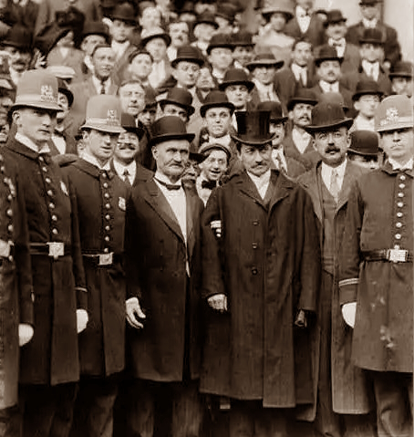
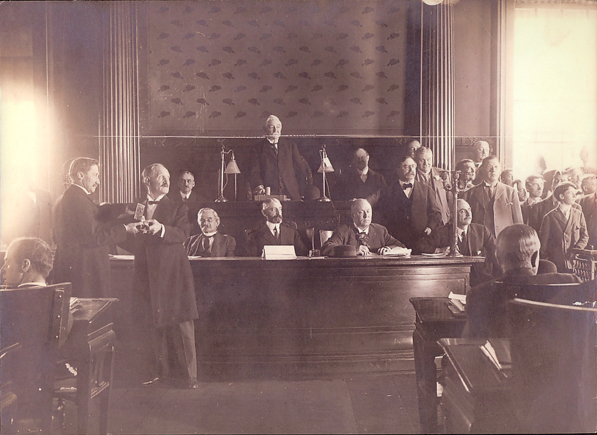
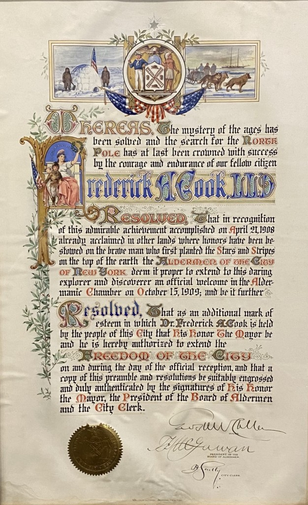
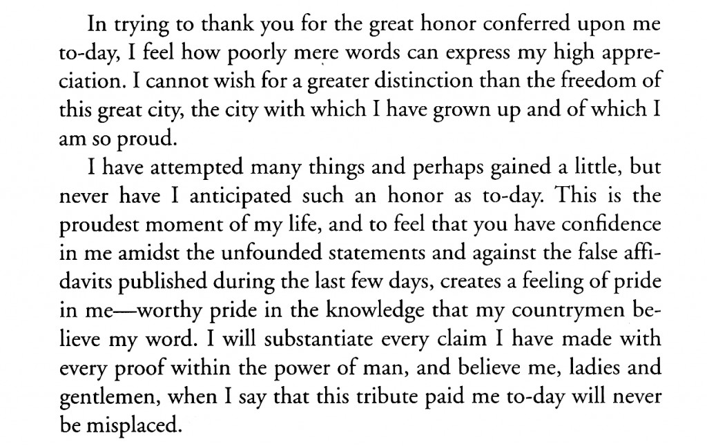

## Dr. Cook Artifacts 9: The Freedom of the City of New York, October 15, 1909

Exactly 115 years ago today, as mentioned in the last post, Frederick Cook was the first American to be offered the Freedom of the City of New York. Only the Prince of Prussia and Charles Dickens before him had been accorded this honor, and it was protested by the pro-Peary interests. General Thomas Hubbard wrote a personal letter to the President of the Board of Aldermen asking that the ceremony be postponed, as did the Explorers Club, in light of its ongoing investigation into Dr. Cook’s claim to have climbed Mt. McKinley in 1906 (see the posts for October, November 2017 and January 2018 below).

Cook arrived at City Hall in top hat and tails, fifteen minutes late and flanked by an honor guard of New York’s Finest, assigned to get him through the crowd of curious onlookers gathered outside. He appeared in the firm grip of Capt. B.S. Osbon, the Arctic Club’s Secretary, on hand for the presentation of the Arctic Club’s gold medal. Before going in, Cook asked for a meeting with the Alderman President Patrick F. McGowan.

Two-thirds of the Aldermen were assembled in the Aldermanic Chamber to receive him along with a crowd of onlookers including Cook’s two brothers and his sister, Captain Osbon, Henry Biederbeck, survivor of the Greely expedition, and Dr. Stebbins, who was to present the medal. Also present were two members of Peary’s 1909 expedition, Donald MacMillan and George Borup.

As he entered the room, two full minutes of applause greeted him. After the presentation of the gold medal, Mr. McGowan spoke. “I deem it only fair to Dr. Cook to say that he wanted this action of the Board of Alderman postponed. The Chair has absolute confidence in Dr. Cook and for that reason a postponement has been refused, although Dr. Cook, with his characteristic manliness, requested that we wait until all proofs are in.” The ceremony presenting the Freedom of the City then commenced.

Dr. Cook was then handed the mahogany box that contained a 15 by 23-inch engrossed sheet of vellum representing the honor being bestowed by President McGowan. On the illuminated scroll, designed by Malcolm and Hayes of New York, were representations of his igloo at the North Pole and a team of dogs pulling a sledge, with the schooner *John R. Bradley* riding at anchor in the distance. At the top rested the Seal of the City of New York upon two draped American flags. The first initial of Cook’s name held the figure of Columbia seated on a throne, holding aloft a laurel wreath about to be placed on the explorer, clad in furs and holding an American flag. The inscription o the scroll began, “Whereas the mystery of the ages has been solved. . .” It was signed by the mayor and Alderman McGowan.

As the alderman handed the scroll to Cook, the flash powder in one of the camera trays set afire a huge cloth bag intended to catch the smoke of the flashlight. It blazed up, scorching the portrait of George Washington that hung on the east wall. After the commotion this caused quieted down, Cook made a brief speech:

**The vellum scroll is now in the possession of the Sullivan County Historical Society Museum in Hurleyville, New York.**

**The photograph of the scroll is courtesy of Darrell Hartman.  
The other illustrations are from the author’s collection.**

]