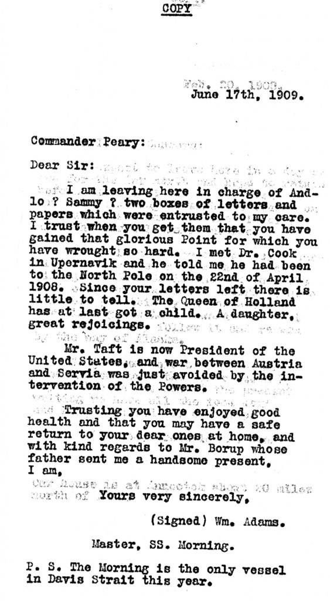

## The Cook-Peary Files: August 25, 1909: Peary gets the first word of Dr. Cook’s attainment

January 4, 2025

*This is the latest in a series of posts that publish for the first time significant documents related to the Polar Controversy.*

When Peary reached North Star Bay on August 23, 1909, according to Matt Henson, “The Jeanie was there waiting for us, and lay alongside until the next day. The Eskimos came out in their kayaks from shore and said a whaling ship had left some letters for us down at Cape York. Then Mr. Whitney said he guessed he’d go on the Jeanie. I guess he knew what he was doing all right. He wanted to get away before there was any trouble.

“The next day we got the box of letters at Cape York. That was the 25th. That’s when we found out that Dr. Cook said he had been at the North Pole. The captain of the whaler had written a letter to the Commander telling how he met Dr. Cook and Dr. Cook said he had been to the North Pole.”

Curiously, earlier in this interview, Henson had said “[Dr. Cook] ordered [his Eskimos] to say that they had been at the North Pole. After I had questioned them over and over again they confessed that they had not gone beyond the land ice.”

The long series on “The Eskimo Testimony” below gives a full account of what can be known of Henson’s questioning of the two Inuit who stayed with Cook after he left Cape Thomas Hubbard. This interview took place on August 17, so, Peary already had this “testimony” in hand. So it should have been no surprise to him to read that Cook had told Captain William Adams that he had been to the North Pole, just as the Inuit had first said that he had to Henson. Yet claiming to have done so to someone else was a different matter entirely. Upon reading Adams letter, Peary dropped everything and put on all speed for the nearest telegraph station, which was at Battle Harbour, Labrador, and in a short time denounced Cook by wire as having handed the world a “gold brick.”

As far as I know, however, Captain Adams letter has never been published. Here is a typed copy of it from the Peary papers held at the National Archives II:

Notice that Captain Adams says Cook said he reached the North Pole on April 22, 1908. There are several early documents, and some notes in Cook’s original diaries that cite his attainment to have taken place on this same date, whereas when he sent his telegrams announcing it to the world from Shetland Islands on September 1, 1909, he claimed he reached the Pole on April 21, not the 22nd.

**Notes:**

“Sammy” or Anaukaq, was Peary’s first Inuit son, born in 1898.

“Whitney” was Harry Whitney, a rich hunter who spent the winter of 1908-09 in Dr. Cook’s box house at Annoatok.

The *Jeanie* was the ship sent to pick up Whitney in the summer of 1909.  The *Morning* was Captain Adams’s Dundee whaler.

“wrought” is probably a typographical error for “fought.”

The Henson interview is cited by Andrew Freeman in *The Case for Doctor Cook*,  to have appeared in the *New York Herald* for September 22, 1909, but I was unable to find it there.

**The copy of Adams’ letter is among the Peary Family Papers, Record Group XP, at NARA II, College Park, MD.**

]