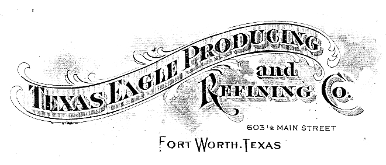
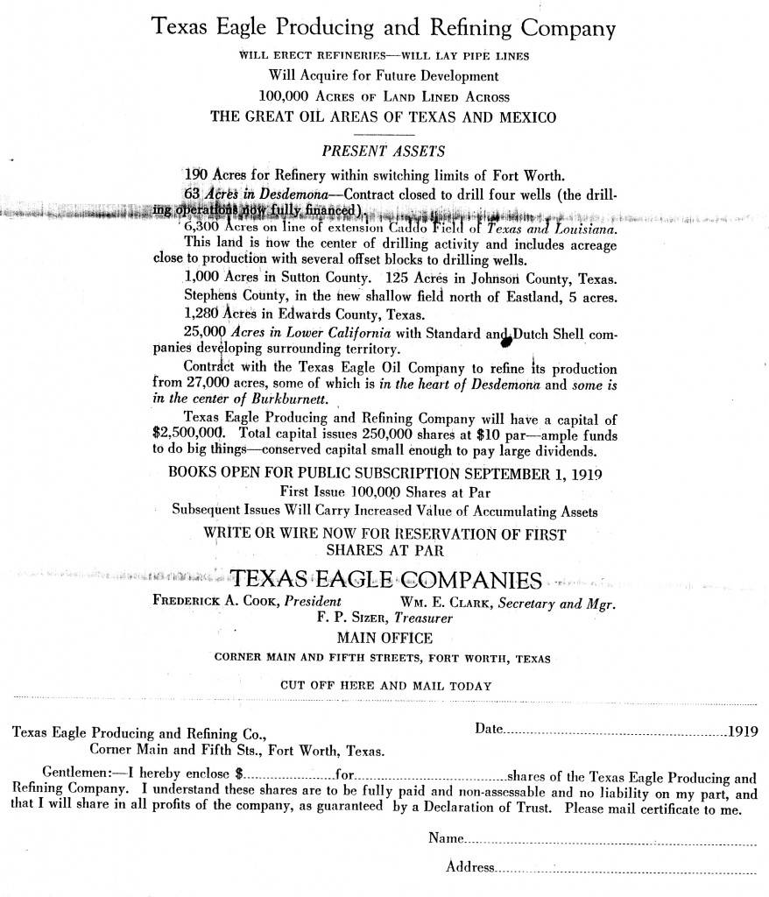
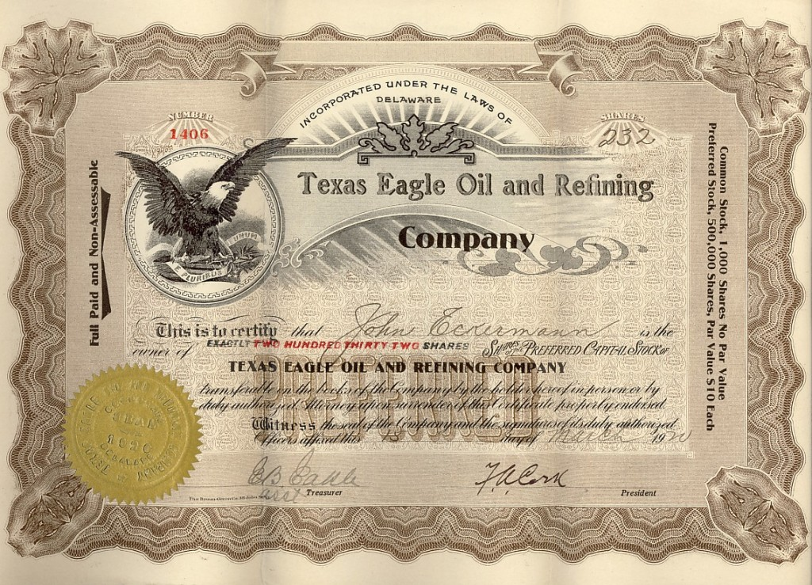
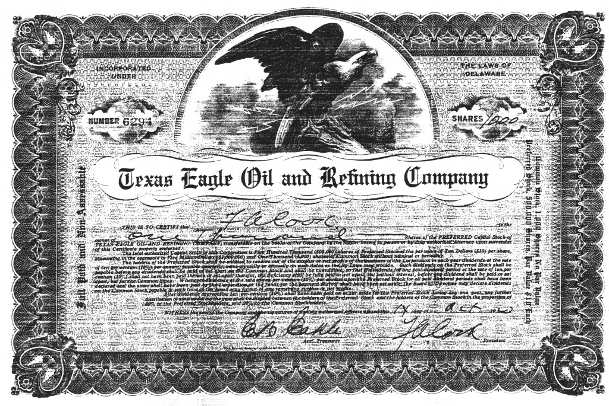
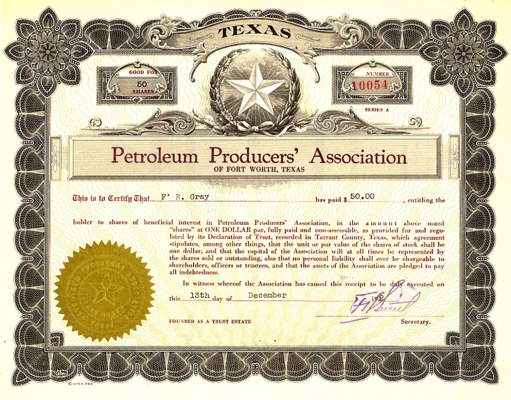
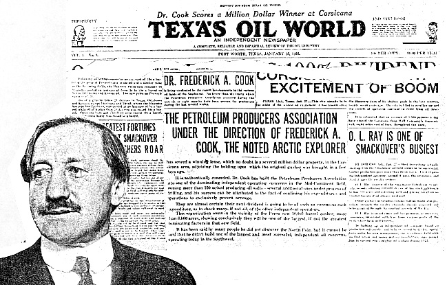
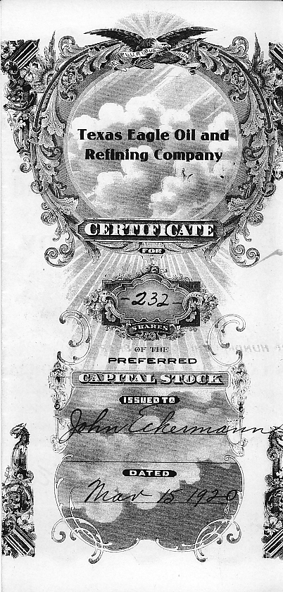

## Dr. Cook artifacts 9: Dr. Cook in the Texas oil fields

Cook started out in the petroleum industry in Wyoming in 1917, but quickly moved on to Texas with news of the fabulous oil strikes there in 1918. He established his first petroleum company that year as The Texas Eagle Oil Co. The company was capitalized at $300,000 in February 1919. It issued 10,000 public shares of stock at $10 a share. That was small money for such an enterprise, so to raise more, in August, a subsidiary company, the Texas Eagle Producing and Refining Co. was created with additional stock amounting to $2.5 million.

Letters soliciting investors were soon sent out:

A third company, The Texas Eagle Oil and Refining Co., was formed from the assets of the first two in February 1920 and incorporated under the liberal laws of Delaware as a Trust Estate. The company was capitalized at $5 million and issued at least two varieties of stock certificates. The first bore a small eagle vignette to the left. Each of the certificates is hand-signed as “F. A. Cook,”  President.

The second variety has a larger eagle vignette at the top center. These are also hand-signed by Cook.

But that company failed, going into receivership, and out of existence on December 5, 1921. But Cook wasn’t finished with oil yet. The next year he organized the Petroleum Producers Association. It issued “Receipt Certificates” for the PPA shares it exchanged for the shares of stock of numerous bankrupt oil companies sent in by their shareholders along with one dollar for each PPA share. These were issued in nearly unlimited quantities as it “merged” 313 defunct oil companies, capitalizing them at $380 million.

PPA shares come in only one variety. The basic certificate with the “Lone Star” vignette at the center, was used by many of the numerous oil companies formed in Texas during the 1920s oil boom there, and is not unique to PPA’s. These certificates do not bear Cook’s signature, but only the hand stamped signature of F. P. Smith, PPA’s Secretary.

Cooks aggressive promotions of this company resulted in his arrest in April 1923, and his subsequent show trial. Overwhelming evidence convinced the jury that PPA’s “mergers” plan was an elaborate ponzi scheme, which, as a result, found him guilty on 12 counts of using the U.S. mails to defraud, and Cook was sentenced to 14 years, nine months in Leavenworth Penitentiary and given a fine of $12,000.

These colorful stock certificates serve as souvenirs of Dr. Cook’s disastrous dip into the Texas Oil Boom.

