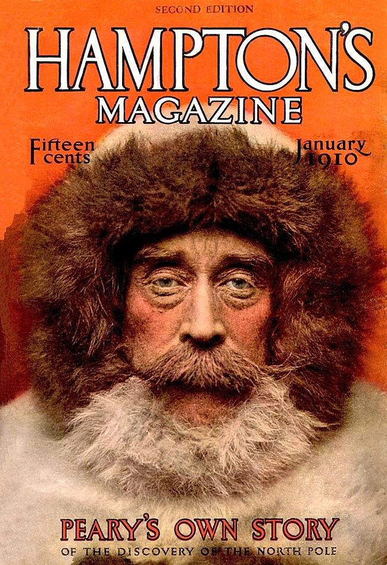
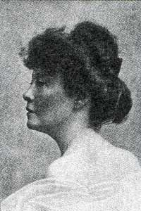
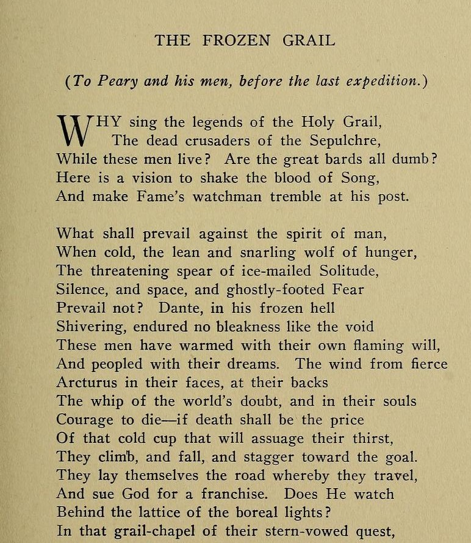
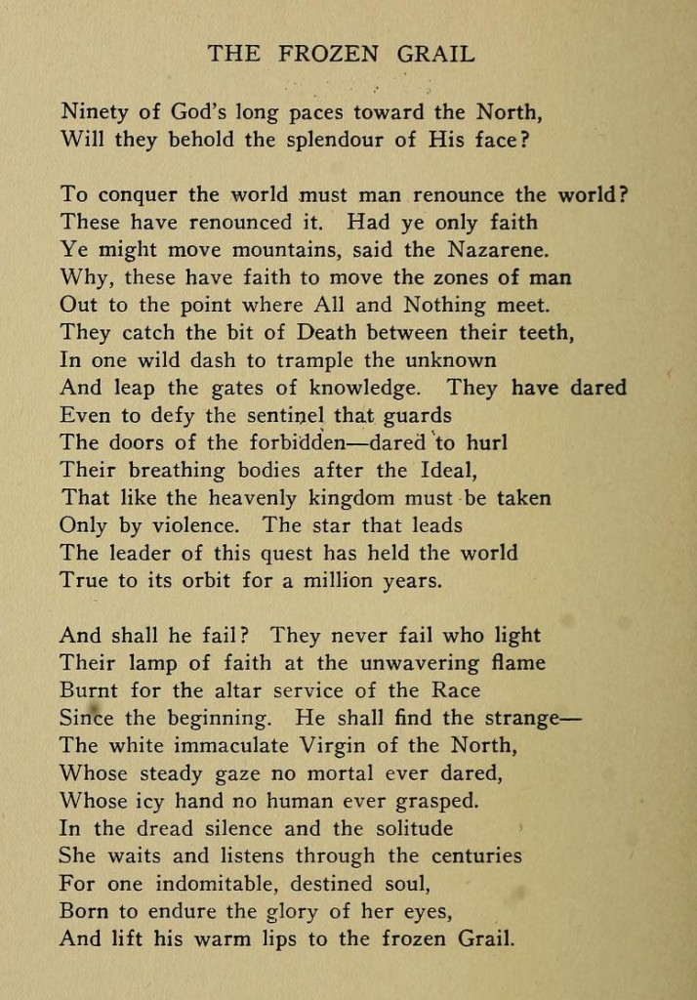
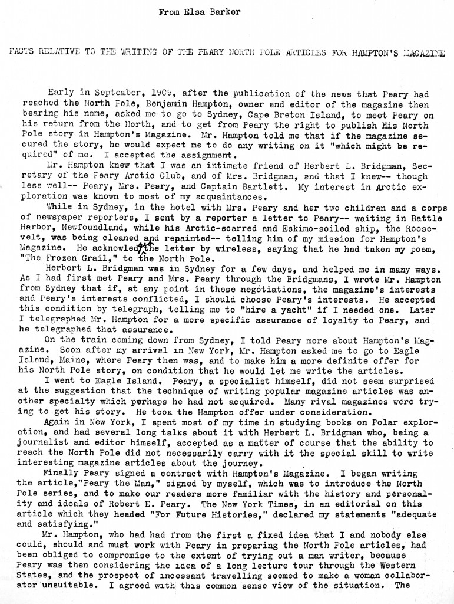
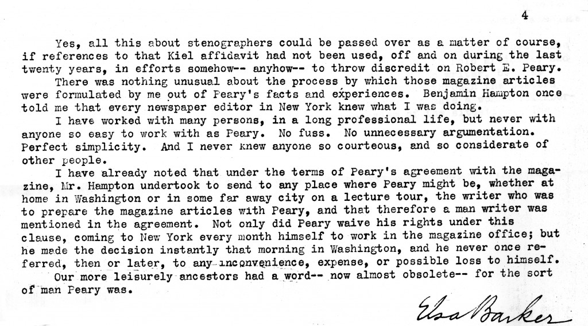

## The Cook-Peary Files: 1936: Elsa Barker refutes Lillian Kiel’s Congressional testimony

*This is the latest in a series of posts that publish for the first time significant documents related to the Polar Controversy.*

On January 28, 1915, Lillian Kiel gave testimony before the Education Committee of the House of Representatives relevant to the controversy between Cook and Peary over which, if either, explorer reached the North Pole. She had been a stenographer for *Hampton’s Magazine* in 1910 and had taken dictation from Elsa Barker, who was ghosting Peary’s series for the magazine entitled “Peary’s Own Story of the Discovery of the North Pole.” 

**Elsa Barker**

Barker was enamored of Peary’s quest for the North Pole and had written the poem “The Frozen Grail.”

Later in her career she was became interested in Spiritualism and wrote three books in which she claimed to be the autodictat of a dead judge in California.

Subsequent to Peary’s series, the magazine published in 1911 a series by Peary’s rival for polar attainment, entitled “Dr. Cook’s Own Story.” Kiel testified how the editorial staff of the magazine had cut through Cook’s galley proofs and inserted statements in his finished articles implying that he was not sure he had reached the Pole in April 1908, which the magazine emblazoned on its cover as “Dr. Cook’s Confession.”

Furthermore, she testified that Peary had no story of his own to tell: “[Peary] did not write his own story. . . . Mr. Peary had no story, he had no data, he had nothing to present to *Hampton’s Magazine*. . . . Mr. Peary merely answered questions. From those notes Mrs. Elsa Barker made up the story.”

This testimony appeared as part of the transcript of that hearing in the *Appendix to the Congressional Record* dated March 4, 1915, as “The Attack on Dr. Frederick A. Cook.”

In 1936, Elsa Barker wrote up her recollections of her dealings with Peary in relation to his series in *Hampton’s*. Here it is published for the first time:

Barker describes choosing Kiel to take her dictation because of her “quiet personality” and “her accuracy.” She may have not realized that Kiel avoided speaking because of severe speech impediment caused by a cleft pallet. Kiel went on to later elaborate on her testimony before Congress in a long unpublished article titled “The Faked ‘Confession’; or How a Magazine Made History,” written in 1916. In it she confirms Baker’s estimate of her by accurately quoting from several letters dictated to Peary by Barker now in NARA II.

**Barker’s statement can be found in Record Group XP at NARA II, College Park, MD.**

**Kiel’s long article is now in the Frederick Cook Papers at the Library of Congress.**

