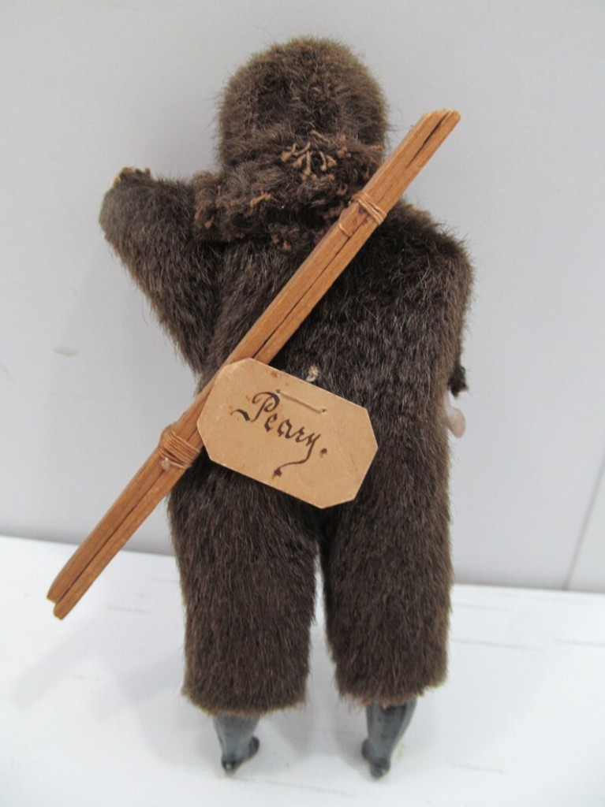
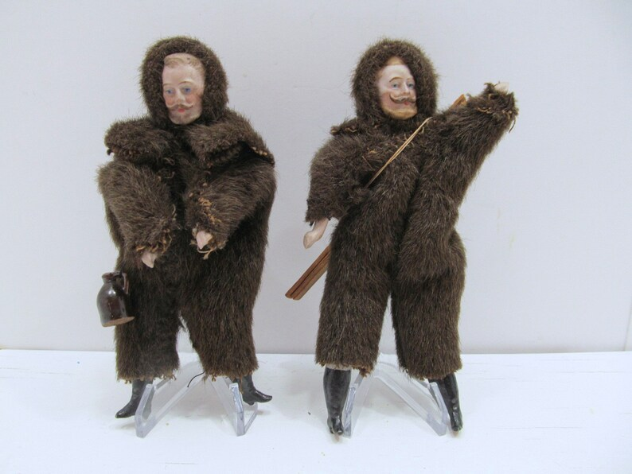
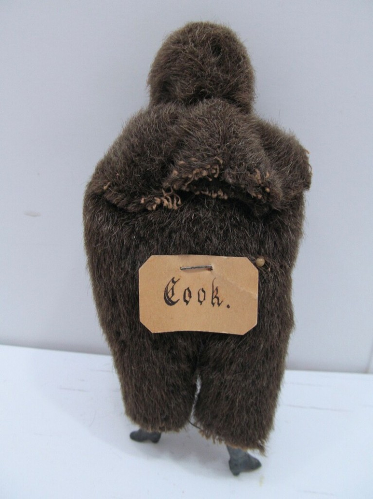

## Dr. Cook Artifacts 12: Blue-eyed Eskimo dolls

January 12, 2026

On December 21, 1909, Dr. Cook’s “proofs” that he had reached the North Pole in 1908 were rejected by the special commission set up by the University of Copenhagen to examine them. Immediately he was branded nothing but a cheap fake, just as Peary had said he was. Merchants in New York City lamented that right in the middle of the Christmas shopping season (it was a lot shorter in those days!) they were stuck with all kinds of “Cook” toys and merchandise that would have no buyers, including “blue-eyed Eskimo dolls.” Recently a couple of those dolls came up for sale on Etsy.  

As described by the sellers, they are six-inches tall and three and one half broad. Their cloth bodies are clothed in faux-fur suits, and they have porcelain heads and appendages. The heads on both dolls are identical. The only way of knowing which is supposed to be which is a paper label attached to their backs with either “Cook” or “Peary” inked on it in Gothic letters.

The one labeled “Cook” incongruously has a ceramic jug strapped around his waist (a strange container to carry liquid in at sub-zero temperatures), while the one labeled “Peary” has two strips of wood strapped across his back, perhaps representing skis (which Peary never used). As to which one the head most looks like, that is probably Cook, because it has a beard, something Peary never sported.

No doubt they were manufactured in Germany, as porcelain headed dolls and other porcelain wares were a major export of that country in the early Twentieth Century. Germany had already contributed several porcelain items relevant to the rivalry between the two explorers, which can be seen in previous posts in this series.

]