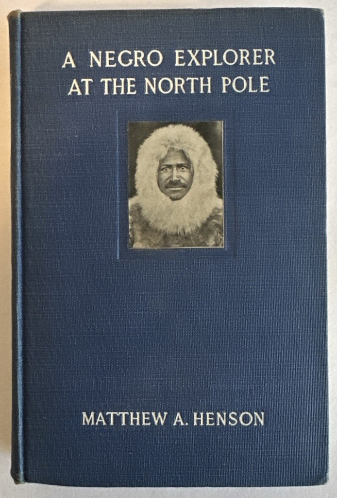
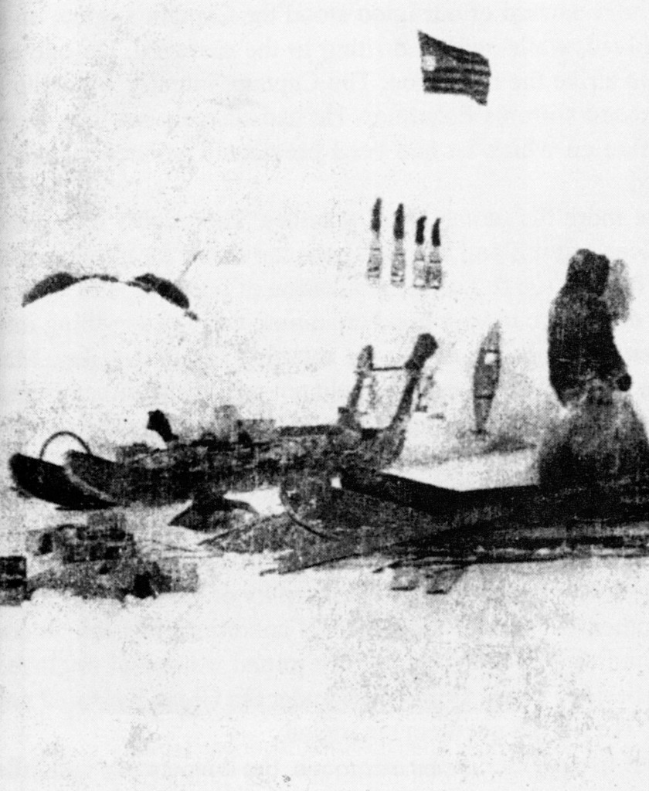
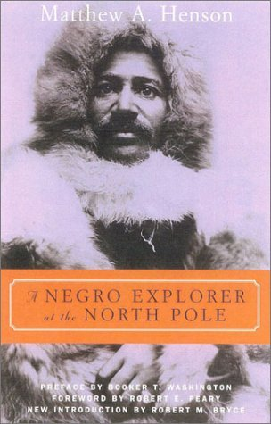

## Polar Controversy Literature Part 5: 1912: A Negro Explorer at the North Pole

Peary had a falling out with Matt Henson after the return of his attempt to reach the North Pole in 1909 over his attempt to prevent him from going on the lecture platform. Peary was especially disturbed to learn that Henson planned to exhibit some of his own photographs, including one he claimed was taken at the North Pole. Peary apparently was apprehensive that Henson’s photographs, which by contract were all supposed to be turned over to Peary after the expedition, might show something that would prove Peary had not actually reached the North Pole, for instance, measurable shadows on the ground, which would be a certain length on the days Peary claimed to have been there. He also was not comfortable with some of Henson’s statements he had made in newspaper interviews, either, regarding the trip to the Pole, some of  which varied considerably from his own reports. For instance, Henson said that Peary rode the sledges the whole way because of his mostly toeless feet did not allow him to walk over the irregular ice, and Peary felt he might reveal other details that conflicted with his already published version of events. Henson was even rumored to be proposing that he debate Dr. Cook, which horrified Peary at the thought.

To discourage Henson, Peary refused to provide lantern slides or maps to use in his lectures and did what he could to keep Henson off the lecture circuit entirely. But Henson went on a lecture tour  anyway, (see the post for June 17, 2024) which led Peary to say that “for a few dollars” Henson had been disloyal and that he “was through with him absolutely.” When Henson appeared at the Hippodrome, he sent Herbert Bridgman in person to get a look at Henson’s “North Pole” picture. He had nothing to fear. Although it was obviously taken at “Camp Morris K. Jesup,” as Peary called his polar camp, it was blurry and showed nothing definitely incriminating.

True to his word, Peary had nothing to do with Henson the rest of his life, with one exception. When Henson proposed to publish a book of his own on his Arctic experiences, Peary got interested in him again briefly. Peary had faced a lot of criticism in the Press for the content of a series of articles he had published in *Hampton’s Magazine* in 1910, for their lack of any “proof” that he had been to the Pole, and got more of the same after his own book, *The North Pole*, was published later that year (see the post for August 18, 2025), which had already resulted in a book questioning the legitimacy of his polar claim (see the post for September 29, 2025). Peary wanted no more conflicting statements from Henson to raise further suspicions.

So Peary agreed to write an introduction to Henson’s book and contribute $500 to defray the expenses of his publisher, Frederick A. Stokes, for publishing it, in return for having editorial rights over Henson’s manuscript. Stokes published it only as a favor to Peary, saying he could not imagine who would want to read it. When Peary’s lawyer went over Henson’s manuscript, some objectionable things were pointed out that he wanted removed. The book came out in 1912 under the title A Negro Explorer at the North Pole, and Stokes thought it was although better written than he expected. But even though Stokes had used Peary’s money to promote the book, it was, as Stokes predicted, a dismal failure, and a financial loss for the publisher.

Who actually wrote the book has never been revealed, since Henson was not functionally literate. Herbert Frisby, a school teacher and editor of an Afro-American newspaper, who knew Henson for the last 13 years of his life and championed him for years after (he was instrumental in getting a commemorative plaque put up to Henson in the Maryland State House in Annapolis), theorized, “Because of Matt’s limited academic background, I feel that his book was ghost written by someone from interviews with him.” One source suggested some of it may have been lifted from the extensive diaries of Peary’s surgeon, Dr. John W. Goodsell, as was a significant part of Peary’s *The North Pole*. In any case, no trace of any original manuscript of Henson’s book has ever been found.

In a letter to Peary, dated April 10, 1911, Henson states, “My wife and I are writing a book,” so perhaps Henson dictated his recollections to his wife, who wrote them down for him, with the finished book being written by a ghost writer working from her notes and using Goodsell’s diary to supply the chronology and “local color.” Some have proposed Peary’s ghostwriter, A. E. Thomas, as the author, but that seems unlikely. Thomas said Peary forbade him to talk with Henson during the writing of *The North Pole*, and Thomas never mentioned having any dealings with him later in interviews with him in the 1930s.

As far as its bearing on The Polar Controversy, there is not much to tell. Perhaps because of Peary’s lawyer’s intervention or editing at Stokes, it has no important direct conflicts with Peary’s version of things, and is especially short on detail of the most questioned aspect of it, the spectacular speed at which Peary made it to the Pole after leaving Bob Bartlett, and his even more spectacular speed on his return journey, on which he almost lapped the Captain getting back to his ship at Cape Sheridan. Curiously, however, the things Peary’s lawyer said he wanted Henson to remove, remained in the book.  
Still, Henson’s book does vary in his reports of what they did on reaching the Pole. For instance, Henson implies that Peary never took a celestial observation before arriving at Camp Morris K. Jesup, and when he did he planted the flags only 150 yards west of their stopping point and where the igloos he had built were located, before taking his observation.

Henson’s descriptions of physical conditions encountered after leaving Bartlett and on the miraculously swift return to land, sketchy as they are, raise doubts that Peary could have made such progress as he claims to have done. These and other accounts by Henson, especially one he had given to the *New York World* and in an article he submitted to *World’s Work* in 1910, would be used by future skeptics like Lewin, Hall and Rost, to help discredit Peary’s account.

In his book Henson says at one point he quotes from his diary, but the so-called entry is contradicted by other known verifiable evidence. What’s more, no trace of ANY Henson diary for any of Peary’s expeditions has ever been found, although Peary kept at least copies of the diaries any of his expedition members kept, and there are no original writings by Henson in the small collection of Henson artifacts held by the Library of Morgan State University in Baltimore, MD.

Henson’s book, was, as Stokes predicted, a commercial flop in 1912, but with the rising interest in black history during the Civil Rights Movement, it was reprinted several times and did very well.

The reprint issued by Cooper Square Press in 2001 has a detailed new introduction by this author which addresses Henson’s biography in general and gives details on the background of how A Negro Explorer at the North Pole came into being.

