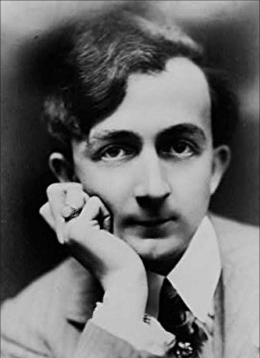
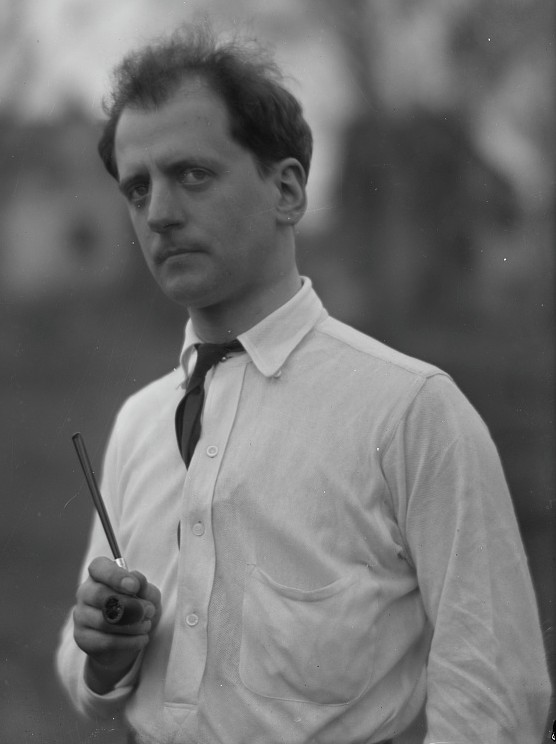
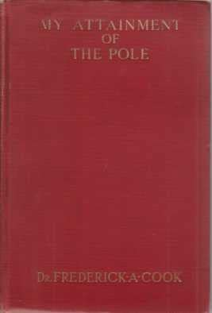
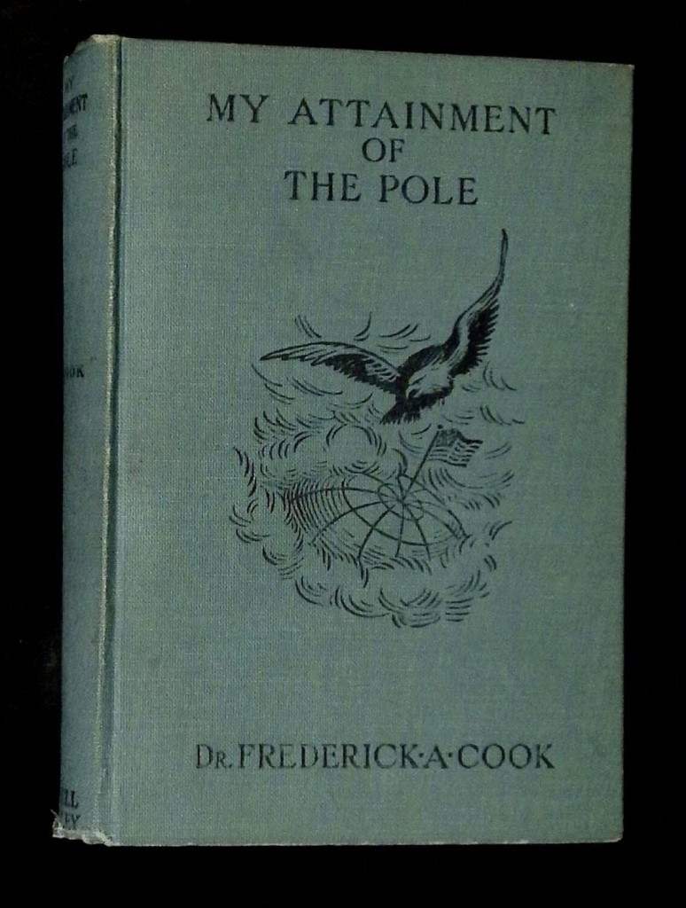
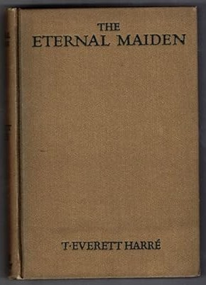
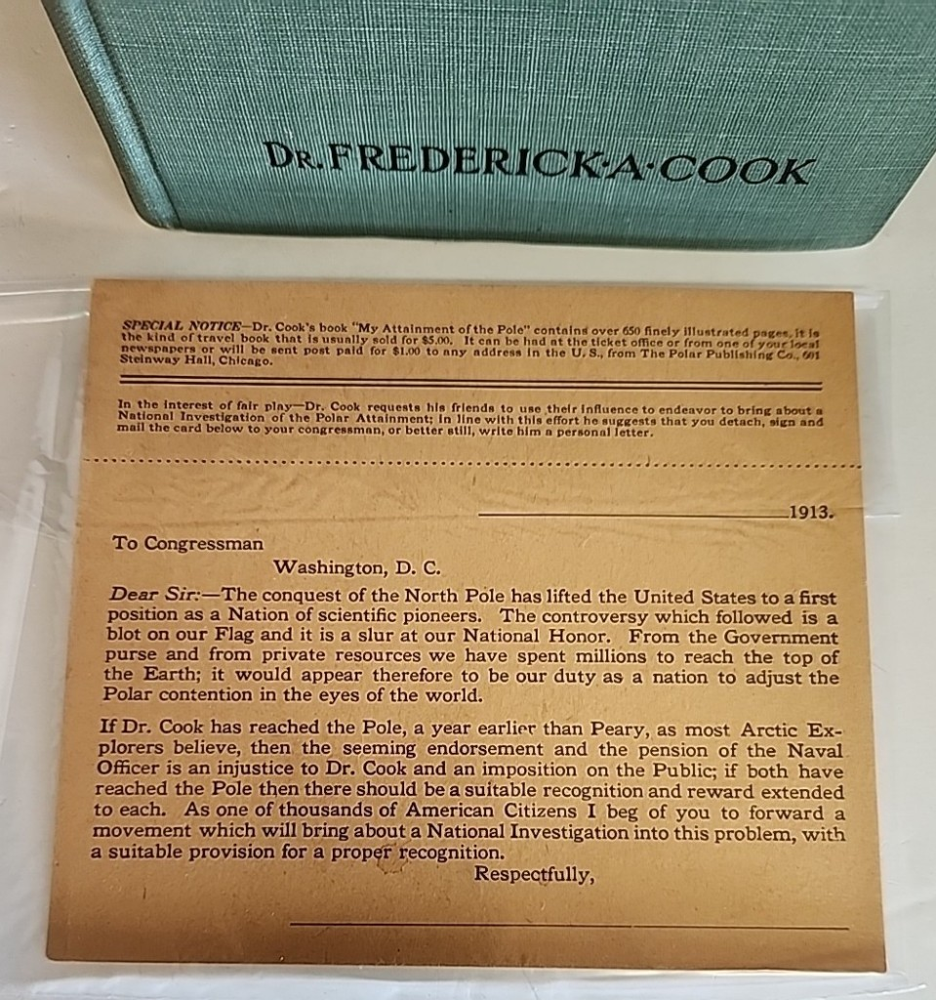
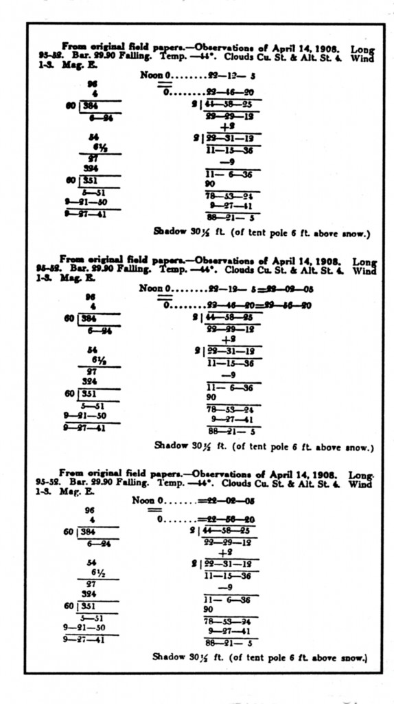
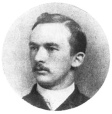

## Polar Controversy Literature: Part 6 1912-13: New Editions of My Attainment of the Pole

No legitimate publisher would touch Cook’s narrative in book form in 1911, so he formed his own “Polar Publishing Company” to issue and promote it and manage the lectures he planned to give after its publication.

T. Everett Harre was a subeditor of *Hampton’s Magazine* at the time Benjamin Hampton secretly contracted with Cook for a four-part serial in 1910, just before he returned to America from his self-imposed exile of a year after Copenhagen University rejected the “proofs” he had sent to them the previous year. Despite being identified as the “author” of the insertions into Cook’s serial that suggested that Cook, himself, was no longer sure he had actually reached the North Pole, and which was promoted as “Dr. Cook’s Confession” by the magazine, Cook hired Harre to manage his company and edit his manuscript that became *My Attainment of the Pole*. We have already dealt with its original issue in 1911. (see the post for November 10, 2025)

In 1912, the second edition appeared. It was issued by Mitchell Kennerley, British-born publisher and bookman, apparently through Harre’s influence. The second edition, much reduced in size from the original, sported bright red covers.

The content of the book was nearly identical to the original, however, with one major exception. One of the two “original observations” Cook printed in the book had a new set of figures printed parallel to the original ones, instead of replacing them with an entirely new plate. This was probably done through a misunderstanding, but the change proved significant. And it was probably this misunderstanding that led to the issuance in 1913 of a third edition, bound in blue-green, but in the same size and format as the second edition.

That same year, Kennerley published Harre’s “Eskimo Romance” *The Eternal Maiden,* which showed the influence of Harre’s association with Cook, in exactly the same style as Cook’s book, right down to the typeface used on its cover.

Unlike the second edition, this one had some textual changes, and both the “observations” were changed, mathematically. It also included some additional pages added at the end of the original text.

One change came in the introduction in which Harre’s role in writing any part of *My Attainment of the Pole* was limited to “certain purely adventure material.” Other than this, changes to the original text were slight. Another modified the caption beneath the picture that showed Peary’s Inuit mistress and his second child by her (facing page 493) to more explicitly insinuate Peary’s relation to the two.

The new material consisted of a number of short testimonials by “Arctic Experts” supporting Cook, and an additional 16 pages of new material that took the form of a reprint of an article from the *New York Tribune* by Edwin Swift Balch, of whom we will soon hear more, arguing in favor of the accuracy of Cook’s narrative on a comparative basis with other explorers’ reports, and several pieces aimed at supporting a Congressional investigation into Cook’s claims, then being prosecuted by Cook’s personal lobbyist, Ernest C. Rost on Capitol Hill. The new material ended with an appeal to the reader to “write your congressman calling for an investigation.” Early copies even included a postcard that could be used for this purpose.

In the new edition, a new plate was executed for the two observations, which changed their internal mathematics.

Ironically, the first to recognize the significance of the changes made to the observations was Cook’s own lobbyist. Apparently Cook met Rost when both served on the Executive Board of the Brooklyn Academy of Arts and Sciences before his polar attempt. Cook was a good judge of people and probably recognized Rost’s eye for detail, perhaps due to his craft as an etcher and photographer of note.

Rost, added by his wife, were very effective in their work for Cook. They authored several “Extension of Remarks” speeches that were inserted in the *Appendix to the Congressional Record* under the name of Representative Henry T. Helgesen of South Dakota, questioning Peary’s exploration career and credibility in general, but especially focusing on his claim to have reached the North Pole in 1909. They were so effective that Peary had to employ a personal lobbyist of his own.

But by 1916, Rost had fallen out with Cook over unpaid back wages. Rost got even on September 4, 1916, when Helgesen announced that he would place in the *Congressional Record* still more remarks on the North Pole question, but this time the subject would not be Peary’s credibility; it would be Cook’s.

One of the most significant parts of Rost’s analysis had to do with Cook’s errors in astronomical observations. He called attention to suspicious revisions made between the first edition and subsequent editions that could not be explained away as typographic errors. The revisions as presented in the third edition gave the same, reacquired results as those in the first while neatly correcting a fatal internal mathematical error the originals contained that brought into question the observer’s basic competence with navigational instruments. Rost deduced from this that Cook had intentionally adjusted the observations to correct this fatal error: “If Dr. Cook was as clever in making observations as in correcting thee errors after they were brought to his attention, he would be able to more convincingly demonstrate that he really knew anything about his geographical position during the various stage of his so-called ‘polar journey’ as his observation prove that he was either deplorably ignorant or inexcusably careless in asking his observation, we can place no more reliance upon them than we can upon Peary’s.”

