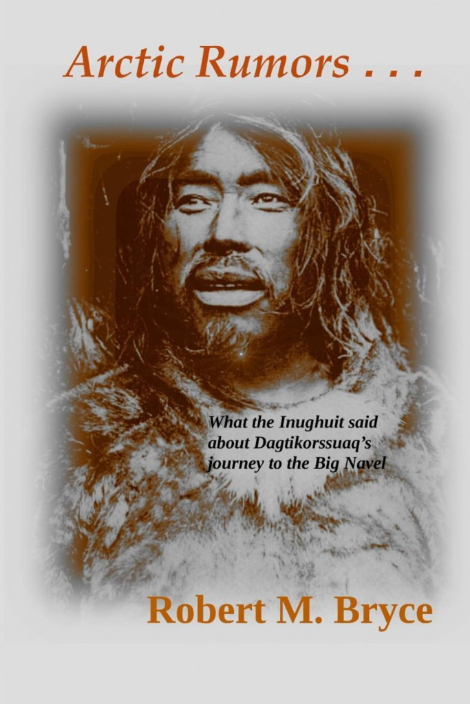
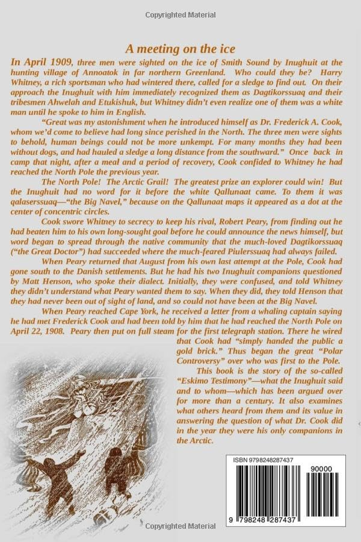

## Arctic Rumors: What the Inughuit said about Dagtikorssuaq’s journey to the Big Navel

Readers of this blog may remember a long series on the so-called “Eskimo Testimony” that ran in 2023 and 2024 in nineteen installments. Those posts have now all been withdrawn.

The author thought of revising them based on considerable new or additional information, but after reviewing them decided instead to issue them in book form. The result is a volume of 183 pages, which incorporates this new information and numerous additional illustrations, all completely documented by 193 scholarly notes, making it the most exhaustive examination of the subject ever published. The book is now available on Amazon.com, where you can look at a sample of the contents, and also at a discount on eBay.

The most sensational news story of 1909 centered on one cold, yet burning, question: “Who discovered the North Pole?” when in September, two veteran explorers emerged from the Arctic almost simultaneously, each claiming to have seized the long-sought “Arctic Grail” of exploration.

The first of the month, Dr. Frederick A. Cook, who had started north in July 1907 on what was billed as a big game hunting trip with his millionaire backer, John R. Bradley, telegraphed from Lerwick in the Shetland Islands that he had attained the North Pole on April 21, 1908. Just five days later, Robert E. Peary wired from Indian Harbour, Labrador, that his latest expedition, his fourth attempt at the coveted prize, had reached the North Pole on April 6, 1909. Cook, who on that date was being feted at an honorary dinner in Copenhagen, on the receipt of Peary’s news proclaimed, “If Peary has reached the Pole, I believe him!” But it turned out very quickly that no such sentiment was shared by his rival.

On September 8 Peary sent a wire to the New York Times saying: “Cook’s story should not be taken too seriously. The Eskimos who accompanied him say that he went no distance north.” Two days later he was even more blunt: “Cook has simply handed the public a gold brick,” he wired the New York Herald, “He’s not been at the pole April 21, 1908, or any other time. The above statement is made advisedly and at the proper time will be backed by proof.”

Thus started the greatest dispute in geographical history, which came to be known as “The Polar Controversy.” It was front page news for the next four months, spawning thousands of column-inches of newspaper copy and endless editorials that divided the nation into warring camps, as advocates of each man advanced arguments and “evidence” in his favor.

That ended only on December 21, when a committee appointed by the University of Copenhagen to examine Dr. Cook’s “proofs” of his polar attainment that he had forwarded to them ruled they were inadequate to prove he had reached the North Pole. That cleared the way for Peary, who’s own records had been judged conclusive after a very superficial examination of them by a biased committee of the National Geographic Society in Washington, D.C., to step forward to claim the title he believed would assure his immortality as the “Discoverer of the North Pole.”

Among aficionados of the Polar Controversy, perhaps no single aspect has raised more debate than the truth and value of the “proof” Peary had promised the Herald, in the form of the testimony Peary allegedly obtained from Cook’s only two eyewitnesses to where he went after he left land on his purported journey to the North Pole. To evaluate this so-called “Eskimo Testimony” properly requires a highly involved process of analyzing a large number of statements made by various parties, some eyewitnesses, and some who only had hearsay as evidence, that bear upon the Inughuit’s statement published by The Peary Arctic Club in a copyrighted story that appeared on October 13, 1909. This book attempts such an analysis and evaluation from original sources, including letters, diaries, and contemporary interviews with the witnesses, as well as published accounts written by them, all are reviewed to gain evidence.

It also examines the events that give background and context to the publication of Peary’s “proof” against Cook’s claim to have beaten him the North Pole. Every eyewitness, and anyone with hearsay evidence has his say. And the stories handed down by the Inughuit as folk memory are also examined.

Finally, any other available evidence, documentary, physical or circumstantial, is considered to come to some conclusion about where Dr. Cook, who the Inuhugit called Dagtikorssuaq (”the Great Doctor”), went and did during the year he was alone in the Arctic but for his two Inughuit companions, Etukishuk and Ahwelah.

