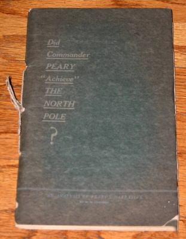
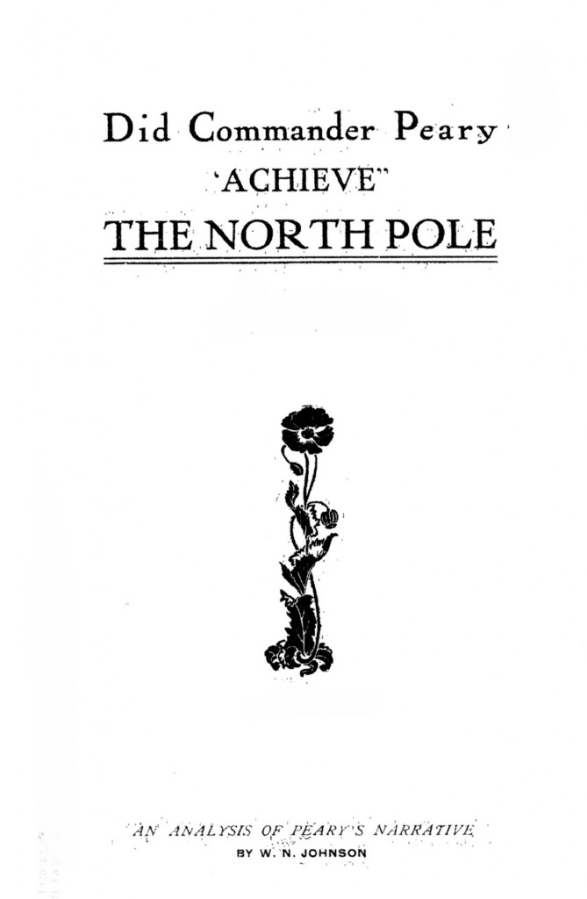

## Polar Controversy Literature Part 8: 1915: Did Commander Peary “Achieve” the North Pole?

Probably the most obscure early study of the Polar Controversy appeared in June, 1915, as a 39-page booklet by William N. Johnson, titled *Did Admiral Peary “Achieve” the North Pole.* It was published in Chicago by the author and printed by the firm of Dvorak & Weiser.

It had originally been written in 1911 and was sent by the author to Representative R. B. Macon, of Arkansas, who at that time was leading a campaign to defeat a bill introduced into the US Congress to recognize Robert E. Peary as the Discoverer of the North Pole and retire him with the rank of Rear Admiral in the Engineer Corps. But Johnson’s study arrived too late for Macon to make any use of it before the bill passed.

There the study lay until in 1914 Dr. Cook, who resided in Chicago at the time, learned of it and personally called upon the author. Johnson said Cook impressed him at that meeting as “a modest, self-restrained gentleman, with every appearance of an honest man,” and as a result, Johnson read Dr. Cook’s *My Attainment of the Pole* and was convinced by it of the genuineness of his claim. After reading Peary’s *The North Pole* and his series of articles published prior to it in *Hampton’s Magazine*, he satisfied himself “that [Dr. Cook] is a much maligned and greatly wronged man.” When bills were introduced in the Congress in 1915 seeking recognition of Cook as the real discoverer of the Pole, Johnson was encouraged by friends to have his study printed “in the hope that the contents of this paper may be of some little service in righting the wrongs from which Dr. Cook has suffered.”

Johnson’s study does not argue Cook’s case at all. Rather, like W. Henry Lewin’s book [see the post for September 29, 2025], it argues entirely against Peary’s. Also like Lewin’s book, it points out numerous inaccuracies and inconsistencies undermining Peary’s claim from his own writings. Johnson especially notes Peary’s own descriptions of the difficulty of the surface he had to travel over to reach the Pole, and eventually uses Peary’s own words to pronounce impossible his reported speeds once he had separated from his last literate witness in the form of Captain Bartlett, supposedly at a position 133 nmi. from his goal. He also casts doubt on Peary’s reasons for not taking Bartlett or any one of the several expedition members other than Bartlett who could have independently verified his arrival at the North Pole through independent, competent celestial observations for his position, and instead took Henson, who could not. Finally, he questions the timetable Peary presented as a record of what he did while allegedly in the vicinity of the Pole, a period of 34 hours, during which Peary implied he traveled as much as 78 nmi. in addition to the time taken for all the observations he said he took to verify he was actually at the North Pole.

Johnson also notes a number of curious conflicts between Peary’s articles published in *Hampton’s Magazine* in 1910 and the text of his eventual book, especially in reference to the number of dogs he had and when they were killed.

In his conclusion, Johnson summarizes these contradictions and inconsistencies as follows:

“That the obstacles encountered during the first 280 miles of the northward journey could have been so extremely difficult as to make their average daily march less than 12 miles [per day when the trail was being broken by another party] and yet the very next day after the last white man had turned south there should be a remarkable improvement in the character of the going, increasing daily, so that even while pioneering his own way and building his won igloos, Peary [once alone with Henson and four Inuit] was able to more than double the average march when preceded by his relay parties who were worked to the limit. . . . .”

Johnson illustrated this with a table which compared the total nautical miles covered per day of each of his support parties, and while the best any of them did was an average of 15 ½ miles per day, Peary’s average was more than double that, at 33.6 miles. He found Peary’s speed astounding, and pointed out that had Peary not taken two days of rest after reaching land again at Cape Columbia on April 27, 1909, on his return from “the Pole,” he would have overtaken Bartlett before he arrived at Peary’s ship, even though Bartlett had an alleged 133 nautical mile head start on him when the two parted on April 1. That meant that Peary was able to travel 266 miles more than Bartlett in the same amount of time (not to mention the 78 nmi, Peary claims to have traveled during the two days he was at his polar camp), a feat Johnson considered “physically impossible.”

In closing, Johnson expressed his regrets that “It is extremely unfortunate for Commander Peary’s own reputation, that his own accounts of his ‘dash for the Pole’ are not more accurate and convincing. Every American citizen who rejoices in the glory of his own county, would be glad to *know* that Peary had reached the North Pole, but there are some, as least, who cannot accept the Commander’s unconfirmed testimony, filled as it is with contractions, as conclusively establishing his claim.”

